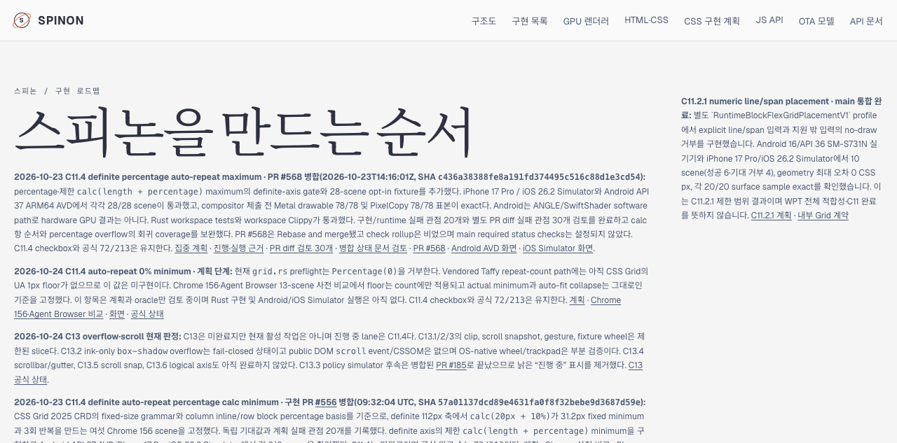

# C11.4 코드·상태 대장·Tailnet 로드맵 동기화 · 2026-10-24

## 판정

검토 기준은 checkout과 원격 `main`의 동일한 SHA `912b88d1890755108279ca124d8f196e9dc10e5f`다. 코드 경계와 공식 상태 원본은 [`spec/STATUS.md`](../../../STATUS.md)이며, Tailnet에서 제공하는 공개 요약은 [`spec/public/roadmap.html`](../../../public/roadmap.html)이다.

- 실제 C11.4 `grid.rs` preflight는 `Percentage(0)`을 거부하고 양수 percentage minimum만 제한 조건으로 받는다. Vendored Taffy repeat count는 resolved repeated size를 그대로 denominator에 사용하며 CSS Grid UA 1px count floor는 없다. 계획 카드와 상태 대장은 이 동작을 미구현으로 기록한다.
- C11.4 0% slice는 Chrome 156·Agent Browser 13-scene 사전 비교와 구현 계획만 있다. Rust 구현 및 Android/iOS Simulator runtime은 시작하지 않았다.
- C11.4와 C13 상위 checkbox는 계속 미완료이고 표시 대상은 `213개 · 공식 완료 72/213`이다. 공개 로드맵에서 현재 lane은 C11.4, C13은 미완료·비활성이다. C13.2 ink-only `box-shadow` overflow는 fail-closed, public DOM `scroll` event/CSSOM은 없고 OS-native wheel/trackpad은 부분 검증이다.
- `STATUS.md`의 기준일을 `2026-10-24`로 맞추고 C11.4 아래에 계획 전용 기록을 추가했다. 체크박스와 완료 집계는 변경하지 않았다. 공개 roadmap의 계획·C13 판정 카드도 같은 사실을 표시한다.

## 선택 문서 빌드

기존 검증된 Rspress root를 hardlink로 복제하고 영향을 받는 Markdown, 상태 대장, roadmap과 전체 사전 비교 evidence 폴더만 덮어써 Rspress `2.0.22`로 선택 빌드했다. Hardlink 대상은 쓰기 전에 분리했다. 저장소 전체의 기존 dead link/image debt는 이 선택 빌드에서 전역 검사하지 않았다.

- [`selected-root.json`](./selected-root.json)은 source SHA, 선택한 입력 파일, hardlink 분리 방식과 overlay 해시를 기록한다.
- [`selected-build-verification.json`](./selected-build-verification.json)은 roadmap/상태/계획/비교·리뷰 페이지, screenshot asset의 존재·해시와 72/213·계획 단계·C13 비활성 표시를 확인한다.
- Rspress 출력은 source roadmap의 SHA-256 `3e36cbe8077bb9e36b58a8b0a0203359edcc7de3380b05e0e4628c3d32c33ef9`와 일치한다.

## Tailnet preview 동기화

기존 preview listener PID `1191`과 `127.0.0.1:8768`을 유지했다. pass01은 [`preflight.json`](./preflight.json)과 [`delta-manifest.json`](./delta-manifest.json)에 적은 27개 변경 관련 route를 반영했다: 18개 추가, 4개 교체, 5개 동일. 교체 파일 4개, 총 2,290,844 bytes를 `SpinonPreviewBackups/c11-4-roadmap-status-sync-2026-10-24/pass01`에 보존했고 삭제는 없었다. 교체는 같은 디렉터리의 임시 파일에서 rename했다.

계획 PR diff 검토 설명을 보강한 pass02에서도 같은 27개 route를 다시 대조했다. 3개 추가, 9개 교체, 15개 동일이었고 교체 파일 9개, 총 4,997,397 bytes를 pass02 backup에 보존했다. 삭제는 없었다. pass01의 [`remote-verification.json`](./remote-verification.json)과 pass02의 [`remote-verification-pass02.json`](./remote-verification-pass02.json)은 각각 build output, local preview와 HTTPS Tailnet 응답 27/27의 HTTP 200 및 byte·SHA-256 일치를 기록한다. 새 계획·사전 비교 route와 README의 generated screenshot asset 및 roadmap의 raw PNG 링크를 포함한다.

Agent Browser `0.31.1`에서 roadmap 카운터 `213개 표시 · 공식 완료 72/213`, C11.4 계획 카드, C11.4 활성 lane, C13 미완료·비활성, 새 계획 페이지, 사전 비교 페이지와 갱신된 계획 PR diff 검토 페이지를 열었다. 비교 페이지의 Agent Browser 이미지 1280×848이 로드됐고 roadmap에서 직접 연결한 PNG도 HTTP 200·69,679 bytes였다. [`agent-browser-verification.json`](./agent-browser-verification.json), [비교 화면 관찰](./agent-browser-evidence-page.json), [PR diff 검토 화면 관찰](./agent-browser-pr-review-pass02.json)이 세부 결과를 담는다. 두 브라우저 세션을 닫은 뒤 모두 `active=false`, `pid=null`, 빈 session list와 전용 daemon PID 부재를 확인했다([pass01](./browser-close.json), [pass02](./browser-close-pass02.json)).

이번 작업은 Tailnet preview 갱신이다. GitHub Pages 배포와 앱 runtime 실행은 하지 않았다.

재현 스크립트, 선택 빌드 기록, Tailnet hash 확인, Agent Browser 화면·종료 상태의 SHA-256은 [`SHA256SUMS`](./SHA256SUMS)에 있다.
