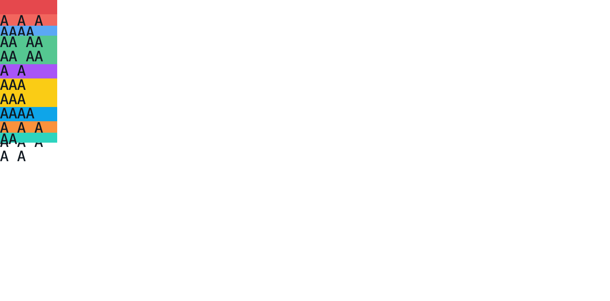
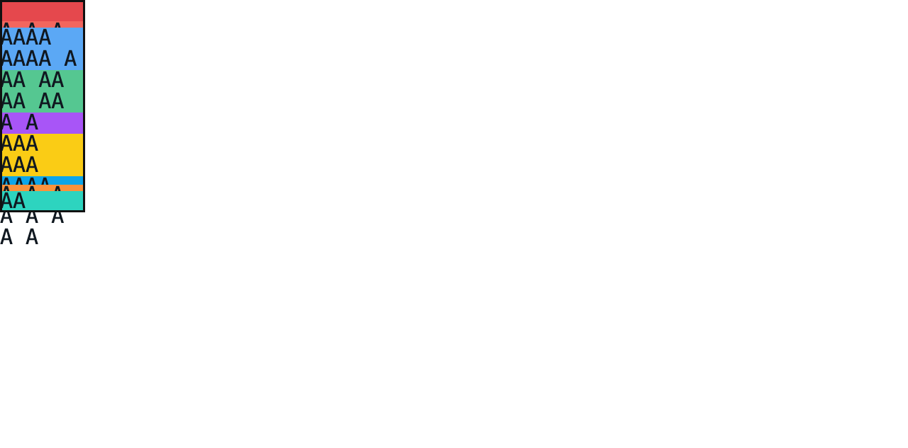

# C11.4 반복 intrinsic row text 사전 비교

**상태:** Chrome 기준 관측 완료 · 제품 구현 전 · 2026-11-08

## 입력과 환경

- Fixture: [HTML source](https://github.com/ohah/spinon/blob/main/tests/fixtures/css/c11/root-html-grid-repeated-intrinsic-text-precomparison.html)
- SHA-256: `bac3d41dcb39b64016e6789677c692334604ca22880b5b01ee6df5ac114e9f0b`
- Agent Browser 0.31.1의 HeadlessChrome 157.0.0.0, macOS 26.5.1 arm64, DPR 1
- 40px Grid column, 10px explicit row, 8개 implicit row item, 0 gap, `align-content:start|stretch`
- 각 item은 한 개 payload `
`만 갖고, payload는 `monospace` 10px, line-height 10px, `white-space:normal`의 고정 텍스트를 가진다.

## 관측 범위

후행 multiset `[min-content ×2, max-content ×2, auto ×1]`의 30개 고유 순서를 생성했다. definite 220px Grid에서 cap `20px`, `20%`, `0%`, `120%` 각각과 `start|stretch`를 조합한 240장면, 100px Grid에서 `20px/start`인 30개 border overflow 장면을 합쳐 270장면을 수집했다.

Agent Browser 페이지에서 `getComputedStyle(grid).gridTemplateRows`와 Grid·item·payload의 `getBoundingClientRect()`를 기록했다. 텍스트 줄 수는 각 payload의 Range client rect에서 서로 다른 y 좌표 수로 구했다. [캡처 스크립트](https://github.com/ohah/spinon/blob/main/spec/internal/evidence/c11-4-root-html-repeated-intrinsic-text-precomparison-2026-11-08/capture-matrix.agent-browser.js)는 페이지 컨텍스트에서 실행하고 [축약 필터](https://github.com/ohah/spinon/blob/main/spec/internal/evidence/c11-4-root-html-repeated-intrinsic-text-precomparison-2026-11-08/reduce-matrix.jq)로 필요한 수치만 JSON에 남긴다.

Chrome은 여덟 payload의 줄 수를 `[2, 2, 2, 1, 2, 1, 3, 1]`로 관측했다. canonical tail `min-content min-content max-content max-content auto`, `fit-content(20px)`, `start`, 220px Grid의 used rows는 `[10, 20, 20, 20, 10, 20, 10, 20, 10]px`다. 동일 tail의 100px scene에서는 `item-7`의 3줄 payload가 30px이고 row item은 3.34375px이며 payload bottom은 116.65625px로 Grid bottom 100px보다 16.65625px 아래까지 이어진다. 이 관측은 overflow visible의 브라우저 기준이며 제품 동작을 검증한 결과가 아니다.

100px overflow cohort의 30 scene 모두에서 적어도 하나의 payload bottom이 Grid bottom `100px`를 넘는다.

## 산출물

- [Chrome 기대 geometry 270장면](https://raw.githubusercontent.com/ohah/spinon/main/spec/internal/evidence/c11-4-root-html-repeated-intrinsic-text-precomparison-2026-11-08/chrome157-expected.json): 각 장면의 track sizes, Grid frame, 9 item frames, 8 payload frames

읽기 쉽도록 화면 캡처에만 3배 시각 확대와 비레이아웃 outline을 적용했다. 확대된 캡처는 수치 oracle이 아니다.

이 결과만으로 Android/iOS 폰트 줄바꿈이나 Spinon 동작을 주장하지 않는다. 계획은 텍스트·스타일을 exact profile로 제한하고 Android API 37 ARM64 AVD 및 iOS 26.2 Simulator에서 같은 fixture hash의 제품 경로를 별도로 검증하도록 한다. 줄바꿈이 플랫폼별로 달라지면 그 원인을 확인하기 전까지 지원 범위를 넓히지 않는다.

JSON의 `gridRows`는 첫 implicit row부터의 used row 크기 순서이며, 각 frame 배열은 `[x, y, width, height]` 순서다. `itemFrames`는 fixture DOM 순서의 9개 item, `payloadFrames`는 `text-1`부터 `text-8`까지다.
