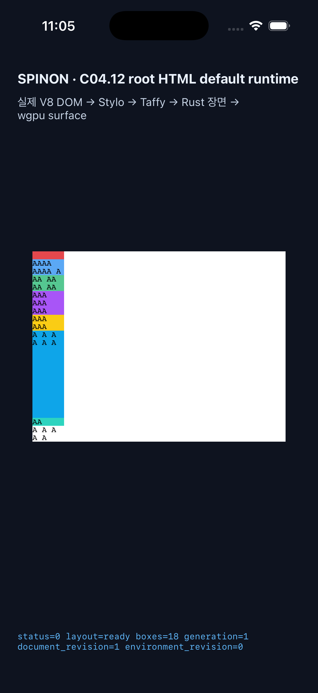
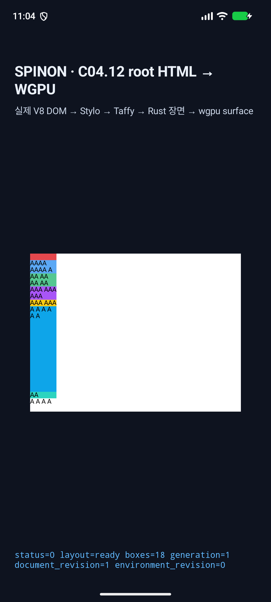

# C11.4 반복 text auto-placement의 fit-content 위치 1–6 구현 근거

**범위:** bounded implementation candidate · C11.4/C11 체크 미완료 · 공식 완료 수 `78/214` 유지 · 내부 계약 버전 `0.1.0` 유지.

이 구현은 기존 parsed Root HTML `RootHtmlFitContentAutoRowsV1`의 fixed direct-text profile에서 여섯-member `grid-auto-rows` 목록 중 유한하고 0 이상인 `fit-content(px|%)` 하나를 authored 위치 1–6 어디든 허용한다. 나머지는 `min-content ×2`, `max-content ×2`, `auto ×1`이어야 한다. 여덟 auto-placement item이 220px definite block-size Grid 안에서 여섯-member cycle을 반복한다. 일반 CSS admission, 임의 text/font, 다른 list multiplicity·topology, WPT 또는 전체 C11.4 완료는 포함하지 않는다.

## 기준 비교

Chrome 157 / macOS arm64 / DPR 1의 고정 비교 fixture는 위치 1–6 × 30개 tail order × cap 4개(`20px`, `20%`, `0%`, `120%`) × 정렬 2개(`start`, `stretch`), 총 1,440 scene이다. Chrome 관측은 독립 CSS Grid 관계 검증의 입력으로만 썼다. RuntimeSession은 authored/computed 순서, 8개 implicit row cycle, row/item/payload frame, text line·glyph count, overflow 및 auto-only stretch를 비교한다. 자세한 사전 비교는 [Chrome 관측·독립 판정](../c11-4-root-html-repeated-text-autoplacement-fit-content-positions-precomparison-2026-11-09/README.md)에 있다.

## Rust 검증

[`rust-verification/run-focused-verification.sh`](./rust-verification/run-focused-verification.sh)를 최종 소스 분리 후 다시 실행했다.

- Style projection: 2/2. Layout six-member matrix와 rejection: 2/2.
- 기존 repeated-intrinsic RuntimeSession 회귀: 8/8.
- 새 기본 Root HTML RuntimeSession matrix: 1,440 scene, 1/1. `c11-4-grid-track-sizing-fixture-test` trace variant: 같은 1,440 scene, 1/1.
- 기존 later fit-content row-span Chrome matrix: 1,920 scene, 1/1. Span 위치 4–6 atomic rejection과 반복 text profile 경계: 각 1/1.
- 변경 crate Clippy `-D warnings`, `cargo fmt --all -- --check`, `git diff --check`: 통과.

최초 row-span 회귀 실행은 scene 292의 position 2 `span2-forward` / `20px` / `stretch`에서 기존 span trace 단계가 거부되어 중단했다. 새 auto-placement 검증을 span 보정 경로와 분리했고, 수정 후 기존 1,920-scene matrix 전체가 통과했다. [회귀 발견·수정 기록](./span-trace-regression-found-and-fixed.md)과 최종 실행별 로그는 `rust-verification/`에 있다.

## Android·iOS 화면 smoke

기본 C04.12 Root HTML 앱 경로에서 Android API 37 ARM64 AVD와 iPhone 17 Pro / iOS 26.2 Simulator에 같은 fixture의 8개 sentinel scene을 각각 실행했다. 위치 1–6, 0% overflow, 20% stretch 장면 모두 layout-ready와 draw/present 로그를 남겼고 OS screenshot을 저장했다. 이는 8/8 scene per platform의 시각·route smoke다. PixelCopy, Metal drawable readback, 1,440-scene native geometry matrix 또는 hardware/실기기 parity는 확인하지 않았다.

대표적인 0% fit-content visible-overflow 화면:

| iOS Simulator | Android AVD |
| --- | --- |
|  |  |

기기 메타데이터와 앱 로그는 `.txt.gz`, `.log.gz`로 보관한다. `raw-log-sha256.txt`에는 압축 전 원본 바이트의 SHA-256과 gzip 파일명이 있고, `./verify-raw-log-sha256.sh`로 확인할 수 있다. Rust 로그도 `rust-verification/` 아래 같은 방식으로 확인한다. smoke 종료 후 Android ADB와 iOS simulator 부팅 목록은 비어 있고, 임시 root HTML 입력은 원본 SHA-256 `38813ca802618bd20bdf3bbb9ed9bc7525c289f48c0928813c855567f9e7df85`로 복구했다. 재사용할 AVD/iOS device definition은 지우지 않았다.

## 추가 검토

- [구현·Runtime 실패 관점 20개](./implementation-runtime-review-20.md)
- [구현 PR diff 독립 검토 30개](./implementation-pr-diff-review-30.md)
- [8개 플랫폼 sentinel과 hash](./sentinel-manifest.json)
- [실행 가능한 Android/iOS smoke harness](./run-platform-smoke.sh)

이 근거는 bounded implementation slice만 다룬다. PR 병합 상태나 CI 결과를 뜻하지 않으며, C11.4/C11 및 공식 `78/214`는 계속 미완료로 둔다.
