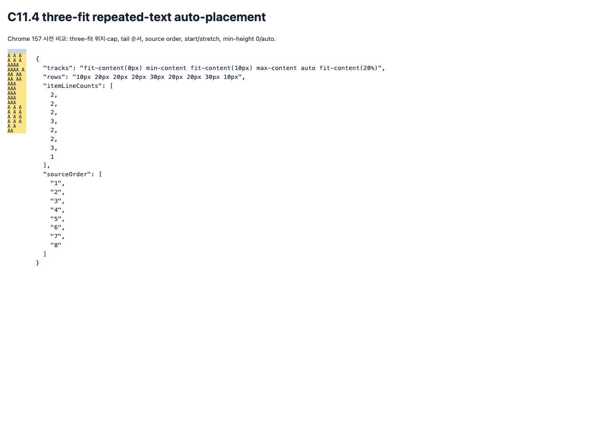

# C11.4 · three-fit repeated-text auto-placement `min-height:auto` 사전 비교

## 비교 범위

- 독립 기준은 Agent Browser가 실행한 HeadlessChrome `157.0.0.0`, `MacIntel`, DPR 1이다. Terminal Browser와 simulator를 쓰지 않았다. Chrome CSS Grid 관측이며 제품 RuntimeSession 구현 근거는 아니다.
- CSS Grid 규범 비교에는 [2025 CRD §6.6](https://www.w3.org/TR/2025/CRD-css-grid-1-20250326/#min-size-auto), [§7.2](https://www.w3.org/TR/2025/CRD-css-grid-1-20250326/#track-sizing-functions), [§11.5](https://www.w3.org/TR/2025/CRD-css-grid-1-20250326/#algo-spanning-items)를 사용한다. Fit-content와 auto track의 auto minimum eligibility를 min-content/max-content track과 분리한다.
- 고정 oracle input은 `oracle-fixture.html`, collector는 `capture-chrome.mjs`, 관측은 `chrome157-observation.ndjson`, 독립 검산은 `verify-chrome-matrix.py`, 요약은 `verification.json`이다. 아래 이미지는 forward DOM, `min-height:auto`, start alignment의 고정 scene이다.

## 입력과 독립 판정

- Grid는 definite `40×220px`, explicit `40px` column 및 빈 `10px` row, gap 0, LTR, sparse row auto-flow, `overflow:visible`이다. Eight auto-placement item은 고정 ASCII payload, 10px monospace/10px line-height를 사용한다. 기대 line count는 `[2,2,2,3,2,2,3,1]`이다.
- Six-member `grid-auto-rows`는 정확히 fit-content 3개, min-content 1개, max-content 1개, auto 1개다. 20 fit-position triples × 6 tail orders × 6 cap permutations (`0px`, `10px`, `20%`)로 720 unique authored lists를 만든다. 각 list에 start/stretch, forward/reverse DOM order, `min-height:0|auto`를 적용해 5,760 scene 및 2,880 paired keys를 관측했다.
- 독립 verifier는 각 key에서 typed/authored track 순서·cap index, computed CSSOM, nine used rows, source-order item/payload geometry·line count, content floor와 220px 경계, start/stretch 총합 및 auto-only stretch 분배를 검사한다. Range line rectangles는 첫 줄이 payload box top보다 1px 위이고 이후 줄 간격이 10px인 관측을 확인한다.

## 관측 결과

| 관측 | 결과 |
|---|---:|
| Chrome scene / paired `min-height:0` ↔ `auto` keys | 5,760 / 2,880 |
| Unique track lists / fit-position triples / tail orders / cap permutations | 720 / 20 / 6 / 6 |
| Baseline payload floor 아래 row / eligible fit-or-auto row | 7,200 / 7,200 |
| Candidate payload floor 아래 row / eligible row | 0 / 0 |
| Paired baseline에서 candidate floor로 회복된 eligible row | 7,200 |
| Candidate start / stretch total row size | 180px / 220px |
| Baseline start total row size | 110px, 120px, 130px, 140px, 150px |
| Auto row occurrence 수 / 각 occurrence stretch 증가 | 1 또는 2 / 각 40px 또는 20px |
| Non-auto row stretch 변화 | 0px |
| Baseline item payload가 row보다 큰 scene / candidate scene | 2,880 / 0 |
| 마지막 item frame이 Grid block end를 넘은 scene | 0 |

Baseline의 visible payload overflow와 Grid 경계 초과는 별도 분류했다. 이 fixed matrix에서 `min-height:auto`는 fit-content/auto track에 있는 content floor를 지키며, `align-content:stretch`는 남은 40px를 반복 auto row에만 분배했다. 수치는 이 입력과 Chrome 157 관측에 한정한다.

## 실행 수명과 한계

- Agent Browser 고유 session `spinon-c114-three-fit-autoplacement-precomparison-20261111`은 capture 종료 직후 `close`됐다. `agent-browser-lifecycle.json`은 `closed=true`, 오류 없음, Terminal Browser 미사용, simulator 미실행을 기록한다. 종료 뒤 `agent-browser session list --json`은 빈 `sessions` 배열을 반환했고, `agent-browser-processes-after-close.txt`에는 process 목록이 비었음을 기록했다.
- PR #1341에 commit 고정으로 붙인 이미지는 별도 Agent Browser session에서 실제 로드됐다(1280×900, `complete=true`). `pr-image-link-check.json`은 `close` 후 session 목록이 비고 Agent Browser/Chrome process가 남지 않았음을 기록한다.
- `mise exec -- bun run docs:build`도 확인했으나 저장소의 기존 dead-link 검사 1,533개 때문에 종료 코드 1로 실패했다. 최신 로그에서는 이 계획 및 사전 비교 경로의 dead-link 항목을 찾지 못했다. 실패한 빌드는 `doc_build` 또는 RSPress 임시 출력 디렉터리를 남기지 않았다.
- 사전 비교는 parsed Root HTML RuntimeSession, Android/iOS app route, pixel readback/compositor, 실기기/hardware GPU, WPT 또는 일반 CSS admission을 검증하지 않았다. Three-fit auto-placement는 현재 코드에서 거부되며, 본 산출물은 구현 이전 계획 근거다.

계획 PR의 실제 변경분에 대한 별도 30관점 검토는 [plan-pr-diff-review-30.md](./plan-pr-diff-review-30.md)에 보존했다. 이는 계획 자체 검토 20관점과 별도다.

## SHA-256

`SHA256SUMS`는 fixture, collector, 관측 corpus, verifier, 요약 JSON, lifecycle과 screenshot hash를 보존한다.
