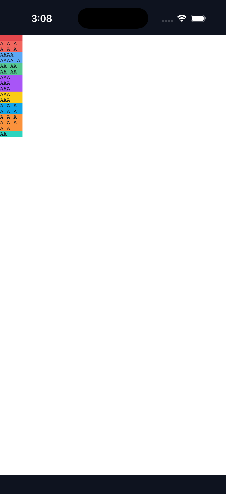
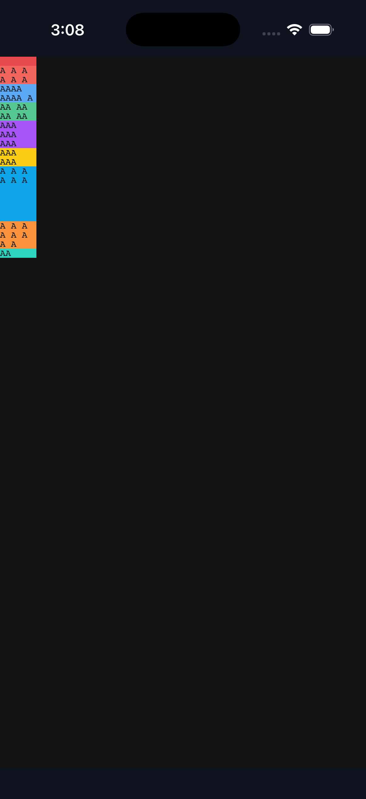
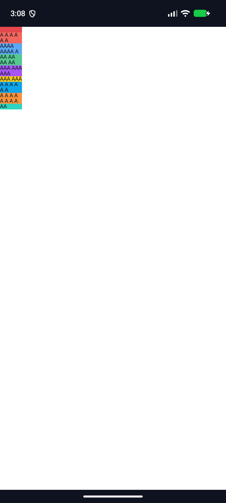
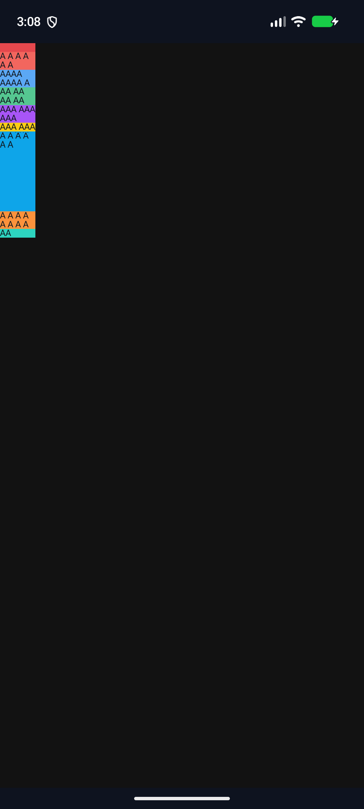

# C11.4 three-fit auto-placement `min-height:auto` 구현 근거

## 범위

이 산출물은 계획 [C11.4 three-fit auto-placement slice](../../../../plan/c11-4-root-html-repeated-text-autoplacement-three-fit-auto-minimum.md)의 구현과 검증 기록이다. 기존 Root HTML nine-item Grid의 여덟 repeated direct-text item만 다루며, 정확히 세 `fit-content()`·한 `min-content`·한 `max-content`·한 `auto`로 된 여섯-member implicit-row list를 허용한다. C11.4/C11의 공식 완료 판정이나 일반 CSS Grid 지원 근거로 확대하지 않는다.

제품 경로는 parsed Root HTML style projection과 layout profile에 predicate를 추가한다. 신규 profile은 세 fit cap이 모두 finite non-negative direct px 또는 percentage일 때만 허용하며, first explicit-row control은 `min-height:0`, 뒤 여덟 item은 전부 `min-height:0` 또는 전부 `auto`여야 한다. Three-fit row-span profile은 별도로 유지한다. 공개 API/FFI와 내부 계약 버전에는 변경이 없다.

## Chrome 비교와 RuntimeSession

독립 oracle은 계획 전용 Agent Browser HeadlessChrome 157 사전 비교 [README](../c11-4-root-html-repeated-text-autoplacement-three-fit-auto-min-precomparison-2026-11-11/README.md) 및 고정된 5,760-scene 관측이다. 신규 RuntimeSession matrix는 같은 관측 JSON을 입력으로 사용하며, 별도 RuntimeSession과 동일 구현 코드에서 expected result를 만들지 않는다.

`three_fit_auto_placement_runtime.log`의 결과:

- RuntimeSession 5,760/5,760 scene 통과, 2,880개 `min-height:0` / `auto` key가 모두 짝지어짐.
- 모든 720 authored track list, 20 fit-position triple, 여섯 tail 순서, 여섯 cap assignment, start/stretch 및 forward/reverse DOM 순서를 검사한다.
- 계산된 typed track/cap list, computed property, 9개 used row, item 및 payload frame, line/glyph count, eligible fit/auto row의 text content floor를 대조한다.
- baseline의 visible payload overflow 2,880 scene은 유지되고 auto-minimum candidate는 0 scene이다. Grid 끝(220px)을 넘는 item은 두 cohort 모두 없다. Item 내부 overflow와 Grid boundary는 별도 검사한다.
- 새 runtime tests 총 6개가 최종 실행에서 278.66초에 통과했다. 두 media color-scheme 변경, 미등록 finite direct px/% cap, out-of-profile mutation rejection, 실패 후 동일 session 복구, feature-gated track sizing trace가 포함된다.

기존 profile 회귀 결과는 다음 파일에 원본 명령 출력으로 보존했다.

| 범위 | 결과 | 기록 |
|---|---:|---|
| one-fit `min-height:auto` | 1,440/1,440 · 72.09초 | `one-fit-auto-minimum-regression.log` |
| one-fit zero-minimum position baseline | 1,440/1,440 · 71.31초 | `one-fit-zero-minimum-regression.log` |
| two-fit zero-minimum | 2,880/2,880 · 143.36초 | `two-fit-zero-minimum-regression.log` |
| two-fit `min-height:auto` | 2,880/2,880 · 145.53초 | `two-fit-auto-minimum-regression.log` |
| three-fit row-span boundary | 11,520/11,520 · 716.84초 | `three-fit-row-span-regression.log` |

Projection과 layout의 three-fit focused tests는 각각 4/4 통과했다. `cargo fmt --all -- --check`, `git diff --check`, 전체 workspace Clippy(`-D warnings`)도 통과했다. 최초 Clippy에서 test-only `needless_range_loop` 두 건을 찾아 iterator로 수정한 전/후 로그를 각각 보존했다. 전체 구현/runtime 적대 검토 20개와 별도 구현 PR diff 검토 30개는 이 디렉터리의 `implementation-runtime-review-20.md` 및 `implementation-pr-diff-review-30.md`에 기록한다.

## iOS·Android simulator 시각 확인

앱은 fixture toggle을 추가하지 않은 기본 Root HTML route로 실행했다. Build script가 `examples/bootstrap/index.html`과 `root-app.js`를 hash 확인 뒤 임시로 교체하고, `trap`으로 원본을 복구했다. 복구 결과는 `source-restoration.log`에 기록되어 있다.

| 플랫폼 | 기기 | 모드 | 화면 |
|---|---|---|---|
| iOS 26.2 Simulator | iPhone 17 Pro | light |  |
| iOS 26.2 Simulator | iPhone 17 Pro | dark |  |
| Android API 37.2 ARM64 AVD | `spinon_api37_2_presenttime_probe_20261018` | light |  |
| Android API 37.2 ARM64 AVD | `spinon_api37_2_presenttime_probe_20261018` | dark |  |

양 플랫폼의 light/dark 실행 로그에서 `SPINON_ROOT_HTML_DEFAULT_APP_BOOT status=pass`, `layout=ready`, `SPINON_C0410_DRAW status=0 presented`를 확인했다. Android emulator의 backend는 Vulkan/lavapipe (`llvmpipe` software renderer)였다. 이 검증은 앱 route 부팅, draw/present, screenshot 기반 시각 확인이다. hardware GPU, 실기기, compositor pixel readback, exact Chrome pixel parity는 확인하지 않았다.

Build 명령은 `build-three-fit-apps.sh`에, 모드별 실행·화면 저장·정리 절차는 `capture-three-fit-simulators.sh`에 있다. iOS·Android build 전체 로그와 실행 로그도 이 디렉터리에 둔다. 성공 캡처 뒤 iPhone 17 Pro와 AVD는 모두 shutdown됐고, `cleanup.log`에서 booted device·ADB 연결·Spinon 앱·emulator process가 없는 것을 확인했다. S03 Pilot 이름의 simulator profile은 Xcode 목록에 없었다. 공유 CoreSimulator 서비스와 공유 기기 프로필은 제거하지 않았다.

```sh
SPINON_ENABLE_C04_RUNTIME_GPU=1 mise exec -- bun run build:ios-sim
SPINON_ENABLE_C04_RUNTIME_GPU=1 mise exec -- bun run build:android
```

위 명령들은 안전한 bootstrap source 백업·복구 절차를 포함한 아래 script를 통해 수행했다. 수동 캡처 시에는 먼저 대상 iOS/Android simulator를 boot해야 한다.

```sh
bash spec/internal/evidence/c11-4-root-html-repeated-text-autoplacement-three-fit-auto-minimum-simulators-2026-11-11/build-three-fit-apps.sh
bash spec/internal/evidence/c11-4-root-html-repeated-text-autoplacement-three-fit-auto-minimum-simulators-2026-11-11/capture-three-fit-simulators.sh
```

## 검증 명령 요약

```sh
mise exec -- cargo test --locked -p spinon-style-to-layout three_fit
mise exec -- cargo test --locked -p spinon-layout three_fit
mise exec -- cargo test --locked -p spinon-runtime three_fit_auto_placement --features c11-4-grid-track-sizing-fixture-test -- --nocapture
mise exec -- cargo test --locked -p spinon-runtime parsed_root_html_one_fit_auto_minimum_matches_all_1440_chrome_scenes -- --nocapture
mise exec -- cargo test --locked -p spinon-runtime parsed_root_html_repeated_text_auto_placement_matches_all_fit_content_positions -- --nocapture
mise exec -- cargo test --locked -p spinon-runtime parsed_root_html_two_fit_auto_placement_matches_all_2880_chrome_scenes -- --nocapture
mise exec -- cargo test --locked -p spinon-runtime parsed_root_html_two_fit_auto_placement_auto_minimum_matches_all_2880_chrome_scenes -- --nocapture
mise exec -- cargo test --locked -p spinon-runtime parsed_root_html_three_fit_row_span_matches_all_11520_chrome_scenes --features c11-4-grid-track-sizing-fixture-test -- --nocapture
mise exec -- cargo clippy --locked --workspace --all-targets -- -D warnings
mise exec -- cargo fmt --all -- --check
git diff --check
```

## SHA-256

`SHA256SUMS`는 이 디렉터리의 source fixture, build/capture scripts, screenshots, logs 및 검토 기록을 고정한다.

Text log의 의미 있는 출력과 시간 정보는 유지했다. `git diff --check`를 통과시키기 위해 줄 끝 공백과 마지막의 추가 빈 줄만 정규화했다.
