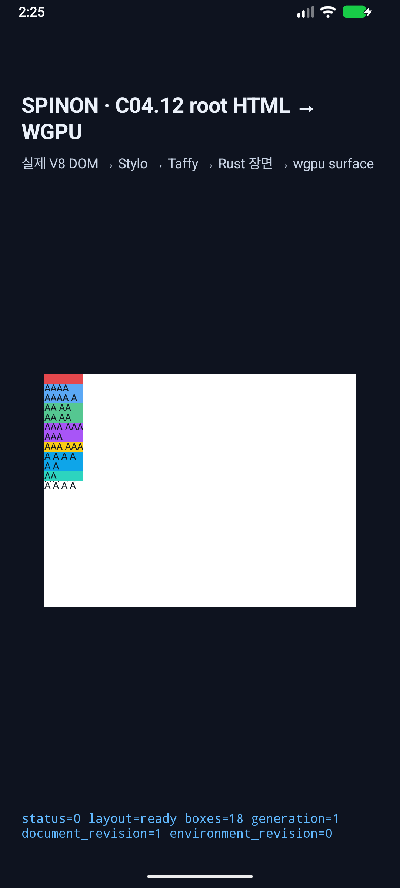
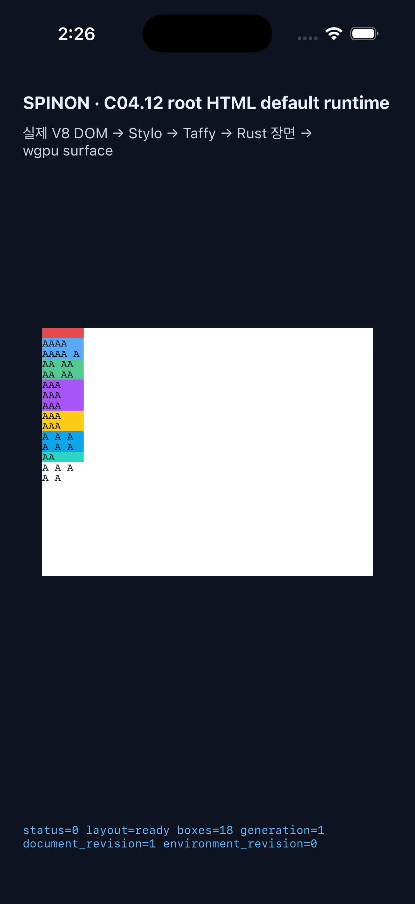

# C11.4 반복 텍스트 자동 배치 두 fit-content 구현 근거

**상태:** 제한 구현 PR [#1314](https://github.com/ohah/spinon/pull/1314) 병합 · `2026-11-09T17:54:36Z` · merge SHA `352e6c0b41a9fd4442eeaa5205f18dc1c94accc4` · C11.4/C11 공식 체크 미완료 · 78/214 유지 · 2026-11-10

## 입력 범위

- 기준 비교: [Chrome 157 사전 비교와 독립 기대값](../c11-4-root-html-repeated-text-autoplacement-two-fit-content-precomparison-2026-11-10/README.md), 2,880/2,880 scene. 기존 계획과 별도 계획 검토 20개 및 계획 PR diff 30개는 해당 사전 비교 디렉터리에 보존했다.
- 구현 경로: 기본 parsed Root HTML → RootHtmlFitContentAutoRowsV1 → style projection → Grid layout → RuntimeSession frame/text snapshot.
- 허용 목록: 여섯 authored track 중 서로 다른 두 위치의 유한하고 0 이상인 직접 px/% fit-content 두 개, min-content ×2, max-content ×1, auto ×1, 나머지 12개 순서. 별도 row-span profile과 기존 한-fit 자동 배치 profile은 유지한다.
- 입력 문서와 회귀는 [고정 Root HTML fixture](../../../../tests/fixtures/css/c11/root-html-grid-repeated-text-autoplacement-two-fit-content-runtime.html) 및 RuntimeSession matrix에 있다.

## Rust 검증

구현 전 기준은 Chrome matrix이며 RuntimeSession은 전체 scene을 실제 기본 Root HTML 경로에 넣고 computed track type/order, cap type, Grid/item/payload frame, line/glyph count, row cycle, overflow와 start/stretch 관계를 검사한다.

- 2,880/2,880 Chrome scene 비교, 1,440개 고유 authored track list, 15개 fit 위치 쌍, 12개 tail 순서, 8개 cap assignment, 1,440개 start/stretch pair 통과.
- layout track trace 실패 주입 unit tests 4/4 통과: 누락·중복·잘못된 owner·순서/단계/index 오류, stale revision을 fail-closed 처리하고 실패 후 출력을 불변으로 유지한다.
- 양수 대조: 기준 matrix 밖 직접 px/% cap, 0 cap, 120% cap 및 반복 auto-row 위치를 검사했다.
- 음수 대조: three-fit, 잘못된 multiplicity, 음수·계산식 cap, column/dense flow, implicit column, indefinite block size, unsupported alignment, 잘못된 item 수, auto-placement와 겹치는 row-span tail의 min-height:auto를 거부한다.
- 같은 RuntimeSession에서 어두운 scheme의 미지원 three-fit 목록을 원자적으로 거부한 뒤 light scheme에서 원래 frame으로 복구한다.
- 기존 회귀: anonymous-text 810, single-fit auto-placement 1,440, two-fit row-span 3,840, row-span 위치 1–3 1,920, row-span 위치 4–6 4,320 scene 통과.
- cargo fmt --all -- --check와 변경 세 crate 대상 cargo clippy --locked -p spinon-layout -p spinon-style-to-layout -p spinon-runtime --all-targets -- -D warnings 통과. 소스·문서 whitespace 검사는 통과했다. 원본 Android/iOS build 및 emulator 로그는 그대로 보존했으며 일부 도구 출력의 줄 끝 공백 때문에 evidence log를 포함한 전체 `git diff --check`는 해당 줄을 표시한다.

세부 명령은 crates/spinon-runtime/src/session/tests/root_html_grid_fit_content_auto_rows/two_fit_auto_placement.rs와 해당 하위 모듈에서 확인할 수 있다. 전체 2,880 scene은 Rust assertion이며 아래 모바일 화면 표본으로 대체하지 않는다.

## Android/iOS 앱 화면 smoke

세 장면 쌍과 cap 값은 위치별·정렬별 경계를 대표한다. 각 장면에 대해 build:android, build:ios-sim을 실행하고 기본 Root HTML route에서 source SHA, layout=ready, SPINON_C0410_DRAW status=0 presented를 확인했다. 두 플랫폼에서 총 12/12 실행이 통과했고 각 실행의 OS screenshot과 runtime log를 보존한다.

| 장면 | fit 위치와 cap | align-content | Android | iOS |
| --- | --- | --- | --- | --- |
| p12-start-zero-mixed | 1: 0px, 2: 20px | start | 통과 | 통과 |
| p12-stretch-over-zero | 1: 120%, 2: 0% | stretch | 통과 | 통과 |
| p25-start-mixed | 2: 20%, 5: 40px | start | 통과 | 통과 |
| p25-stretch-zero-over | 2: 0px, 5: 120% | stretch | 통과 | 통과 |
| p16-start-mixed-over | 1: 40px, 6: 120% | start | 통과 | 통과 |
| p16-stretch-mixed-zero | 1: 20%, 6: 0px | stretch | 통과 | 통과 |

대표 화면:

Android는 기존 spinon_api37_2_presenttime_probe_20261018 AVD의 API 37 / ARM64에서 실행했다. 에뮬레이터는 -read-only, snapshot load/save 비활성, 별도 임시 user-data/cache 경로와 -gpu swangle을 사용했다. 이는 Google APIs 16 KB AVD와 software renderer이며 물리 Android 기기나 hardware GPU 근거가 아니다.

iOS는 이번 run에서만 생성한 iPhone 17 Pro / iOS 26.2 프로필(6773E54F-498C-484F-8090-E18639292BB3)을 사용하고 종료 직후 삭제했다. 사전 목록에 있던 기존 iOS 프로필은 모두 종료 상태였고 변경하지 않았다.

화면 이미지는 앱의 실제 실행 화면을 보여 주는 visual smoke다. 전체 2,880 geometry 대조, PixelCopy, Metal drawable readback, compositor 이후 픽셀, 색상·glyph pixel parity를 주장하지 않는다.

## 정리 확인

- cleanup-state.txt: Android/iOS Root HTML asset 두 개를 사전 SHA-256 38813ca802618bd20bdf3bbb9ed9bc7525c289f48c0928813c855567f9e7df85로 복원, 생성 iOS profile 삭제, Android 임시 user-data 디렉터리 삭제를 기록한다.
- preflight-avd-state.txt와 post-run-avd-state.txt가 동일하다. 공유 Android AVD의 userdata/cache overlay와 snapshots는 변경하지 않았다.
- 최종 adb devices -l 및 xcrun simctl list devices booted에 연결·부팅된 기기가 없다. Android 임시 transport가 잠시 offline으로 보인 뒤 종료/정리 과정에서 해소된 것도 post-cleanup 파일에 반영했다.
- 이 실행은 Agent Browser나 Terminal Browser를 사용하지 않았다. 이전에 확인된 S03 이름의 simulator/profile은 현재 inventory에 없으며, CoreSimulator 시스템 서비스는 장치가 부팅되지 않아도 macOS가 유지하는 시스템 데몬이므로 작업 잔여물로 종료하지 않았다.
- 앱 번들·공유 빌드 캐시, 기존 simulator profile/AVD, 이전 실행의 screenshot·snapshot 및 저장소의 사전 untracked 자료는 삭제하지 않았다.

SHA256SUMS는 이 디렉터리의 실행 근거 파일 manifest다.

## PR 병합

구현 PR [#1314](https://github.com/ohah/spinon/pull/1314)은 `2026-11-09T17:54:36Z` Rebase and merge됐고 merge SHA는 `352e6c0b41a9fd4442eeaa5205f18dc1c94accc4`다. GitHub combined status check rollup과 PR review 제출은 없었다. 따라서 로컬·시뮬레이터 결과와 CI 결과를 혼합하지 않는다. 공식 완료 `78/214`, C11.4/C11 미완료, 내부 numeric contract `0.1.0`은 유지한다.
