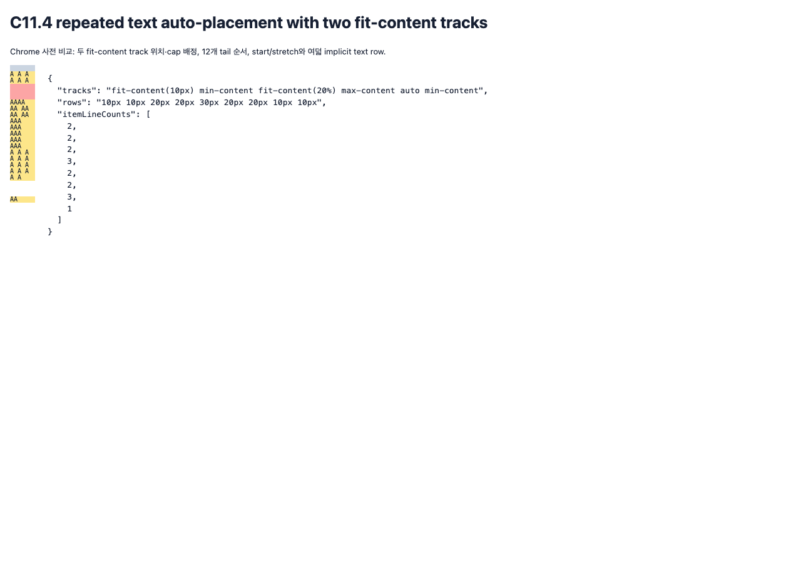

# C11.4 반복 텍스트 자동 배치의 두 `fit-content()` 사전 비교

**상태:** Chrome 157 기준 관측과 독립 CSS Grid 관계 검증 완료 · 계획 검토 완료 · 구현 전 · 2026-11-10

## 입력과 환경

- Fixture: `tests/fixtures/css/c11/root-html-grid-repeated-text-autoplacement-two-fit-content-precomparison.html`
- Fixture SHA-256: `861c6085b5ee2f2c02e51b9f588af21aff5065e47e9f4ace5ce08a0d29ea7722`
- 브라우저: Agent Browser `/opt/homebrew/bin/agent-browser`, HeadlessChrome `157.0.0.0`, `MacIntel`, DPR 1, viewport `1280×900`
- Grid: definite `40×220px`, `40px` column 하나, `10px` explicit row 하나, gap 0, row auto-flow, `align-content:start|stretch`, LTR, visible overflow
- 자식: `grid-row:1/2` 빈 control item 하나 뒤에 auto-placement item 8개가 온다. Text line 수는 `[2,2,2,3,2,2,3,1]`이다.
- `grid-auto-rows`: `fit-content()` 2개, `min-content` 2개, `max-content` 1개, `auto` 1개. Fit positions 15쌍, 두 ordered cap assignments를 포함한 cap 조합 8개, 후행 네 member의 12개 고유 순서, alignment 2개를 조합했다.

## 관측값과 독립 판정

고정 matrix는 `15 × 8 × 12 × 2 = 2,880` scene이며, 고유 authored track list는 `15 × 8 × 12 = 1,440`개다. 모든 장면의 `chrome-matrix-observation.ndjson`, `verify-chrome-matrix.py`, `matrix-verification.json`을 보존했다. 표본 화면은 아래에 삽입했다.

독립 검증기는 브라우저 출력만으로 정답을 복제하지 않고 다음 CSS Grid 관계를 확인한다.

- 여섯 authored member의 정확한 multiplicity, fit position, typed cap 배정과 계산 CSSOM 순서.
- explicit row 다음에서 여덟 implicit row가 6-track list를 순환하고, 각 auto-placement item이 해당 used row에 놓이는 관계.
- 이 고정 `min-height:0` 입력에서 각 fit row가 고정 text line-height contribution과 resolved px/% cap 중 작은 크기를 갖는 관계. Percentage basis `220px`에서 `20%`는 `44px`, `120%`는 `264px`다.
- item frame과 track 크기, payload frame과 line count가 서로 맞는 관계.
- `align-content:stretch`가 positive free space를 반복 등장하는 auto row occurrence에 균등 배분하며 다른 track은 바꾸지 않는 관계.
- Grid의 definite `220px` 바깥으로 visible text가 나오는 장면을 보존하는 관계.

2,880/2,880 scene shape가 맞았고, fit-content row occurrence 7,680개와 start/stretch 쌍 1,440개를 대조했다. 고정 cap group 360/360에서 cap assignment에 따른 row 변화가 관측됐다. non-auto stretch 최대 변화는 `0 CSS px`, auto stretch 최대 변화는 `120 CSS px`다. fit track used size 범위는 `0–30 CSS px`였고, 288개 scene에서 text payload가 Grid 아래로 나왔으며 최대 overflow는 `30 CSS px`였다.

수집 과정에서 검증기 cardinality assertion 두 곳을 관측 결과로 수정했다. 2,880 scene 중 start/stretch 쌍을 합친 고유 track list는 360개가 아니라 1,440개이며, fit-row cycle occurrence는 직접 계산한 7,680개다. 최종 collector와 verifier는 전체 matrix를 통과했다. 이는 입력/검증 도구 수정이며 Spinon runtime defect가 아니다.

Capture에 사용한 Agent Browser session은 `agent-browser-lifecycle.json`에 `closed: true`로 기록했다. 별도 Terminal Browser나 simulator는 사용하지 않았다. SHA-256 manifest는 `SHA256SUMS`다.

이 결과는 브라우저 사전 비교다. Spinon RuntimeSession, Android/iOS 앱, surface pixel parity, 일반 author CSS admission, WPT 적합성 또는 C11.4/C11 전체 완료를 입증하지 않는다.
