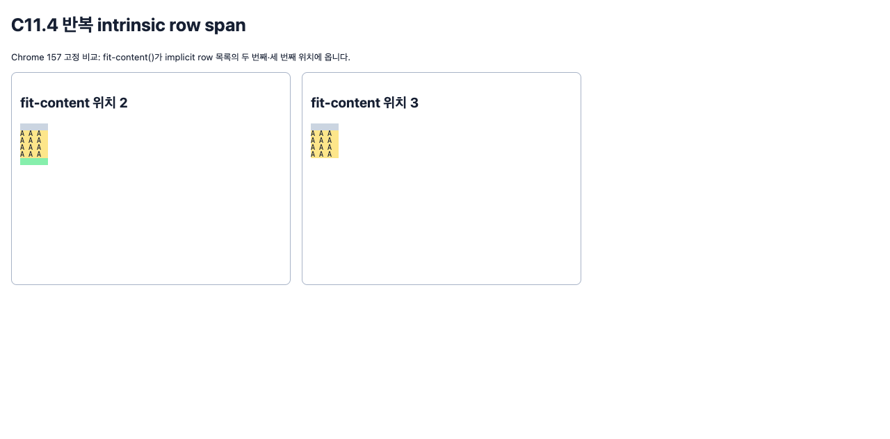

# C11.4 Root HTML 반복 텍스트 행 span · 후속 fit-content 위치

## 목적과 범위

이 사전 비교는 기존 direct-text 반복 행 span topology에서 여섯-member `grid-auto-rows` 목록의 `fit-content()`를 두 번째 또는 세 번째 member로 옮겨 측정한다. 현재 parsed Root HTML profile은 이를 첫 member로만 허용한다. 이 기준 관측은 Spinon layout/runtime 구현을 사용하지 않았다.

기본 입력은 PR #1295와 같은 고정 40×220 CSS px Grid다. explicit 40px column 하나, 10px row 하나, gap 0, LTR, visible overflow를 쓰며 모든 item에 `grid-column:1 / 2`를 지정한다. A/B/C content는 기존 10px monospace 문법을 유지하고 줄 수는 각각 2/3/4다. 기존 span topology의 forward/reversed 네 가지를 사용한다.

## 브라우저와 산출물

- 브라우저: Agent Browser 0.31.1, HeadlessChrome 157.0.0.0, MacIntel, DPR 1.
- Fixture: [`root-html-grid-repeated-text-later-fit-content-row-span-precomparison.html`](../../../../tests/fixtures/css/c11/root-html-grid-repeated-text-later-fit-content-row-span-precomparison.html), SHA-256 `faefbffa75dad33af7fc32cc193fb4741c6c4cb761dda61c89e5e1bc886b96d4`.
- 전체 CSSOM·frame·line 관측: [`chrome157-matrix-observation.ndjson`](./chrome157-matrix-observation.ndjson), SHA-256 `12fa49a03436604477e121335335d1bc14b3afded957a921206addfaba0f3d90`.
- 브라우저 screenshot: [`chrome157-later-fit-content-row-span.png`](./chrome157-later-fit-content-row-span.png).
- 독립 matrix verifier: [`verify-chrome-matrix.py`](./verify-chrome-matrix.py), 요약: [`matrix-verification.json`](./matrix-verification.json).

## Matrix와 결과

측정 곱집합은 `fit-content 위치 2개 × 5개 tail의 고유 순서 30개 × cap 4개 × alignment 2개 × topology 4개 = 1,920 scene`이다. Cap은 `20px`, `20%`, `0%`, `120%`이며 definite block-size percentage basis는 220px다. 따라서 authored cap 기대값은 각각 20px, 44px, 0px, 264px다. 각 fit 위치는 960 scene, 각 topology는 480 scene이다.

모든 scene은 여섯-member authored/computed 순서, explicit row 하나와 positive implicit row 세 개를 유지했다. Text 줄 수는 A=2, B=3, C=4로 정확했다. 독립 span/frame 관계의 최대 오차는 0 CSS px였다. Source order를 뒤집은 뒤 semantic frame geometry도 0 CSS px 차이였다. `start`와 `stretch` 비교에서 사용된 non-`auto` track 크기는 바뀌지 않았다.

독립 기대 관계는 CSS Grid 2025 CRD [§11.5 intrinsic track sizing](https://www.w3.org/TR/2025/CRD-css-grid-1-20250326/#algo-spanning-items)와 [§10.5 post-sizing alignment](https://www.w3.org/TR/2025/CRD-css-grid-1-20250326/#grid-align)를 따른다. Authored track order를 보존하고, explicit track 뒤에서 implicit cycle을 시작하며, span frame은 점유한 used row 크기의 합과 같아야 한다. 의미가 같은 source-order permutation은 frame이 같고, stretch는 auto track에만 적용한다. `fit-content()`의 min-content floor가 cap보다 클 수 있으므로 verifier는 모든 used size가 cap 이하라고 잘못 가정하지 않는다. Chrome 자료는 고정 입력 교차 확인이며 독립 모델을 대신하지 않는다.

이 자료는 브라우저 기준 근거다. Spinon runtime 결과, Android/iOS 렌더링, surface pixel, 일반 CSS admission 또는 C11.4 완료를 뜻하지 않는다.
