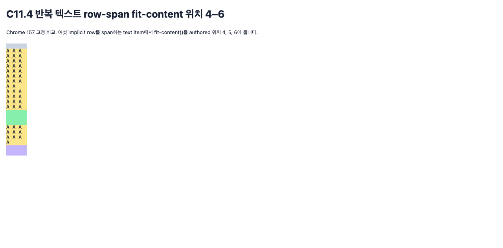

# C11.4 반복 텍스트 row-span · fit-content 위치 4–6 사전 비교

## 목적과 범위

현재 parsed Root HTML repeated-text row-span profile은 여섯-member grid-auto-rows list에서 fit-content authored 위치 1–3까지만 다룬다. 이 사전 비교는 six implicit row를 실제 생성하는 고정 span topology에서 위치 4–6을 관측한다. Spinon layout/runtime 구현을 사용하지 않은 브라우저 기준이다.

## 브라우저와 산출물

- Agent Browser 0.31.1, Google Chrome 157.0.8103.39, HeadlessChrome/157.0.0.0, MacIntel, DPR 1.
- [고정 HTML fixture](../../../../tests/fixtures/css/c11/root-html-grid-repeated-text-row-span-fit-content-positions-4-6-precomparison.html), SHA-256 3eb82a38d28e387f0c631738ef38ddfb05f13f30495d65b6b0ad41bf00d24013.
- [Chrome 157 관측 전체](./chrome157-capture.json), SHA-256 4932392e5c0291c51a3460fba7d69fbf0763bd59a1ab33ebc5398f7dd3637352.
- [독립 관계 검증기](./verify-chrome-matrix.py), [검증 요약](./matrix-verification.json).
- [계획 PR diff 실패 관점 검토 30개](./plan-pr-diff-review-30.md).
- [대표 화면](./chrome157-sample.png).
- [Agent Browser 세션 종료 전·후 상태](./agent-browser-session-before-close.json), [종료 후 프로세스 검색](./agent-browser-processes-after-close.txt), [종료 후 doctor](./agent-browser-doctor-after-close.txt).

## Matrix와 결과

고정 곱집합은 fit-content 위치 3개(4–6) × 나머지 다섯 member의 고유 순서 30개 × cap 6개(0px, 0%, 10px, 20px, 20%, 120%) × alignment 2개(start, stretch) × span topology/source order 4개로 총 **4,320 scene**이다. 각 위치는 1,440 scene, 각 topology는 1,080 scene이다. 각 장면은 explicit row 하나와 positive implicit row 여섯 개를 가진다.

Text 줄 수는 semantic item A–E 순서로 6/5/4/4/3이었다. 고정 corpus에서 각 text item의 frame 높이는 span한 used row 합과 정확히 일치했고 source-order reverse 최대 frame 차이도 0 CSS px였다. stretch는 non-auto track을 바꾸지 않았다. 10px cap과 20px cap의 fit track 사용 크기는 위치 4에서 48 scene, 위치 5에서 48 scene, 위치 6에서 24 scene만큼 달랐다. 0px와 0%, 20px·20%·120%는 이 corpus에서 같은 rows를 만들었다. 이 관측을 다른 text나 topology로 일반화하지 않는다.

독립 기대 관계는 [CSS Grid Layout Module Level 1 2025 CRD §11.5](https://www.w3.org/TR/2025/CRD-css-grid-1-20250326/#algo-spanning-items)의 spanning-item intrinsic track sizing과 [§10.5](https://www.w3.org/TR/2025/CRD-css-grid-1-20250326/#grid-align)의 post-sizing alignment다. 고정 브라우저 관측은 독립 불변식 cross-check다. Fixture와 verifier는 authored/computed track order, explicit row와 implicit cycle, item span 합, payload line-height와 source-order invariance를 확인한다.

이 산출물은 browser precomparison만 증명한다. Spinon 런타임, Android/iOS 실행, public CSS admission, surface pixels 또는 C11.4 구현 완료를 뜻하지 않는다.
