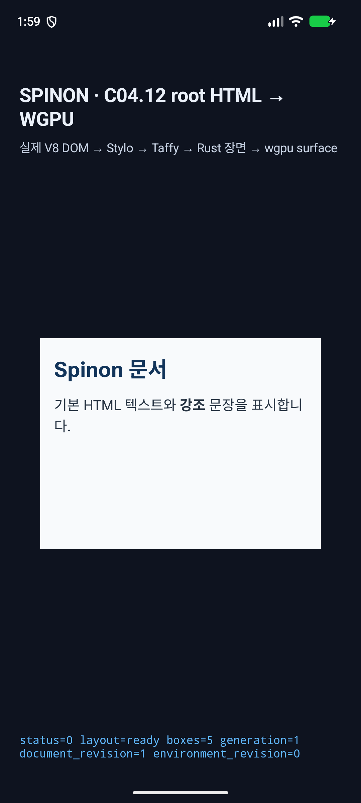
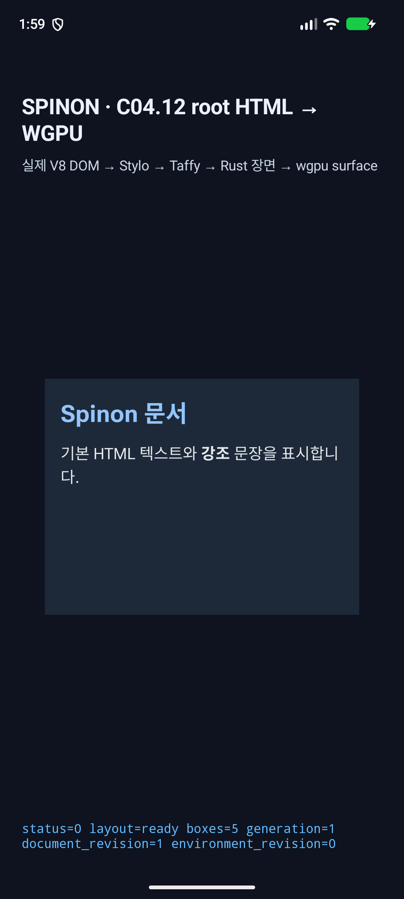
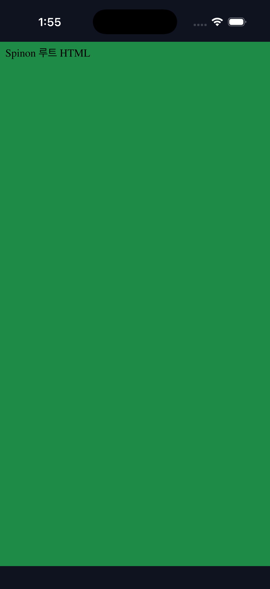

# PR #1372 병합 기록

- 제목: `feat(layout): five-fit row-span item별 mixed minimum 지원`
- 상태: Rebase and merge 완료
- 병합 시각: `2026-11-12T05:20:43Z`
- 병합 SHA: `15b7263c7045c7f55f02d74307605a6d85b35ee5`
- Base SHA: `33d35857b6e3f7f5b2bc2f83781ec7ed711e99b6`
- PR head SHA: `5a45e5a38e21d940012bed6a0a1a3bfa780af07c`
- PR diff: 67 files; 원격 PR diff와 로컬 후보 diff가 일치함
- GitHub checks/workflows: 각 0개. CI green으로 판정하지 않음.
- PR labels: `enhancement`, `area:layout`, `area:runtime`, `area:testing`

정확한 five-fit row-span profile의 span item별 mixed minimum 지원만 추가했다. C11.4/C11은 미완료이며 공식 완료 `78/214`, internal numeric contract `0.1.0`은 그대로다. 구현/runtime 20개 관점 및 PR diff 30개 관점 검토는 완료했다.

Android API 37.2 ARM64 AVD/SwiftShader와 iPhone 17 Pro/iOS 26.2 Simulator 화면은 light/dark 기본 Root HTML route smoke다. five-fit mixed fixture geometry, surface readback, pixel parity 또는 실기기 결과가 아니다. PR 본문에 포함된 화면을 그대로 가리킨다.

### Android API 37.2 AVD · 기본 Root HTML route

| Light | Dark |
| --- | --- |
|  |  |

### iPhone 17 Pro / iOS 26.2 Simulator · 기본 Root HTML route

| Light | Dark |
| --- | --- |
|  |  |
