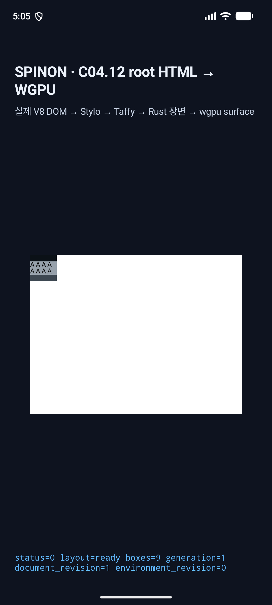
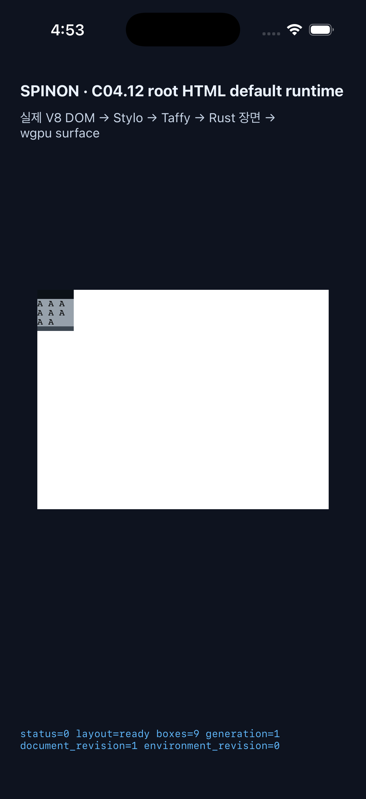

# C11.4 parsed Root HTML repeated-text row-span bounded implementation

이 폴더는 `RootHtmlFitContentAutoRowsV1`에서 반복 intrinsic row와 제한 text item row span을 기본 parsed Root HTML `RuntimeSession` 경로로 연결한 구현 후보의 실행 근거를 담는다. 계획 및 사전 비교는 [전용 계획](../../../../plan/c11-4-root-html-repeated-text-row-span.md)과 [Chrome 157 960-scene 사전 비교](../c11-4-root-html-repeated-text-row-span-precomparison-2026-11-09/README.md)에 있다. 공식 C11.4/C11 상태와 완료 수는 이 bounded slice로 변경하지 않는다.

## 변경 요약

- Plain Grid에서도 authored `grid-auto-rows`/`grid-auto-columns`를 Taffy style로 전달한다. 이전에는 auto-repeat이 있을 때만 전달해 authored rows가 빠지고 implicit rows가 모두 `auto`로 계산되던 입력 경로를 고쳤다.
- 기존 six-member 반복 intrinsic list와 text grammar를 유지하면서 빈 explicit item 뒤에 두 개 또는 세 개의 direct text wrapper를 둔다. Row placement는 `2 / span 2`, `3 / span 2`, 선택적 `2 / span 3`만 받고 각 item의 column은 `1 / 2`로 고정한다.
- Final row track trace와 placement line으로 item span frame을 검증한다. 불완전하거나 모순된 trace는 layout output을 반환하지 않는다. Blink 1/64 CSS px 보정은 측정된 row track trace를 쓴다.
- Public API, CSS 지원 약속, fixture success route 또는 FFI symbol을 추가하지 않았다.

## 독립 비교·Runtime 검증

- Chrome 157 사전 비교: 4 topologies × 30 tail orders × 4 caps × 2 alignments = 960 scenes. Track order, row sizes, line/span mapping, item/payload frames와 source-order invariance를 독립 기대값과 대조했다.
- RuntimeSession: 960 positive scenes, 35개의 unsupported style/placement/content 입력 원자 거부, vertical writing-mode cascade failure, reject 뒤 같은 session recovery. 기본·feature trace 테스트 모두 4/4 통과했다.
- Layout: Root HTML fit-content 반복 rows 16/16, trace omission/owner/index errors 2/2, Grid track sizing 127/127.
- Style-to-layout: 반복 text profile 2/2.
- 기존 810-scene repeated-text RuntimeSession regression: 1/1.
- `cargo fmt --all -- --check`와 변경 세 crate의 `cargo clippy --locked -p spinon-layout -p spinon-runtime -p spinon-style-to-layout --all-targets -- -D warnings` 통과.

상세 명령 출력은 `runtime-repeated-text-span.log`, `runtime-row-span-feature-trace.log`, `layout-root-html-fit-content-auto-rows.log`, `layout-row-span-trace-failures.log`, `layout-grid-track-sizing.log`, `style-root-html-fit-content-auto-rows.log`, `runtime-repeated-text-810-regression.log`, `clippy-final.log`에 보존했다. [Focused test summary](./focused-test-summary.txt)도 확인할 것.

전체 `cargo test -p spinon-layout --lib`는 506개 통과, C15 `host_document_collects_direct_text_and_inherited_spans_in_source_order` 테스트 1개 실패를 기록했다. 실패 테스트와 HostDocument 입력 생성 경로는 현재 diff에 없지만, clean baseline에서 재현하지 않아 baseline failure로 확정하지 않는다. 원본 로그는 `spinon-layout-lib.log`다.

## Android/iOS 앱 실행

동일한 temporary sentinel HTML은 SHA-256 `c1f81d9bef820362fe95e155ad029bbed013b8709020cab3946075d3c14668a9`다. Android bundle과 iOS bundle이 이 값을 포함했고 기본 Root HTML route에서 `layout=ready`, 9 boxes, 2 text payload를 기록했다. Android API 37.2 ARM64 AVD와 iPhone 17 Pro / iOS 26.2 Simulator 빌드·실행 결과는 `android-build.log`, `ios-build.log`, `android-runtime.log`, `ios-runtime.log`에 있다. 각 기기 화면 캡처는 사용 화면이 표시되는지 확인한 visual smoke다. 960-scene 앱 행렬, Android PixelCopy, Metal drawable readback, compositor 이후 pixel parity 또는 실기기는 검증하지 않았다.

AVD가 새로 생성된 API 37.0/37.2 이미지에서 QEMU 시작 오류를 냈다. 그 두 task-created AVD만 삭제하고 기존 `spinon_api37_2_presenttime_probe_20261018`을 read-only로 재사용한 뒤 정상 종료했다. iOS 기기는 전부 `Shutdown`이며 `S03 Pilot`은 현재 `simctl list devices`에 없다. `Simulator.app` GUI 프로세스도 남아 있지 않다. 기존 Hwpjs 소유 Agent Browser와 unrelated Terminal Browser는 열거나 종료하지 않았다.

## 지원 경계

이 결과는 계획에 고정한 direct-text syntax·style·Grid topology와 Chrome 157 oracle scene만을 뒷받침한다. General CSS Grid spanning, 임의 text/font/markup, nested Grid, implicit columns, 전체 C11.4/C11, Spinon WPT conformance, Android hardware GPU, iOS physical device 및 OS compositor 이후 출력은 미검증이다. 공식 완료 집계 `78/214`는 유지한다.
