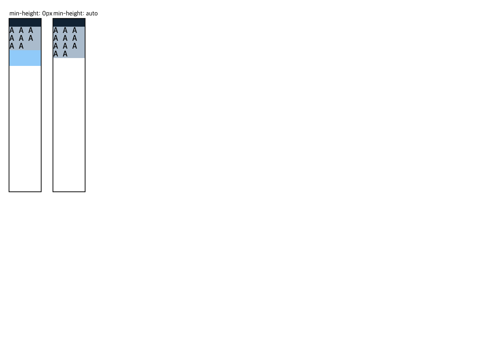

# C11.4 · one-fit repeated-text row-span `min-height:auto` 사전 비교

## 입력과 방법

- 규범 기준은 [CSS Grid 2025 CRD §6.6](https://www.w3.org/TR/2025/CRD-css-grid-1-20250326/#min-size-auto), [§7.2](https://www.w3.org/TR/2025/CRD-css-grid-1-20250326/#track-sizing) 및 [§11.5](https://www.w3.org/TR/2025/CRD-css-grid-1-20250326/#algo-spanning-items)이다. §6.6의 automatic minimum eligibility, §7.2의 `fit-content()` auto minimum 및 §11.5의 spanning contribution 순서를 독립 판정 관계로 사용했다.
- 비교 대상은 기본 parsed Root HTML의 one-fit repeated-text row-span 기존 min-height-zero 입력과 같은 입력에 `min-height:auto`만 적용한 입력이다. Chrome은 Agent Browser HeadlessChrome `157.0.0.0`이다.
- 3개 fit position × 30개 unique tail order × 4개 typed cap × 2개 alignment × 4개 source-order topology × 2개 minimum mode로 5,760 scene을 실행했다. 각 mode는 2,880 scene, paired key는 2,880개다.
- [fixture](../../../../tests/fixtures/css/c11/root-html-grid-repeated-text-row-span-one-fit-auto-minimum-precomparison.html), [capture script](./capture-chrome.mjs), [summary](./capture-summary.json), [raw observations](./chrome157-observation.ndjson)을 사용했다. Fixture SHA-256은 `d77bcfdf8b843589fdbef4fedb185b54a3eab86a1817d05914a8e9b3ccbaa889`다.

## 관측과 독립 검증

- Eligibility 조건을 만족한 span item은 총 6,048 occurrence다. `fit-content()`/`auto` minimum track을 포함하고 non-scrollable이며 flexible track을 span하지 않는 경우만 content-based automatic minimum 대상으로 세었다.
- `min-height:auto` 적용 후 6,036 item frame이 바뀌었다. 최대 row 차이는 30 CSS px, 최대 item frame 차이는 45 CSS px, text line 수는 모든 paired scene에서 동일했다.
- Baseline의 content-floor 위반 0, candidate의 content-floor 위반 0, candidate visible content overflow 0이다. 따라서 baseline overflow를 고친 사례라고 주장하지 않는다. 관측된 차이는 automatic minimum contribution이 spanning row base와 item span frame에 미치는 영향이다.
- Forward/reverse DOM order pair 2,880개의 used track 및 semantic item frame 최대 차이는 0 CSS px다. `align-content:stretch`와 `start` 비교 2,880쌍에서 non-auto track 최대 차이는 0 CSS px였고 auto track만 늘었다(최대 180 CSS px; 증가 관측 1,152개).
- 대표 `fit-content(0%) auto max-content max-content min-content min-content`, `start`, span-2 forward input의 used rows는 baseline `[10,0,20,30]px`, candidate `[10,10,15,15]px`였다. Candidate item frames A/B는 25/30px, payload는 20/30px다.
- 0.01 CSS px tolerance로 used-row 합과 item span frame, typed authored track order/cap, source-order invariance, stretch의 auto-only growth 및 candidate content overflow를 검사했다. 이는 Chrome 기준 비교와 규범 관계 검증이지 Spinon 구현 실행이나 WPT 적합성은 아니다.

## 화면 및 브라우저 수명

Agent Browser session `spinon-c114-row-span-one-fit-auto-20261110`은 캡처 스크립트에서 닫혔다. close 직후 browserLaunched=false/pageCount=0이었고, 후속 `session list --json`은 빈 목록을 반환했다. 최종 capture daemon PID 30018은 후속 process 확인 시 더 이상 존재하지 않았다. 기존 Terminal Browser PID 87587은 이 작업에서 실행·종료하지 않았다.

## 결론과 한계

One-fit row-span의 `min-height:auto`는 기존 `min-height:0`과 다른 Grid row sizing/frame을 만든다. 세 implicit-row topology의 positions 1–3에 계획된 제한 구현을 별도 predicate로 연결할 이유가 있다. Positions 4–6, two-fit/auto-placement profile, arbitrary text/style, WPT, Android/iOS runtime 및 surface pixel 검증은 이 사전 비교에 포함되지 않는다.
