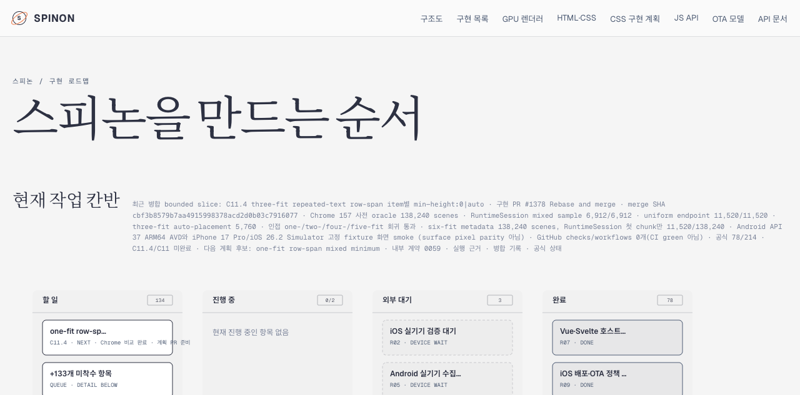

# C11.4 one-fit repeated-text row-span item별 mixed minimum · 구현 전 비교

## 범위와 기준

기존 one-fit row-span profile의 span text item마다 `min-height:0|auto`를 섞은 CSS Grid 결과를 비교했다. 제품 코드는 변경하지 않았다. 자동 최소 크기는 item마다 적용 여부를 판정한다. item이 scrollable overflow가 아니고, 해당 축에서 `auto` minimum track을 하나 이상 span하며, 둘 이상의 track을 span할 때 flexible track을 포함하지 않는 경우에 content-based minimum size를 사용한다. `fit-content()` cap은 content-based minimum size를 같은 방식으로 제한하지 않는다. 기준 문서는 고정 [CSS Grid Layout Module Level 1 · 2025 CRD §6.6](https://www.w3.org/TR/2025/CRD-css-grid-1-20250326/#min-size-auto), [§7.2](https://www.w3.org/TR/2025/CRD-css-grid-1-20250326/#track-sizing), [§11.5](https://www.w3.org/TR/2025/CRD-css-grid-1-20250326/#algo-spanning-items)다.

Agent Browser `0.31.1` / HeadlessChrome `157.0.0.0`에서 macOS `26.5.1` arm64, DPR 1, viewport `1280×900`으로 수집했다. Terminal Browser와 simulator는 사용하지 않았다. `capture-manifest.json`은 Chrome 실행 파일·fixture·collector hash, browser 환경, raw observation 및 screenshot hash를 고정한다. 전체 evidence와 고정 fixture의 파일 hash 목록은 `SHA256SUMS`다.

## 행렬

- Track list는 `fit-content(cap), min-content×2, max-content×2, auto`의 6-member 순열이며 tail의 30개 고유 순열을 유지한다. Positions 1–3은 기존 4개 cap(`20px`, `20%`, `0%`, `120%`), positions 4–6은 기존 6개 cap(`0px`, `0%`, `10px`, `20px`, `20%`, `120%`)을 사용했다. 총 900 unique track lists다.
- Positions 1–3에는 기존 3-row topology 네 가지를, positions 4–6에는 기존 six-row topology 네 가지를 사용했다. 각 topology의 모든 semantic item mask를 실행했다: 두 item이면 4개, 세 item이면 8개, 네 item이면 16개, 다섯 item이면 32개.
- `align-content:start|stretch`, 모든 fit position/cap/tail/topology/mask를 합쳐 120,960 scene을 수집했다. 첫 explicit-row control은 항상 `min-height:0`이다.
- 입력 fixture `tests/fixtures/css/c11/root-html-grid-repeated-text-row-span-one-fit-mixed-auto-minimum-precomparison.html`, Agent Browser collector `capture-chrome.mjs`, 압축 원본 `chrome157-one-fit-mixed-observation.ndjson.gz`, 독립 verifier `verify-chrome-matrix.py`, 검증 결과 `verification.json`을 보존했다.

## 결과

- 120,960/120,960 scene, 900/900 track list, 모든 topology의 mask를 확인했다. 모든 row·item·payload frame은 finite였고, item span 높이와 점유 row 합의 최대 차이는 `0.00025 CSS px`다.
- 기존 one-fit uniform baseline과 14,400 endpoint scene을 대조했다. 전체 row, item/payload frame과 text line rectangle의 최대 차이는 `0 CSS px`다.
- `min-height:auto`가 CSS Grid automatic-minimum 조건을 만족한 169,344 item occurrence에서 payload content-floor 위반은 0건이다. Uniform zero baseline 대비 geometry가 달라진 mixed scene은 90,096개다.
- 정방향/역방향 source-order 60,480쌍의 semantic item 및 track geometry 차이는 `0 CSS px`다.
- `start|stretch` 60,480쌍에서 non-auto track size 차이는 `0 CSS px`다. stretch가 auto row에 준 최대 증분은 180px이다. 늘어난 auto row 뒤에 놓인 non-auto item은 위치가 이동할 수 있어, 검증에서는 그 item의 크기와 비-auto track size를 따로 대조했다.
- 이 입력 행렬에서 Grid content edge를 넘는 payload는 0 scene이다. 화면의 붉은 outline은 기준 입력과 같은 `40×220 CSS px` grid의 외곽을 보이기 위한 것으로 layout 크기에 영향을 주지 않는다.

대표 표본은 scene 25, fit-content position 1 / `20px` cap, `align-content:stretch`, `span2-forward`, A만 `min-height:auto`다. 화면은 CSS oracle의 시각 표본이고 Spinon 앱 화면이나 pixel parity 근거가 아니다.

## 로드맵 카드 확인

로컬 branch preview에서 one-fit 계획이 칸반 `할 일` 열의 `NEXT` 카드로 표시됐다. 계획과 사전 비교를 마쳤지만 구현 PR은 아직 시작하지 않았으므로 진행 중으로 표시하지 않는다. 이 캡처는 배포 후 페이지가 아니다.

## 정리와 한계

- Collector는 전용 Agent Browser session을 닫았고 `agent-browser --namespace spinon-c114-onefit-mixed session list --json` 결과는 빈 목록이다. 별도 Terminal Browser session에는 접근하지 않았다.
- 이 자료는 Chrome 사전 비교다. Spinon RuntimeSession, Android/iOS 앱, WPT, compositor 이후 표면, 실기기와 GPU parity를 검증하지 않았다.
- 사전 비교는 고정된 Root HTML profile 밖의 일반 CSS Grid 동작이나 구현 완료를 뜻하지 않는다. C11.4/C11 상태와 공식 완료 집계는 이 자료로 바뀌지 않는다.
