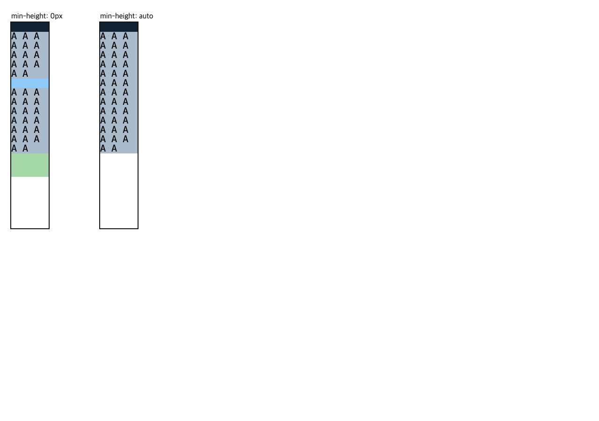

# C11.4 row-span positions 4–6 automatic minimum · 구현 전 비교

2026-11-10에 기본 CSS oracle을 Agent Browser 0.31.1 / HeadlessChrome 157에서 실행했다. 제품 코드는 변경하지 않았다. 규범 기준은 [CSS Grid Layout Module Level 1 · 2025 CRD §6.6](https://www.w3.org/TR/2025/CRD-css-grid-1-20250326/#min-size-auto), [§7.2](https://www.w3.org/TR/2025/CRD-css-grid-1-20250326/#track-sizing), [§11.5](https://www.w3.org/TR/2025/CRD-css-grid-1-20250326/#algo-spanning-items)다. Agent Browser에서 §6.6의 scrollable overflow, `auto` minimum track, flexible span 예외와 fit-content minimum 규칙을 확인했다.

## 고정 입력과 결과

| 축 | 값 |
| --- | --- |
| Grid | definite `40×220px`, explicit column `40px`, explicit row `10px`, gap 0, LTR |
| `grid-auto-rows` | fit-content 하나와 `min-content ×2`, `max-content ×2`, `auto ×1`의 6-member list |
| Fit positions | authored positions 4, 5, 6 |
| Tail orders | 다섯 tail member의 30개 고유 순열 |
| Caps | `0px`, `0%`, `10px`, `20px`, `20%`, `120%` |
| Alignment/topology | `start|stretch`; five span-2 items 또는 span2/span3 mixed 4-item topology; 각 forward/reverse |
| Minimum modes | baseline `min-height:0`; candidate `min-height:auto`; empty explicit-row control은 항상 `0` |
| Browser matrix | baseline 4,320 + candidate 4,320 = 8,640 scenes, 4,320 paired keys |
| Text | direct ASCII payload A–E, fixed 10px monospace / 10px line-height; line counts 6/5/4/4/3 |

독립 Python verifier가 NDJSON 전체를 별도로 읽어 scene 조합·중복·computed style·row/frame 합·source order·alignment pair를 검사했다.

| 관측 | 결과 |
| --- | ---: |
| Automatic-minimum eligible item occurrences | 12,240 |
| baseline / candidate content-floor 위반 | 0 / 0 |
| candidate visible content overflow | 0 |
| `min-height:auto`로 바뀐 item frame | 15,348 |
| maximum used-track / item-frame 변화 | 70px / 55px |
| Paired text line-count 변화 | 0 |
| Forward/reverse semantic frame 최대 차이 | 0 CSS px |
| Stretch가 non-auto track에 준 최대 변화 | 0 CSS px |
| Auto-track 최대 stretch 증가 | 90px |
| 허용 오차 | 0.01 CSS px |

대표 paired scene:



## 재현과 산출물

```sh
node spec/internal/evidence/c11-4-root-html-repeated-text-row-span-positions-4-6-auto-minimum-precomparison-2026-11-10/capture-chrome.mjs
python3 spec/internal/evidence/c11-4-root-html-repeated-text-row-span-positions-4-6-auto-minimum-precomparison-2026-11-10/verify-chrome-matrix.py
```

수집기는 전용 Agent Browser session을 `finally`에서 닫는다. 이번 session은 닫혔고 이후 `agent-browser session list`에 이 이름이 남지 않았다. 기존의 별도 `zntc4603-root` session은 이 작업 소유가 아니므로 유지했다. Terminal Browser는 사용하지 않았다.

- [HTML fixture](../../../../tests/fixtures/css/c11/root-html-grid-repeated-text-row-span-positions-4-6-auto-minimum-precomparison.html)
- [전체 Chrome observation NDJSON](./chrome157-observation.ndjson)
- [수집 요약](./capture-summary.json)
- [독립 matrix 검증](./matrix-verification.json) · [검증기](./verify-chrome-matrix.py)
- [전용 Agent Browser 생명주기](./agent-browser-lifecycle.json)
- [SHA-256 manifest](./SHA256SUMS)

Chrome observation은 구현 전 기준만 고정한다. Spinon runtime, Android/iOS, WPT, compositor 이후 surface pixels, 실기기 또는 일반 CSS Grid 지원으로 해석하지 않는다.
