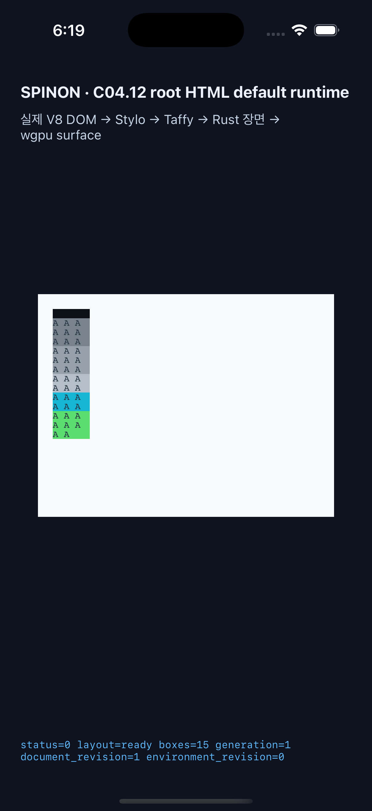
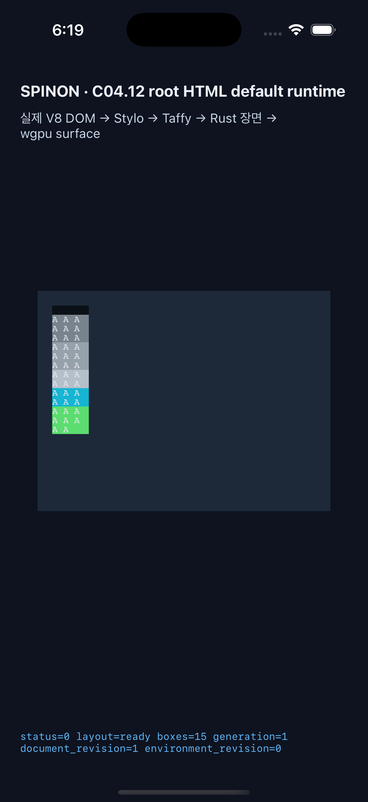
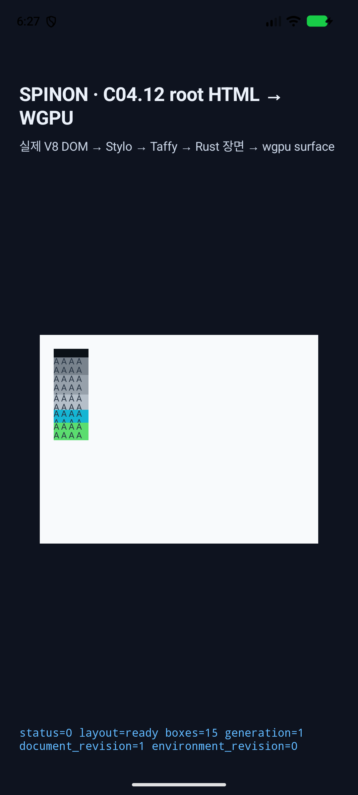
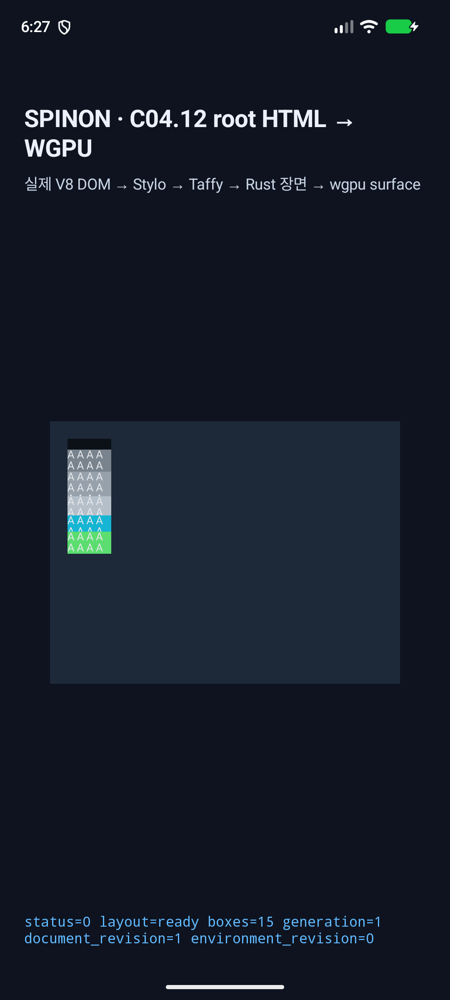

# C11.4 row-span positions 4–6 `min-height:auto` 런타임 근거

이 제한 구현은 기본 parsed Root HTML `RuntimeSession`의 single-fit repeated-text row-span profile에서 기존 six-row topology의 authored fit-content positions 4–6에 `min-height:auto`를 연결한다. CSS track sizing 일반 기능, 임의 row-span/text, WPT 적합성 또는 C11.4/C11 완료를 뜻하지 않는다. 공식 상태는 미완료이며 완료 집계 `78/214`, 내부 숫자 계약 `0.1.0`을 유지한다.

## 기준 입력과 hash

고정 Chrome 157 baseline/candidate 자료와 scene 정의는 [구현 전 비교](../c11-4-root-html-repeated-text-row-span-positions-4-6-auto-minimum-precomparison-2026-11-10/README.md)에 있다. 이번 RuntimeSession 테스트는 authored scene별 baseline `min-height:0`과 candidate `min-height:auto`를 4,320쌍으로 대조한다.

| 입력 | SHA-256 |
| --- | --- |
| baseline six-row Root HTML | `357bf8b9bbc5b2fc23ee906187dc66dc80ddee0078ae94c0515919896f422f92` |
| candidate six-row Root HTML | `42fc943bde36016bc659df84e590ba32b7e8057030c92c90f011bc6aa513bf92` |
| 복구한 기본 앱 asset | `38813ca802618bd20bdf3bbb9ed9bc7525c289f48c0928813c855567f9e7df85` |

Android APK 내부의 baseline, candidate, 복구 asset hash는 각각 해당 source hash와 일치한다. iOS asset hash도 `ios-source-hashes.txt`에 기록했다.

## RuntimeSession 검증

- `focused-runtime-tests.log`: eligible trace, 0px/20px cap 반올림, mixed minimum 및 잘못된 위치 거부, 원자적 실패와 같은 session 복구 5/5 통과.
- `six-row-matrix-final.log`: Chrome 157 paired RuntimeSession 행렬 4,320쌍/8,640 observations 통과. eligible automatic-minimum item 12,240개, 기준보다 변한 item frame 15,348개를 고정 기대값과 대조했다. source-order 의미 기하 차이 0 CSS px, non-auto stretch 차이 0 CSS px, auto row 비축소를 검사했다.
- `positions-1-3-regression.log`: 기존 single-fit positions 1–3 row-span 자동 최소 크기 2,880 paired Chrome scenes 통과.
- `two-fit-regression.log`: 기존 two-fit row-span의 두 cap 위 content minimum 회귀 test 1/1 통과.
- `layout-rounding-tests.log`: 양자화와 cap 경계 layout unit test 5/5 통과.
- Agent Browser에서 네 개 commit-pinned 후보 PNG가 모두 완전히 로드되고 intrinsic dimensions가 0보다 큰 것을 확인했다. 고정 Chromium 157.0.8103.40 source도 열어 `LayoutUnit` raw-value 기반 contribution share 구현을 대조했다. 상세 값은 `agent-browser-verification.txt`에 있다.
- 양자화 trace는 여섯 positive implicit row, typed `AutomaticMinimum`, auto-min track span, multi-track span, non-flex max track, content-based floor를 확인한다.
- 구현 검토 20개와 PR diff 별도 검토 30개는 [implementation-review-20.md](implementation-review-20.md), [pr-diff-review-30.md](pr-diff-review-30.md)에 기록했다.

행렬은 고정 Chromium 관찰값과 bounded RuntimeSession 결과의 대조다. CI 상태나 전체 CSS/WPT 적합성을 대신하지 않는다.

## iOS Simulator visual smoke

| 항목 | 값 |
| --- | --- |
| Simulator | iPhone 17 Pro · iOS 26.2 |
| UDID | `ACA7BF91-E2D5-4CF7-909A-08D1AD95FF3D` |
| Viewport | 320×240 CSS px · device scale 3 |
| 실행 경로 | 기본 Root HTML 앱 asset · light/dark · `layout=ready` · draw `status=0 presented` |

Baseline과 candidate를 각각 light/dark로 실행했다. 캡처와 원본 launch/runtime 로그는 `ios-baseline-light.png`/`.log`, `ios-baseline-dark.png`/`.log`, `ios-candidate-light.png`/`.log`, `ios-candidate-dark.png`/`.log`다. 후보 화면은 Grid의 6개 implicit row와 colored span item을 보이는 시각 확인이다.

## Android AVD visual smoke

| 항목 | 값 |
| --- | --- |
| AVD | `spinon_api37_2_presenttime_probe_20261018` · API 37 · `arm64-v8a` |
| Display | 1080×2400 · density 420 dpi |
| Renderer | Vulkan / Goldfish GFXStream SwiftShader |
| 실행 경로 | 기본 Root HTML APK asset · light/dark · `layout=ready` · draw `status=0 presented` |

Baseline과 candidate를 각각 light/dark로 실행했다. 캡처와 원본 launch/runtime 로그는 `android-baseline-light.png`/`.log`, `android-baseline-dark.png`/`.log`, `android-candidate-light.png`/`.log`, `android-candidate-dark.png`/`.log`다.

## 검증 범위와 정리

- 네 화면은 기본 앱 경로의 visual smoke다. Android PixelCopy, iOS Metal drawable 직접 readback, compositor 뒤 pixel parity는 측정하지 않았다. 실기기 또는 hardware GPU도 사용하지 않았다.
- iOS app asset을 원본 SHA로 복구하고 원본 앱을 다시 빌드했다. 원래 appearance인 dark를 복구한 뒤 iPhone 17 Pro Simulator를 종료했다.
- Android asset을 원본 SHA로 복구하고 APK를 다시 빌드·설치했다. 원래 light appearance (`Night mode: no`, secure setting `1`)와 일치시킨 뒤 앱을 force-stop하고 AVD를 종료했다. 실행은 `-read-only -no-snapshot-load -no-snapshot-save`였다.
- 현재 iOS booted device와 `Simulator.app` 프로세스는 없다. `S03` named simulator profile은 기기 목록에 없었고 제거하지 않았다. 공유 iPhone 17 Pro/Pro Max profile과 data는 보존했다.
- 현재 `adb devices`에는 연결 기기가 없다. 작업용 `/tmp/spinon-c114-android-original.ZpEECL` 백업은 원본 복구 확인 뒤 삭제했다. S03·공유 simulator profile을 삭제하지 않았다.
- 복구 빌드·환경·hash 근거: `ios-restore-build.log`, `ios-restored-state.txt`, `ios-source-hashes.txt`, `android-restore-build.log`, `android-restored-state.txt`, `android-environment.txt`, `android-source-hashes.txt`.

## 로컬 검증

- `cargo fmt --all -- --check` 통과.
- 위 focused runtime tests 5/5 및 six-row paired matrix 1/1 통과.
- `cargo clippy --locked -p spinon-layout --all-targets -- -D warnings`, `cargo clippy --locked -p spinon-style-to-layout --all-targets -- -D warnings`, `cargo clippy --locked -p spinon-runtime --lib --features c11-4-grid-track-sizing-fixture-test -- -D warnings` 통과. 전체 workspace Clippy는 실행하지 않았다.
- 빌드·테스트 `.log`는 원래 내용은 유지하고 줄 끝 공백과 연속된 마지막 빈 줄만 정규화해 `git diff --check`에 맞췄다.
