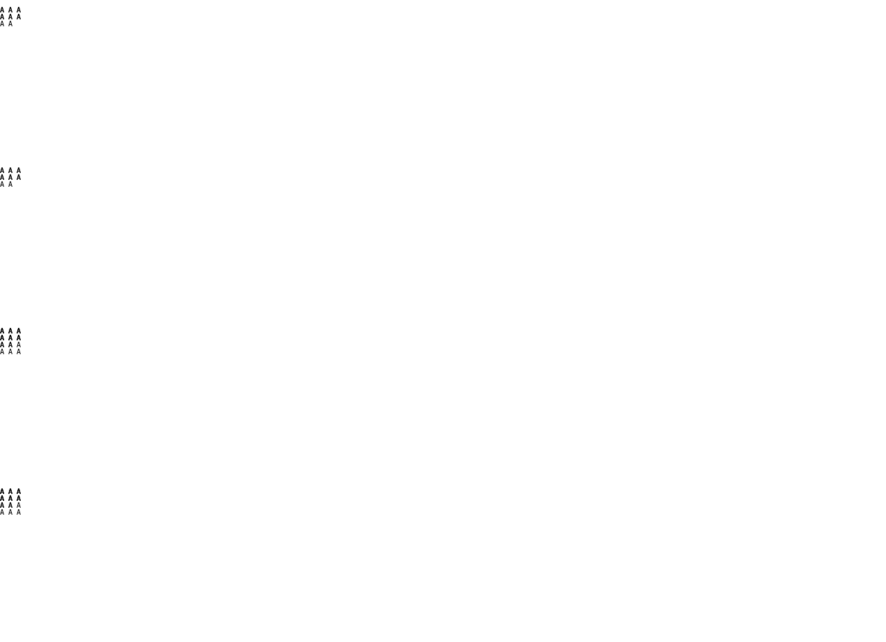

# C11.4 Root HTML 반복 intrinsic row 텍스트 span 사전 비교

## 목적

현재 기본 parsed Root HTML의 `RootHtmlFitContentAutoRowsV1` 반복 텍스트 profile은 텍스트 item을 자동 배치하며 각 item이 implicit row 하나만 차지하는 형태로 제한한다. 이 사전 비교는 반복 intrinsic row list 안에서 두 행·세 행을 span하는 실제 텍스트 item의 행 기여를 고정한다. 제품 코드, Spinon layout, 계획 fixture adapter를 기준 측정에 사용하지 않았다.

기준은 Agent Browser가 연 HeadlessChrome 157.0.0.0, `MacIntel`, DPR 1이다. 실제 user-agent 문자열은 `chrome157-matrix-observation.ndjson`에 보존했다. 고정 입력 fixture는 `tests/fixtures/css/c11/root-html-grid-repeated-text-row-span-precomparison.html`이며 해당 SHA-256은 `20388cdb1efaca752ea91885c2412492ea24b794a3936ca89e88ef6d3ff54baf`다.

## 비교 입력

- Root: 40×220 CSS px, 40px explicit column 하나, 10px explicit row 하나, 0 gap, LTR, visible overflow.
- Implicit row list: `fit-content(<cap>)` 뒤에 `min-content` 2개, `max-content` 2개, `auto` 1개의 30개 고유 순서를 둔다.
- Cap은 `20px`, `20%`, `0%`, `120%`; alignment는 `start`, `stretch`다.
- 첫 item은 빈 explicit row item이다. 이후 direct text item은 `grid-column:1 / 2`로 같은 열에 고정한다.
- `A A A A A A`는 2줄, `A A A A A A A A`는 3줄, `A A A A A A A A A A A A`는 4줄이다. 모두 기존 #1292 텍스트 문법과 10px monospace/10px line-height 안에 있다.
- 네 topology는 `A:2/span2, B:3/span2`와 source-order 역전, 이어서 `A:2/span2, B:3/span2, C:2/span3`와 source-order 역전이다.

총 30 × 4 × 2 × 4 = **960 scene**을 측정했다. Chromium CSSOM row serialization, 각 item과 payload frame, text line y 좌표는 `chrome157-matrix-observation.ndjson`에 있다. `verify-chrome-matrix.py`는 모든 조합을 점검하고 결과를 `matrix-verification.json`에 쓴다.

## 고정된 결과와 판정

- 4 topology 각 240 scene, 총 960 scene이 빠짐없이 있다.
- 네 scene 모두 정확히 explicit row 1개와 implicit row 3개를 생성한다. 세로 item frame은 해당 item이 차지한 used row들의 합과 최대 0.011 CSS px 차이다.
- A/B/C의 line count는 모든 scene에서 각각 2/3/4다. 명시 열 배치로 implicit column이 생기지 않는다.
- `start`와 `stretch`의 DOM source order 역전은 semantic item geometry에 0 CSS px 차이를 보였다. `stretch`는 auto track 크기만 변경하고 fit-content 및 다른 intrinsic track은 유지한다.
- 독립 검산은 CSS Grid 2025 CRD §11.5의 span 길이별 intrinsic sizing 순서와 §10.5의 sizing 이후 alignment 순서를 사용한다. 브라우저 관측은 이 계산을 대체하지 않고 fixed-input 교차 확인으로 보존한다: [§11.5 Resolve Intrinsic Track Sizes](https://www.w3.org/TR/2025/CRD-css-grid-1-20250326/#algo-spanning-items), [§10.5 Aligning the Grid](https://www.w3.org/TR/2025/CRD-css-grid-1-20250326/#grid-align).
- 기준 sentinel인 `fit-content(20px) min-content max-content auto min-content max-content`, `align-content:start`에서 span-2 pair는 rows `10px 0px 20px 15px`, A/B item heights `20px/35px`다. span-2/3 topology는 rows `10px 0px 22.5px 17.5px`, A/B/C item heights `22.5px/40px/40px`다. Source-order reversal 결과는 동일하다.

처음에는 행 placement만 고정하고 열을 자동 배치해 겹치는 item이 2·3열로 밀리는 측정 오류를 발견했다. 최종 fixture는 빈 explicit item을 포함한 모든 item에 `grid-column:1 / 2`를 지정한다. 이를 통해 이번 측정이 implicit-column 생성이나 열 축 sizing을 섞지 않는다.

화면은 CSSOM geometry와 text line wrapping 관측이며 Spinon rendering, iOS/Android, surface pixel 또는 glyph raster 증거가 아니다.
