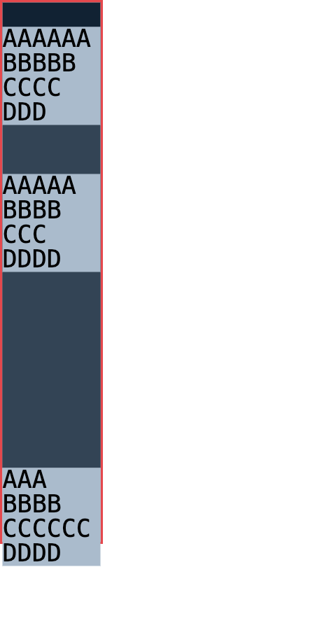

# C11.4 three-fit row-span mixed automatic minimum · 사전 비교

## 범위와 기준

이 비교는 item마다 `min-height:0|auto`를 섞은 세 `fit-content()` implicit-row track의 CSS Grid reference behavior를 관측한다. 기준 문서는 [CSS Grid Layout Module Level 1 · 2025 CRD §6.6](https://www.w3.org/TR/2025/CRD-css-grid-1-20250326/#min-size-auto), [§7.2.1](https://www.w3.org/TR/2025/CRD-css-grid-1-20250326/#track-sizes), [§11.5.1](https://www.w3.org/TR/2025/CRD-css-grid-1-20250326/#algo-spanning-items)다. 이 문서는 작업 당시 고정한 Candidate Recommendation Draft이며 최종 CSSWG 명세 또는 제품 지원 완료라고 주장하지 않는다.

기준 실행은 Agent Browser `0.31.1`의 HeadlessChrome `157.0.0.0`, macOS `26.5.1` arm64, DPR 1, viewport `1280×900`이다. Terminal Browser를 사용하지 않았다. 원본 fixture는 `tests/fixtures/css/c11/root-html-grid-repeated-text-row-span-three-fit-mixed-auto-minimum-precomparison.html`이고, capture/verifier는 이 디렉터리의 `capture-chrome.mjs`와 `verify-chrome-matrix.py`다. 압축 관측 138,240 scenes, 검증 JSON, capture metadata, Agent Browser 종료 기록과 SHA-256 manifest 파일은 각각 `chrome157-three-fit-mixed-observation.ndjson.gz`, `verification.json`, `capture-manifest.json`, `agent-browser-lifecycle.json`, `SHA256SUMS`다.

Fixture Grid의 border box는 `42×222 CSS px`, border는 1px, `box-sizing:border-box`이며 content box는 `40×220 CSS px`다. 따라서 `fit-content(20%)` percentage basis는 220px block content size다. Visible overflow를 두고 고정 six-row topology, explicit 10px row, zero gap, direct 10px monospace text, `align-content:start|stretch`를 사용한다.

## Matrix

- Track list: 20 fit-position triples × six permutations of `0px|10px|20%` caps × six permutations of `min-content|max-content|auto` tail = 720 exact lists.
- Topology: span-2 five-item six-row list (`span2Six`)과 span-2/span-3 four-item six-row list (`span2Span3Six`); 각각 DOM forward/reverse.
- Minimum masks: A–E의 32개 및 A–D의 16개 semantic-ID mask. 첫 explicit-row empty control은 모든 scene에서 `min-height:0px`다.
- Alignment: `start|stretch`.
- Total: `720 × (32+32+16+16) × 2 = 138,240` scenes.

Verifier는 scene index를 연속성 검사하고 track list/cap/tail coverage, topology별 모든 mask, authored/computed declaration, 7개 used row, item/covered-row geometry, payload line wrapping, eligible auto-minimum content floor, source-order reversal, stretch 분배, border geometry와 기존 uniform endpoint를 각각 확인한다. 기존 three-fit uniform oracle 11,520 scene과 새 mask 0/all-set endpoint의 row/item/payload geometry도 비교한다.

## 관측 결과

독립 verifier 결과는 `verification.json`에 저장했다.

- 720 track list, 138,240 scenes, 69,120 source-order pairs, 69,120 alignment pairs 모두 확인했다.
- Eligible `min-height:auto` item 304,128회 중 payload content-floor 위반 0개다. Maximum span frame/covered-row 오차는 `0.00045 CSS px`, source-order geometry 차는 `0 CSS px`, non-auto row stretch 차는 `0 CSS px`다.
- Grid content box 끝에서 text payload가 넘은 장면은 전체 1,344개, mixed-mask 장면 1,236개이며 최대 초과는 20px이다. 이 장면들은 `overflow:visible`의 oracle 결과이므로 0으로 강제하지 않는다.
- 기존 uniform mask 0/all-set의 11,520 endpoint는 기존 three-fit reference와 최대 `0 CSS px` 차이다.
- 대표 scene index 54,448은 mask `16`으로 E만 `auto`이고 A–D는 `0px`다. Track list는 `fit-content(20%) min-content auto fit-content(0px) fit-content(10px) max-content`, alignment는 `stretch`다. D의 payload는 Grid content 끝을 10px 넘고 E는 자신의 payload 높이 30px를 보존한다. 실제 1px Grid border와 넘친 `DDDD`는 아래 화면에서 확인할 수 있다.

## 제한

이 자료는 Chrome의 사전 비교만 증명한다. Spinon RuntimeSession, Root HTML app, Android/iOS simulator, GPU surface, PixelCopy/Metal readback, compositor 후 화면, 실기기, WPT, general CSS admission은 아직 검증하지 않았다. 대표 시나리오 및 simulator 검증 조건은 `plan/c11-4-root-html-repeated-text-row-span-three-fit-mixed-auto-minimum.md`에 있다.
