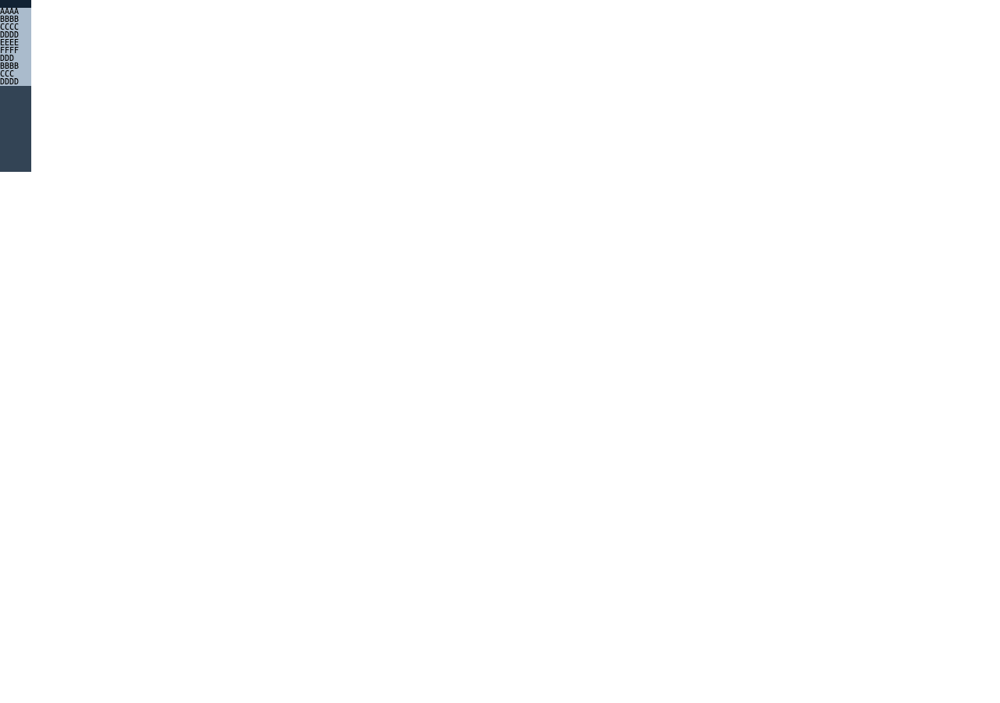

# C11.4 두 `fit-content()` row-span의 item별 최소 크기 사전 비교

## 비교 범위

Chrome 157 Agent Browser에서 기존 six-member repeated-text row-span의 두 `fit-content()` profile에 span item별 `min-height:0|auto`를 적용했다. 총 92,160개 scene은 CSS Grid의 독립 oracle 결과이며 Spinon layout, RuntimeSession, Android/iOS 앱 동작을 검증하지 않는다.

- Fixture: [`root-html-grid-repeated-text-row-span-two-fit-mixed-auto-minimum-precomparison.html`](../../../../tests/fixtures/css/c11/root-html-grid-repeated-text-row-span-two-fit-mixed-auto-minimum-precomparison.html)
- Collector: [`capture-chrome.mjs`](./capture-chrome.mjs)
- 별도 matrix verifier: [`verify-capture.mjs`](./verify-capture.mjs)
- 실행 정보와 source hash: [`capture.json`](./capture.json)
- 독립 검증 결과: [`verification.json`](./verification.json)
- 계획 PR diff 검토: [서로 다른 30개 관점](./plan-pr-diff-review-30.md)
- 전체 장면: [`chrome-observation.ndjson.gz`](./chrome-observation.ndjson.gz)
- mixed mask 화면: [`chrome157-two-fit-mixed-sample.png`](./chrome157-two-fit-mixed-sample.png)
- 경계 넘침 control 화면: [`chrome157-two-fit-mixed-overflow-sample.png`](./chrome157-two-fit-mixed-overflow-sample.png)
- 브라우저 종료 기록: [`agent-browser-lifecycle.json`](./agent-browser-lifecycle.json)

### Mixed item minimum sample

### Visible text overflow control

Chrome은 `/opt/homebrew/bin/agent-browser` 0.31.1의 HeadlessChrome 157.0.0.0을 사용했다. Viewport는 `1280×900`, DPR은 1이다. Terminal Browser는 사용하지 않았다. 수집은 `92,160/92,160` scene에서 끝났고 전용 Agent Browser session은 close 뒤 session 목록에서 사라졌다.

## 행렬

고정 definite Grid는 `40×220px`, explicit row는 `10px`다. `grid-auto-rows`는 six-member `fit-content(cap)×2`, `min-content×2`, `max-content×1`, `auto×1`이다. 두 fit 위치는 15가지 pair, representative cap은 `(0px,0%)`, `(10px,20px)`, `(10px,20%)`, `(20%,120%)`의 양방향 assignment, tail은 네 고정 순열이다. 이로써 480개의 고유 track list를 만든다. cap은 직접 px 또는 percentage이며 percentage basis는 220px이다. 표본 cap은 지원값 allowlist가 아니다.

두 topology는 다섯 span-2 item `A–E`와 span-2 두 개 뒤 span-3 두 개인 `A–D`다. 양쪽 topology에 정방향·역방향 DOM 순서를 두고, 각 semantic item ID의 bit가 `min-height:auto` 여부를 고정한다. 역순 DOM에서도 mask 소유 ID는 바뀌지 않는다. 첫 explicit-row control은 항상 `min-height:0`; span item mask는 각각 32개와 16개다. `align-content:start|stretch`를 포함한 총 scene 수는 `480 × 2 × 2 × (32 + 16) = 92,160`이다. all-zero와 all-auto endpoint는 각각 3,840 scene이다.

각 scene은 computed track list와 overflow mode, 7개 used row, Grid/item/payload frame, computed minimum, text line rect를 기록한다. verifier는 46,080 source-order pair와 46,080 alignment pair, mask coverage, span frame과 covered row 합, 화면 경계 넘침을 독립적으로 검사한다.

## 관측

- `92,160/92,160` scene과 480/480 track list를 확인했다. Automatic-minimum style은 span item occurrence `215,040`회였다.
- 모든 used row는 finite non-negative 값이었다. 범위는 `0–170 CSS px`; span frame과 covered row 합의 최대 오차는 `0.000375 CSS px`다.
- 46,080 source-order pair의 semantic geometry 차이는 `0 CSS px`다. 46,080 alignment pair에서 non-auto row 변화는 `0 CSS px`, singleton auto row의 stretch 증가는 `25–130.0002 CSS px`다.
- 320 scene에서 text payload와 line rect가 220px Grid content/border edge를 넘어갔고 최대 넘침은 `30 CSS px`였다. Grid item frame 자체가 넘은 scene은 0, 전체 used-row 합이 220px를 넘은 scene도 0이다. 이 320 scene은 모두 `overflow:visible`, `align-content:stretch`, span2Six topology, zero-cap pair `(0px,0%)` 또는 `(0%,0px)`였다. 각 cap 순서는 160 scene씩이다. 이는 min-height zero/mixed mask와 zero fit cap을 포함한 관측된 visible overflow이며, 숨기거나 0건으로 정규화하지 않았다. 별도 화면과 mask별 분포는 위 evidence 파일에 있다.
- all-zero와 all-auto endpoint 사이 item frame의 최대 관측 차이는 `65 CSS px`다. 이는 해당 matrix 표본에서의 결과다.

## 해석 경계

이 사전 비교는 Chrome 157에서의 CSS 동작과 fixture 관계만 증명한다. 이미 style projection이 받아들이는 두-fit mixed 입력이 Spinon RuntimeSession에서 동일하다는 증거는 아니다. 제품 기능 완료, WPT conformance, 일반 CSS Grid 지원, Android/iOS 동작 또는 pixel parity로 해석하지 않는다. 다음 구현 gate에서 전체 Chrome record를 기본 Root HTML RuntimeSession과 비교하고, 실패하면 rounding/admission 원인을 먼저 좁힌다.
