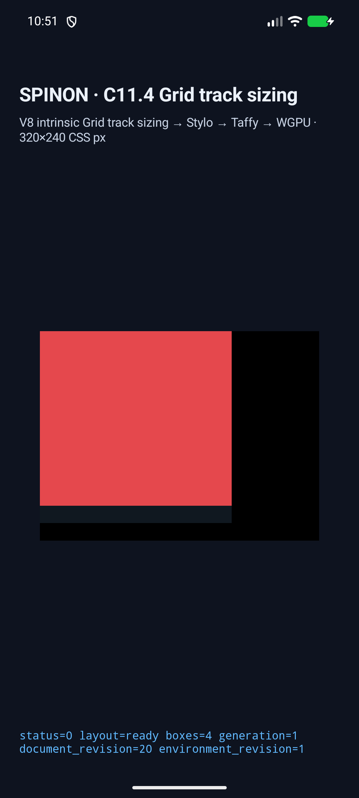
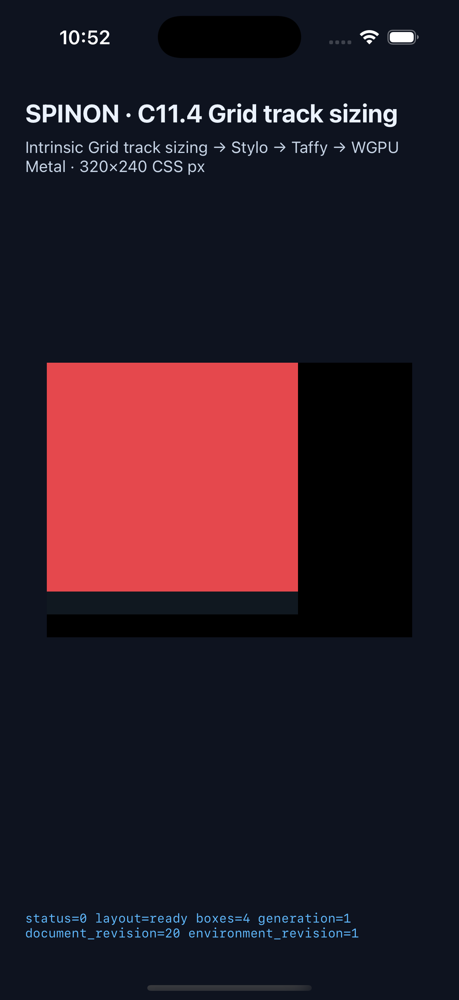

# C11.4 행 축 overlapping-span runtime slice

## 상태

실행 전 계획은 [행 축 runtime slice 계획](../../../../plan/c11-4-row-axis-overlapping-span-runtime.md), 계획 적대 검토는 [20개 관점 기록](../../../../plan/c11-4-row-axis-overlapping-span-runtime-plan-review-20.md), 입력 oracle은 [행 축 span 단계 사전 비교](../c11-4-row-axis-span-stage-precomparison-2026-10-27/README.md)에 있다.

구현 후 실제 코드·runtime 실패 관점을 새로 검토한 [20개 기록](implementation-runtime-review-20.md)과 이번 변경 전체의 [PR diff 검토 30개](pr-diff-review-30.md)를 함께 보관한다.

2026-10-27 최종 capture runner에서 Android API 37 ARM64 16 KB AVD와 iPhone 17 Pro/iOS 26.2 Simulator가 각각 네 scene 모두 통과했다. 미등록 scene과 C11.2.1 profile 충돌도 양 플랫폼에서 거부됐다. 실행마다 debug app을 현재 source로 빌드했고, V8 checkout은 요구 revision `7b50b62cb18f28617959e8452e2cd18195b38bcf`와 일치하며 빌드 전후 clean이었다.

```sh
node spec/internal/evidence/c11-4-row-axis-overlapping-span-runtime-2026-10-27/capture-row-axis-overlapping-spans.mjs android-avd emulator-5554
node spec/internal/evidence/c11-4-row-axis-overlapping-span-runtime-2026-10-27/capture-row-axis-overlapping-spans.mjs ios-simulator 9DCCE836-7659-4914-B6C1-13F54BFFA9DB
```

인자 뒤에 scene ID 하나를 추가하면 해당 scene만 실행한다. runner는 현재 source로 simulator app을 빌드하고 opt-in C11.4 fixture-test feature를 켠다. Android에서는 지정 AVD의 Spinon 앱만 force-stop한다. iOS에서는 실행 전에 simulator 상태를 기록하고, 이미 booted 상태였던 simulator는 유지한다. runner가 직접 boot한 대상만 종료한다.

## 확인할 행렬

각 플랫폼에서 다음 네 장면을 독립적으로 실행하며 manifest는 `runs/` 아래 생성한다.

| Scene | Rows span batch | 최종 Rows | Item DOM 순서 |
| --- | --- | --- | --- |
| `row-axis-span2-forward` | `[2]` | `[40,60,60,0]` | A → B |
| `row-axis-span2-reversed` | `[2]` | `[40,60,60,0]` | B → A |
| `row-axis-span2-before-span3` | `[2,3]` | `[160/3,220/3,220/3,0]` | A → B → C |
| `row-axis-span3-before-span2` | `[2,3]` | `[160/3,220/3,220/3,0]` | C → B → A |

Runner는 summary/status, 모든 node frame, trace chunk의 중복·누락 여부, Rows stage 순서와 각 stage track snapshot, Columns fixed-track control, source-order contribution 목록, `presented` marker를 재검사한다. Trace는 `1e-4 CSS px`, frame은 `1/64 CSS px` 허용오차를 사용한다. 두 플랫폼 모두 span-2-only 결과는 `[40,60,60,0]`, span-2/3 결과는 `[160/3,220/3,220/3,0]` Rows와 각각 6/9개 contribution을 기록했다. 모든 scene에서 root와 authored item의 전체 node frame을 검사했다.

## 최종 실행 근거

| 플랫폼 | 성공 run | 기기·화면 | 앱 artifact SHA-256 |
| --- | --- | --- | --- |
| Android | [`android-simulator.json`](runs/c114-row-axis-overlap-android-avd-20261027T015127780Z-405af06d/android-simulator.json) | `spinon_api37_1_compat16k`, API 37, ARM64, 16 KB, 1080×2400 | `f89d059e6a1f3b5c0c853549ee380308174bed48f7332df3ecb5f41442b1b126` |
| iOS | [`ios-simulator.json`](runs/c114-row-axis-overlap-ios-simulator-20261027T015150113Z-b9e17089/ios-simulator.json) | iPhone 17 Pro, iOS 26.2, 1206×2622 | `b3a255516597d43d4432342ea169a649ba20cca972586fb1f6f781cec660bc15` |

양쪽 manifest에는 두 negative route 입력, scene별 trace chunk 수, 전체 node frame, draw/present 결과, build log·artifact·screenshot hash가 있다. Android 앱만 force-stop했으며 AVD는 계속 booted 상태다. iOS는 이미 booted였던 지정 Simulator에서 Spinon 앱만 종료했고 iPhone과 별도 pilot Simulator의 boot 상태를 유지했다.

## 정적 FFI archive 경계

최종 Rust/Java/Swift source와 simulator evidence를 stage한 뒤 release configuration에서 product archive와 opt-in fixture positive control을 전체 빌드·비교했다. 이후 바뀐 것은 README, STATUS, 내부 계약, 검토 문서와 scanner report metadata뿐이며 archive 입력 source는 그대로다. 활성 디스크 정리와 새 빌드를 겹치지 않도록 archive 결과는 재사용하고 최종 staged diff SHA-256만 갱신했다. 전체 원장과 diff hash는 [`artifact-boundary.json`](artifact-boundary/artifact-boundary.json), 각 archive의 build log와 symbol 목록은 [최종 full-scan run](artifact-boundary/runs/artifact-boundary-20261027T020346Z-e39b6713/)에 있다. 정확한 staged diff SHA-256은 [`artifact-boundary.json`](artifact-boundary/artifact-boundary.json)에 기록한다.

| FFI feature | 정적 archive 크기 | scene marker | fixture ABI 문자열/정의 심볼 | candidate Rust source 심볼 | SHA-256 |
| --- | ---: | ---: | ---: | ---: | --- |
| `c04-runtime-gpu` | 75,138,808 bytes | 0/4 | 없음/없음 | 없음 | `7dd43b80990c9874732f141f1d060b2cd88c92935bdae088f63f237e86bded4e` |
| `c04-runtime-gpu-fixture-test,c11-grid-metal-surface-pixels-test` | 78,841,264 bytes | 4/4 | 있음/있음 | 있음 | `72a6521a5fb61c25e856a0b642525535bc2ded36dc1ec72a1f266cf076df5bc8` |

```sh
python3 spec/internal/evidence/c11-4-row-axis-overlapping-span-runtime-2026-10-27/artifact-boundary/scan-ffi-archives.py
```

이 검사는 macOS ARM64 `spinon-ffi` 정적 archive 두 개의 fixture marker와 ABI 심볼만 비교한다. Android APK, iOS app/IPA 또는 release bundle 전체에서 fixture가 제외됨을 증명하지 않는다.

대표 화면은 최종 실행의 span-2/3 장면이다. Screenshot은 보이는 UI와 배치 기록이며 pixel equality 또는 iOS compositor 이후 출력 검증을 뜻하지 않는다.





## 실패 실행과 수정

첫 Android 실행은 item B의 `grid-column:auto`가 겹치는 row placement를 피하려고 implicit column을 만들면서 `x=220`으로 이동해 앱 matcher와 캡처가 실패했다. [실패 run의 원본 로그와 assertion](runs/c114-row-axis-overlap-android-avd-20261027T013941805Z-181b6377/android-runtime-row-axis-span2-forward.log) 및 [`failure.json`](runs/c114-row-axis-overlap-android-avd-20261027T013941805Z-181b6377/failure.json)을 보존했다. runtime builder를 고정 HTML oracle와 같이 `grid-column:1 / 2`로 명시한 뒤 최종 두 플랫폼 matrix를 다시 통과했다.

실행은 제한된 opt-in fixture profile만 확인한다. 일반 author CSS admission, 전체 C11.4, WPT, 실기기/hardware GPU, Release APK/IPA exclusion 또는 pixel equality 근거로 확대하지 않는다. C11.4 checkbox와 공식 `72/213`은 미완료로 유지한다.

이 fixture는 일반 CSS 지원이나 전체 C11.4 완료 근거가 아니다. 공식 C11.4 상태와 완료 집계는 실행 뒤에도 별도 완료 요건을 충족하기 전까지 미완료로 유지한다.
