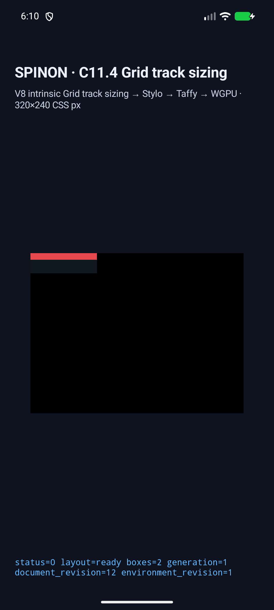

# C11.4 Ahem spanning auto-minimum flex text Android AVD 재검증

기존 [구현 PR #415](https://github.com/ohah/spinon/pull/415)의 `spanning-auto-min-flex-tracks` 한 장면을 Android 17/API 37 ARM64 AVD에서 다시 실행했다. Chrome 155의 고정 oracle과 통과 기준은 [C11.4 계획](https://github.com/ohah/spinon/blob/main/plan/c11-4-grid-track-sizing.md#2026-10-21-ahem-spanning-auto-minimum-flex-track-text-fixture)에 기록된 값을 사용한다. AVD 실행을 실기기 결과와 별도로 남긴다.

## 실행과 관찰

- source checkout: `2dd8b09b662c61042f3af3796f8ccf285316015d`; 기능 코드는 PR #415 merge commit `0ffd31b52a6da2f20dec65e9149448ac56e47c66`에 포함됐다.
- 대상: `emulator-5558`, Android 17/API 37, ARM64, `sdk_gphone64_arm64`.
- 빌드: `mise exec -- env SPINON_ENABLE_C04_RUNTIME_GPU=1 SPINON_ENABLE_C04_RUNTIME_GPU_FIXTURE_TEST=1 bun run build:android` 성공. Android Gradle Plugin의 compile SDK 37.2 버전 권고가 출력됐지만 빌드에는 실패가 없었다.
- focused regression: `mise exec -- cargo test -p spinon-runtime --features c11-4-grid-track-sizing-fixture-test c114_spanning_auto_min_flex_text_keeps_tracks_at_half_width` — 1 passed.
- 실행: `mise exec -- bun tools/css-reference/capture-c11-4-auto-repeat-neighbors-simulator.mjs android-avd emulator-5558 --scene-id=spanning-auto-min-flex-tracks --run-kind=spanning-auto-min-flex-avd-recheck --evidence-group=c11-4-spanning-auto-min-flex-avd-recheck` — scene 1/1 passed.
- 기대·관찰: columns `48/48px`, root `100×30px`, item `100×10px`, track trace 6 chunks, `drawPresented=true`, superseded retries 0.
- 설치된 `base.apk` SHA-256과 local APK SHA-256이 모두 `b8f02254392a35766ff83bc50ac54479a0b54de7a857582ea7eb177b2ca6f355`로 일치했다.
- source revision, AVD·APK 식별값과 관찰 결과는 `source-revision.json`에, 원본 파일 digest는 `SHA256SUMS.txt`에 있다.

## 화면과 범위

화면과 runtime log는 Grid/item box frame, track 결과, trace 및 draw/present를 보여준다. Ahem 문자의 glyph paint나 200px text overflow의 화면 픽셀은 확인하지 않았고 PixelCopy 표본도 수집하지 않았다. Chrome `scrollWidth=200`은 독립 oracle 값이며 Spinon 화면에서 이 overflow가 그려졌다는 주장이 아니다. 이번 실행은 Android AVD 한 대의 보충 결과로, Android 실기기·다른 AVD·WPT·전체 C11.4 검증을 대신하지 않는다.

C11.4 체크와 공식 완료 수 72/213은 변경하지 않는다. 원본 실행 파일은 같은 디렉터리의 `android-avd-c114-spanning-auto-min-flex-avd-recheck-android-avd-20261021T091026603Z-21ddb7ba/`에 있고, PR 변경분은 [적대적 검토 30개](./pr-diff-review-30.md)에 기록했다. PR #438 본문 이미지 로드와 브라우저 종료는 `pr438-image-agent-browser.json`, `browser-close.json`에 기록했다.
