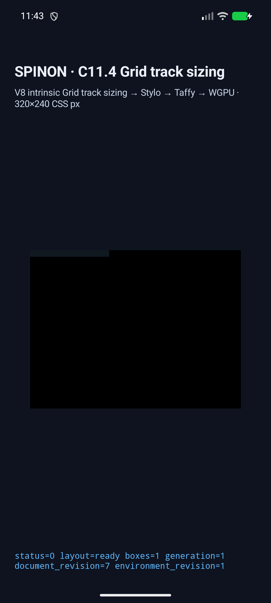
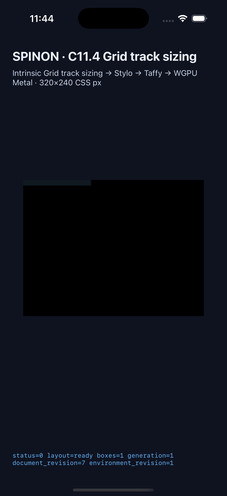

# C11.4 full computed `tab-size` value runtime evidence

This is an implementation candidate for the opt-in anonymous Grid text fixture. It does not complete C11.4 or C11. The official implementation count remains `72/213`.

## Simulator matrices

The matrix uses the 14 computed values and 10 positive text/layout cases per value from the pinned [expected values](../c11-4-pre-tab-size-values-precomparison-2026-10-31/expected-values.json): 140 positive scenes per platform. Each scene checks the expected computed value, complete runtime trace, `layout=ready`, line advances, item/root frame, Grid track contribution, GPU draw/present, and absence of retry.

| Target | Result | Runtime |
| --- | --- | --- |
| Android API 37 ARM64 16 KB AVD | 140/140 positive, 0 rejected, 0 retries | [result](c114-tab-values-20261031023230658-60542c3b/android-avd/result.json) · [device and APK hashes](c114-tab-values-20261031023230658-60542c3b/android-avd/simulator.json) |
| iPhone 17 Pro, iOS 26.2 Simulator | 140/140 positive, 0 rejected, 0 retries | [result](c114-tab-values-20261031023846353-9422eb91/ios-simulator/result.json) · [device and executable hashes](c114-tab-values-20261031023846353-9422eb91/ios-simulator/simulator.json) |

Both complete matrices used source HEAD `e3ec8a24b2ff463519dc79968f4cbba35d1226e3`. The Android local and installed APK hashes match (`82e6a7681e383cbf9217d20b454d33bdd9d6b40069e5e984c41748450ca80dee`). The iOS local and installed executable hashes match (`4101e1f5c9bcc03e779b17e33e295e56e6c0f477ea98d39a2f92f046c502d4d7`). Per-scene launch output and runtime logs are retained beside each result.

## Representative simulator captures

The captures below come from a separate one-scene run of `anonymous-pre-tab-value-number-three-and-quarter-after-two` on the same source and app binaries. They show the fixture route and its status/present state. The black render surface is not a glyph screenshot and does not establish text-pixel equality.

The screenshot run is recorded in [Android](c114-tab-values-20261031024357017-869b04d0/android-avd/result.json) and [iOS](c114-tab-values-20261031024357017-869b04d0/ios-simulator/result.json); each ran the representative scene once with no rejection or retry.

## Focused implementation checks

The candidate's focused checks passed: `spinon-text-layout` 70 tests, `spinon-layout` 315 tests, anonymous-text runtime tests 9/9, the FFI full-value matrix test 1/1, Android app build, iOS Simulator app build, and Rust formatting. The successful simulator matrices above validate the native app route against all 140 expected positive scenes per platform.

The [implementation/runtime failure review (20 cases)](implementation-runtime-review-20.md) and separate [implementation PR diff review (30 cases)](pr-diff-review-30.md) are complete. [Post-merge status review (30 checks)](post-merge-status-review-30.md) confirms PR #893 merged without reported CI checks and that official C11.4/C11 status remains unchanged. The follow-up status-only change has a separate [PR diff review (30 checks)](status-sync-pr-diff-review-30.md). The fixture boundary test passed 24/24. A default `spinon-ffi` static archive build contained no full-tab fixture markers; the `c04-runtime-gpu-fixture-test` opt-in archive contained the C11.4 fixture symbol and fixed scene IDs. Commands and the `nm` reader limitation are recorded in [artifact boundary evidence](artifact-boundary.txt). The raw `.log` captures remain unchanged; the local `.gitattributes` only excludes their device-generated trailing spaces from whitespace checks.

## Failed attempt retained

The earlier API 37.0 AVD attempt is retained for diagnosis at [ANR dump](c114-tab-values-20261031022520703-dbaa1149/avd-recovery/system-server-anr.txt), with its [failure record](c114-tab-values-20261031022520703-dbaa1149/failure.json). Android `system_server` stalled while waiting for SurfaceFlinger during display-manager bootstrap; that AVD was stopped and not repaired by deleting snapshots or lock files. The successful Android matrix used the separate API 37.1 16 KB AVD listed above.

An extra full-matrix launch caused by a mistaken Bun command-line option was terminated after Android had logged progress through 20/140 scenes. Its partial logs are retained in [run `c114-tab-values-20261031024903777-645c3d62`](c114-tab-values-20261031024903777-645c3d62); it has no result summary, did not run iOS, and is not counted as validation.

## Limits

- Android ran on an ARM64 QEMU AVD using the software graphics path; this is not physical-device or hardware-GPU evidence.
- iOS evidence checks the Simulator app route and drawable submission before the OS compositor; it does not prove post-compositor output.
- The screenshots do not show glyph ink. Glyph rasterization equality, physical devices, hardware GPUs, general CSS admission, public API support, full WPT conformance, full C11.4, and C11 remain unverified.
- The implementation/runtime review 20 and separate PR diff review 30 are complete. Implementation PR [#893](https://github.com/ohah/spinon/pull/893) was Rebase merged at `2026-10-31T02:54:29Z` (`ae292fff135a925ef30a3e2437082e96c2386e9c`). GitHub reported no check runs, and required main checks were not enabled; this is not a CI pass. Do not promote this evidence to an official completion checkbox.
