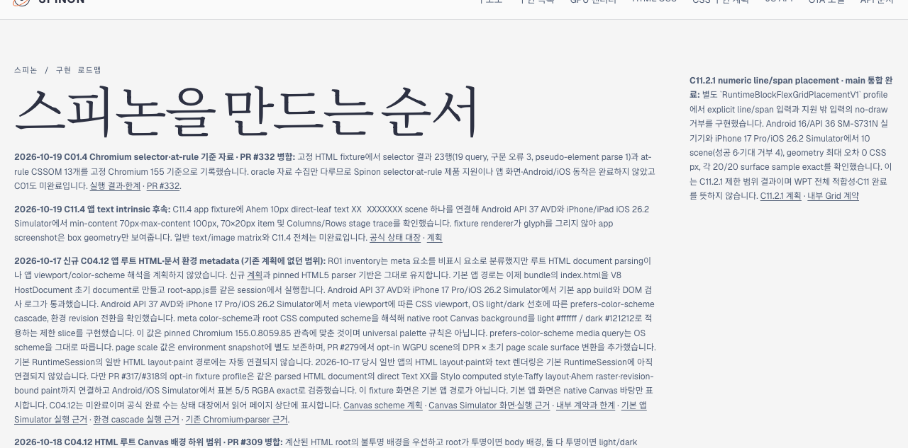
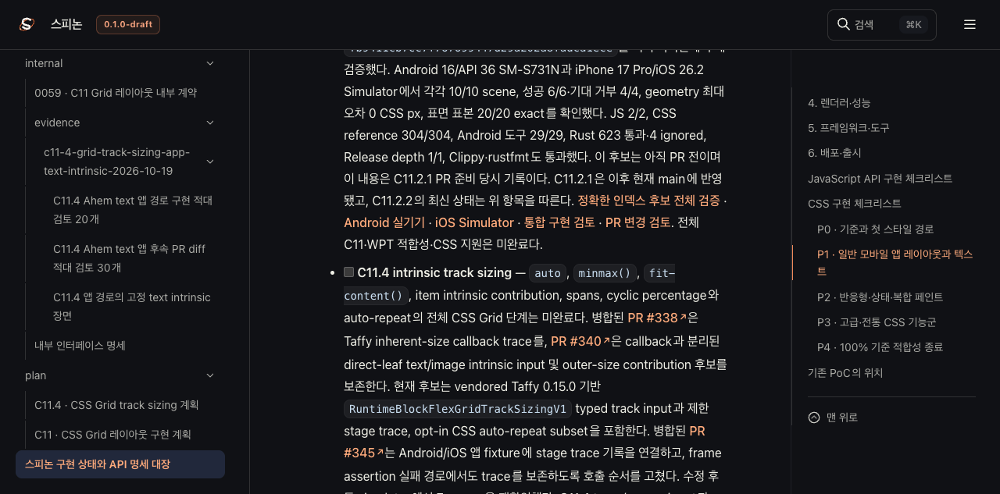
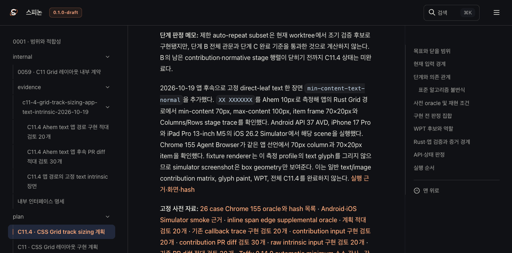

# C11.4 PR #347 뒤 Tailnet 미리보기 동기화

**기준 원본:** `7e552f2d23abeddf405c29a11060dadb19d67bb3` (PR #347 병합 뒤 `main`) 
**범위:** 선택 Rspress 빌드 결과를 기존 Tailnet 미리보기 루트에 정적으로 복사했다. 기존 listener는 유지했다.

## 동기화 결과

- 사전 목록은 80개 경로와 4,762,311 byte를 포함했다. 54개를 새로 만들고, 기존 12개를 교체하고, 동일한 14개는 그대로 뒀다. 삭제는 없었다.
- 교체한 12개 파일은 전용 backup 경로에 각각 보존했고, 백업 SHA-256이 원본과 모두 일치했다.
- 미리보기 listener가 제공한 80개 응답은 HTTP 200, byte 수, SHA-256이 소스 파일과 모두 일치했다. [사전 목록](preflight.json), [복사 확인](copy-verification.json), [백업 확인](backup-verification.json), [제공 응답 확인](served-verification.json)에 경로별 결과가 있다.
- 주요 갱신 화면은 `/spinon/roadmap.html`, `/spinon/STATUS.html`, `/spinon/plan/c11-4-grid-track-sizing.html`이다. 내부 계약·근거 문서와 선택된 공용 자산은 같은 사전 목록에 기록했다.
- 이 동기화 근거를 내부 문서 색인에 추가한 뒤 색인과 근거 페이지를 pass-2로 Tailnet에 반영했다. pass-2는 21개 경로(19개 생성, 2개 교체)였고 삭제 없이 21/21 HTTP 200 및 byte·SHA-256 일치다.
- Agent Browser에서 새 근거 페이지가 참조하는 Rspress 정적 자산을 확인해 7개 hashed JS/search 파일이 기존 preview에 없음을 찾았다. pass-3에서는 이 7개를 생성하고 근거 페이지·검토·해시·빌드 로그 6개 파일을 백업 후 교체했다. 총 13개 경로(7개 생성, 6개 교체)를 삭제 없이 갱신했고 13/13 HTTP 200 및 byte·SHA-256 일치를 확인했다.

## 빌드와 브라우저 확인

RSPress 2.0.22로 선택된 문서 집합만 빌드했다. 전체 문서 빌드는 수행하지 않았고, 선택 빌드에서 dead link/image 검사는 꺼져 있었다. GitHub Pages 배포도 하지 않았다. 빌드 로그는 [초기 CLI 경로 실패](selected-build.log), [재시도](selected-build-retry.log), [최초 최종 빌드](selected-build-final.log), [색인·근거 페이지 후속 빌드](selected-build-index-followup.log)에 남겼다. 실패 로그의 사용자 계정 경로는 가렸다.

Agent Browser에서 업데이트된 Tailnet 화면 세 곳을 열어 문구와 상태를 확인했다. 로드맵은 C11.4 앱 후속 범위와 남은 한계를 표시한다. 상태 대장의 C11.4 intrinsic track sizing은 체크되지 않았다. 계획은 새 Ahem direct-leaf text 장면의 측정값과 glyph paint 미검증 경계를 기록한다.

화면 파일의 SHA-256은 [해시 목록](SHA256SUMS)에 기록했다. 브라우저 세션은 확인이 끝난 뒤 닫았다. Terminal Browser는 사용하지 않았다.

## 범위의 한계

이는 정적 문서 미리보기 동기화다. Android AVD나 iOS Simulator 앱을 이 동기화에서 실행하지 않았으며, 화면 세 장은 문서가 제공되는지 확인한 근거다. 앱 실행 결과는 병합된 PR #347의 별도 근거를 따른다. C11.4와 상위 CSS Grid 범위는 미완료이며, 여기서 완료 개수를 늘리지 않았다.

## 검토

[PR 변경 적대 검토 30개](pr-delta-review-30.md)
