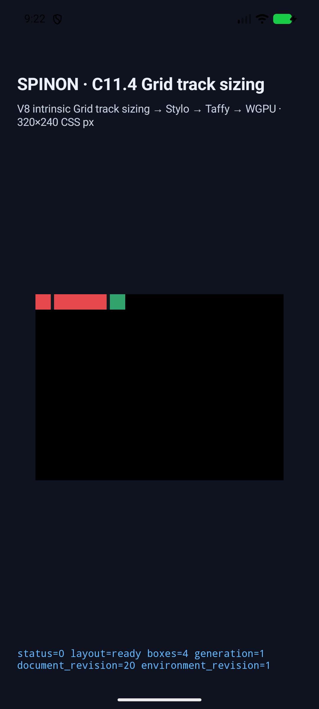
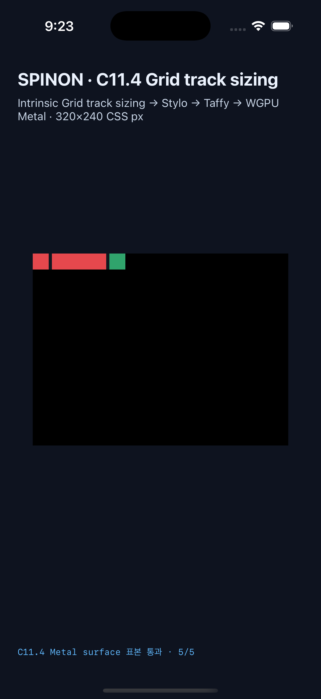

# C11.4 auto-repeat + template areas 제한 runtime 근거

이 실행은 `RuntimeBlockFlexGridTrackSizingV1`의 한 축 auto-repeat과 `grid-template-areas` 결합만 확인한다. 공개 CSS admission, WPT 적합성 또는 전체 CSS Grid 구현 완료를 뜻하지 않는다. 기준 CSS/Chrome 156/규범 비교는 [사전 비교](../c11-4-template-area-auto-repeat-2026-10-23/README.md)에 있다.

## 대상과 결과

| 대상 | 빌드/기기 | scene | surface 표본 | 결과 |
| --- | --- | ---: | ---: | --- |
| Android | API 37 ARM64 AVD `emulator-5558`, `sdk_gphone64_arm64` | 13/13 | PixelCopy 66/66 exact | 통과 |
| iOS | iPhone 17 Pro, iOS 26.2 Simulator `ACA7BF91-E2D5-4CF7-909A-08D1AD95FF3D` | 13/13 | Metal drawable 66/66 exact | 통과 |

각 scene은 전체 node frame, active-axis used tracks와 auto-fit collapsed state, stage trace 및 draw/present를 확인한다. 두 플랫폼 frame과 used track은 [교차 비교 JSON](./cross-platform-comparison.json)에서 scene별 exact match다. 표본은 root/gutter, 각 item 중심, root 바깥 clear를 사용한다. `area-larger`의 green suffix 표본은 100 CSS px root 끝을 넘어 그려지는 색을 확인한다. Android AVD는 simulator software path이고 iOS 표본은 compositor 제출 전 drawable이다.

| platform | `columns-area-larger` 화면 |
| --- | --- |
| Android API 37 AVD |  |
| iPhone 17 Pro Simulator |  |

## 입력 행렬

13개 scene은 양 축의 `auto-fill`/`auto-fit`, expanded track보다 짧거나 긴 area dimension, authored/area alias 충돌, 반복 track에 in-flow item이 없는 area, numeric no-area control을 포함한다. `auto-fit`의 expected suffix 위치는 CSS Grid 규범의 gutter collapse 결과인 44px / 20px를 쓴다. Chrome 156의 48px / 24px 관측은 진단값으로만 보존한다.

현재 runtime CSS parser는 `visibility:hidden`을 지원하지 않는다. 따라서 alias 충돌 probe는 겹친 hero와 같은 빨간색으로 표시한다. 해당 node frame과 track trace는 검사하지만, visibility cascade 동작은 검증하지 않는다.

## Build와 artifact 경계

- Android app SHA-256: `c468bc71bc4422a6b2c87d495cf9b5cb6b6b2a9537372b0d447c494d90ca5bcb`; installed APK hash matches.
- iOS Simulator app SHA-256: `1c2a0bd3096088632f74788120461c299a3c8bd7477b009646154e851cb2bfbe`.
- Base commit: `3df7fe704fe253e5edcc4946ed215e33dc2e935e`. Simulator capture metadata also records tracked diff hash `915cea94331bbd621b3e7a4f19b6dac1c6e6a974ab7d24ede80b7c8b698cedea`. New, untracked fixture/module inputs are bound by [source file hash manifest](./source-files-manifest.json).
- Default `c04-runtime-gpu` FFI release archive: 75,100,928 bytes, SHA-256 `506327961f393de231410a21b8258a2f58d59932f3d5665a730cfe0dfad40351`; scene marker and module symbol absent.
- `c04-runtime-gpu-fixture-test` positive control archive: 78,104,560 bytes, SHA-256 `951c05636840a53b7a6785fa575e2ea75adec77f8b8da2e652c76d5b3cf6a818`; scene marker and module symbol present.
- Archive symbol inspection used Rust 1.96 / LLVM 22.1.2 `llvm-nm`. This proves the FFI static archive boundary only, not final APK/IPA exclusion.
- `cargo fmt --all -- --check`, workspace all-target Clippy `-D warnings`, focused Rust tests, fixture-boundary Node tests and Android/iOS Simulator app builds passed. Android reports the configured AGP/compile SDK compatibility warning; Xcode reports non-fatal duplicate V8 debug-map/symbol warnings and completes successfully.

The focused Rust test totals are `spinon-layout` 238, `spinon-style-to-layout` 192 and `spinon-style` 221 passed; the opt-in FFI scene validator passed. The fixture module boundary Node test passed 6/6. Logs, app hashes and archive records are in this directory. Per-run runtime JSON, original logs and 26 PNG screenshots are in the two simulator run directories. [Screenshot SHA-256 manifest](./screenshot-manifest.json).

## 한계

Android 실기기, Android hardware GPU, iOS 실기기, compositor 이후 iOS 픽셀, CSS border stroke, 일반 CSS 지원 또는 WPT 결과를 주장하지 않는다. Taffy 0.15.0 내부 allocation의 전역 OOM 복구를 보장하지 않는다. 고정 runtime parser/fixture 경로는 일반 HTML/CSS 파싱 동작을 입증하지 않는다. 이 실행 기록 당시 공식 집계는 `77/213`이었고 현재 공식 집계는 `72/213`이다. C11.4는 미완료이며 내부 계약 `0059`의 numeric version은 `0.1.0`으로 유지한다.

## 원본 근거

- [Android final result](../c11-4-template-area-auto-repeat-2026-10-23/android-avd-c114-template-area-repeat-android-avd-20261023T002240504Z-8c091e78/result.json) · [Android simulator metadata](../c11-4-template-area-auto-repeat-2026-10-23/android-avd-c114-template-area-repeat-android-avd-20261023T002240504Z-8c091e78/simulator.json)
- [iOS final result](../c11-4-template-area-auto-repeat-2026-10-23/ios-simulator-c114-template-area-repeat-ios-simulator-20261023T002340216Z-ea7c6290/result.json) · [iOS simulator metadata](../c11-4-template-area-auto-repeat-2026-10-23/ios-simulator-c114-template-area-repeat-ios-simulator-20261023T002340216Z-ea7c6290/simulator.json)
- [Android build](./android-build-final.log) · [Android scene capture](./android-capture-final.log)
- [iOS build](./ios-build-final.log) · [iOS scene capture](./ios-capture-final.log)
- [Focused Rust tests](./focused-rust-tests-final.log) · [FFI fixture test](./ffi-fixture-test-final.log) · [fixture module boundary 6/6](./fixture-module-boundary-final.log) · [cargo fmt](./cargo-fmt-final.log) · [workspace Clippy](./workspace-clippy-final.log)
- [Default archive](./ffi-product-archive.json) · [fixture-test archive](./ffi-fixture-archive.json)
- [Plan](../../../../plan/c11-4-auto-repeat-template-areas.md) · [Internal contract 0059](../../0059-c11-grid-layout.md)
