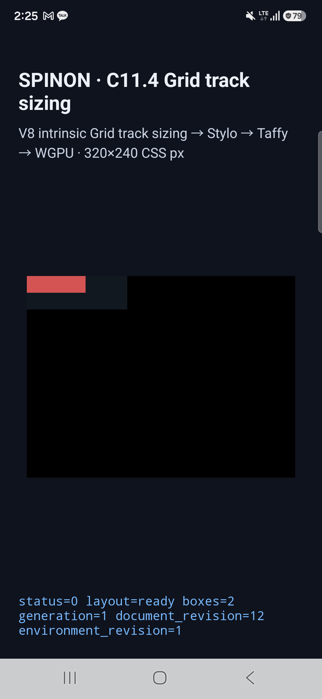
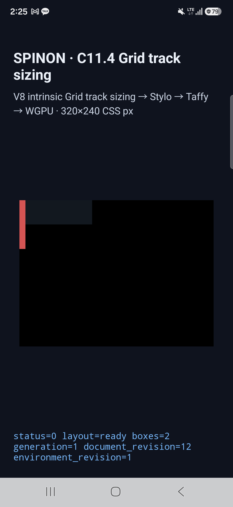

# C11.4 text intrinsic matrix · Android 실기기

## 범위와 판정 기준

2026-10-21 `origin/main` (`f086e54519647d51fd44c205b18fb9436099218c`)의 opt-in C11.4 fixture APK를 Samsung SM-S731N 실기기에 설치해 기존 고정 Ahem direct-leaf text 10개 scene을 재실행했다. 기준은 [C11.4 text intrinsic matrix의 Chrome 155 비교값](../c11-4-text-intrinsic-matrix-2026-10-19/README.md)과 해당 scene의 `x/y/width/height`다. 허용치는 각 frame scalar에서 1/64 CSS px다.

각 scene에서 다음을 확인했다.

- 루트와 item의 전체 node frame이 고정 root/item 기대값과 일치한다.
- runtime summary가 `status=0 layout=ready boxes=2`이고 text intrinsic 입력에 `fontRegistryRevision=1`을 기록한다.
- Columns와 Rows trace chunk가 누락·중복 없이 재조립되고 JSON으로 해석된다.
- Android SurfaceView의 `SPINON_C0410_DRAW status=0 presented`가 기록된다.

| scene | root frame (CSS px) | item frame (CSS px) | 결과 |
| --- | --- | --- | --- |
| `auto-text-max-content` | 120×40 | 100×10 | 통과 |
| `min-content-text-normal` | 120×40 | 70×20 | 통과 |
| `max-content-text-normal` | 120×40 | 100×10 | 통과 |
| `fit-content-text-minimum` | 120×40 | 70×20 | 통과 |
| `fit-content-calc-limit` | 100×120 | 15×80 | 통과 |
| `min-content-text-edge` | 120×50 | 80×20 | 통과 |
| `min-content-text-min-width` | 120×50 | 90×20 | 통과 |
| `min-content-text-max-width` | 120×50 | 40×20 | 통과 |
| `min-content-text-break-all` | 120×40 | 10×80 | 통과 |
| `min-content-text-nowrap` | 120×40 | 100×10 | 통과 |

전체 결과는 10/10 통과, frame 최대 차이는 0 CSS px다. 원본 runtime log는 `runtime-<scene>.log`, 개별 실행 입력은 `launch-<scene>.log`, 기기·APK 정보는 `device.txt`, machine-readable 결과는 `result.json`에 있다.

## 기기와 APK

- 기기: Samsung `SM-S731N`, Android 16/API 36, 1080×2340, density 450, `ro.kernel.qemu=0`.
- SurfaceFlinger renderer: Samsung Xclipse 940 위 ANGLE/Vulkan 1.3.279, OpenGL ES 3.2.
- 빌드: `mise exec -- env SPINON_ENABLE_C04_RUNTIME_GPU=1 SPINON_ENABLE_C04_RUNTIME_GPU_FIXTURE_TEST=1 bun run build:android` — 성공. 전체 출력은 `build.log`.
- 설치 APK SHA-256: `191f7457528f8691c3d0d03b1d8b28887a7172939a077b80e4d4b79fe4625224`. 로컬 assemble APK와 기기 `base.apk`의 SHA-256이 같다.

화면 캡처에는 기본 `min-content-text-normal` item과 세로 overflow가 있는 `min-content-text-break-all` item이 보인다. 이 fixture renderer는 text glyph를 그리지 않는다. 캡처는 box geometry와 앱의 runtime status 표시를 보여주며 글꼴 잉크·typography를 증명하지 않는다. 화면 캡처에 대한 표본별 색상 비교나 OS compositor 이후 픽셀 정확도 검사는 하지 않았다.





## 재현 명령

```sh
mise exec -- env SPINON_ENABLE_C04_RUNTIME_GPU=1 SPINON_ENABLE_C04_RUNTIME_GPU_FIXTURE_TEST=1 bun run build:android
adb -s R5KYB06SMPE install -r platforms/android/app/build/outputs/apk/debug/app-debug.apk
adb -s R5KYB06SMPE shell am start -W -n dev.spinon.bootstrap/.MainActivity \
  --ez spinon_c114_grid_track_sizing true \
  --es spinon_c114_grid_scene min-content-text-normal \
  --es spinon_c114_grid_run_id physc114-text-1792517104641-02
adb -s R5KYB06SMPE logcat -d -v raw -s SpinonBootstrap:I
```

scene별 실제 run ID와 logcat 기록은 `result.json`과 `runtime-<scene>.log`에 보존했다. build와 capture 근거의 SHA-256 목록은 `SHA256SUMS.txt`에 있다.

## 한계와 공식 상태

이번 후속은 이미 구현된 내부 fixture의 실기기 재검증이며 Rust·앱 코드나 버전 있는 CSS 계약은 바꾸지 않았다. 다른 Android 기기, Android API 37 emulator와의 차이 전체, 일반 font/script, nested·anonymous item, text glyph paint, image contribution, WPT, 전체 CSS Grid는 검증하지 않았다. [C11.4 상태](../../../STATUS.md)의 체크와 공식 완료 수는 변경하지 않는다.

실기기 실행의 [독립 실패 관점 검토 20개](./physical-evidence-review-20.md)를 기록했다.

이 문서·실행 결과 변경의 [PR diff 검토 30개](./pr-diff-review-30.md)를 별도로 기록했다.

## 문서 빌드 경계

전체 RSPress build는 임시 config에서 dead-link 검사만 끈 뒤에도 완료되지 않았다. 현재 저장소의 기존 dead image 경로, Shiki `rust,ignore` 언어 번들 누락과 다른 문서의 이미지 resolve 오류가 남아 있으며 자세한 실패는 `docs-build.log`에 보존했다. 최신 시도에서 이 새 evidence route를 가리키는 dead-link 오류는 없었다. 이 실패를 전체 문서 사이트 build 성공으로 취급하지 않는다.
