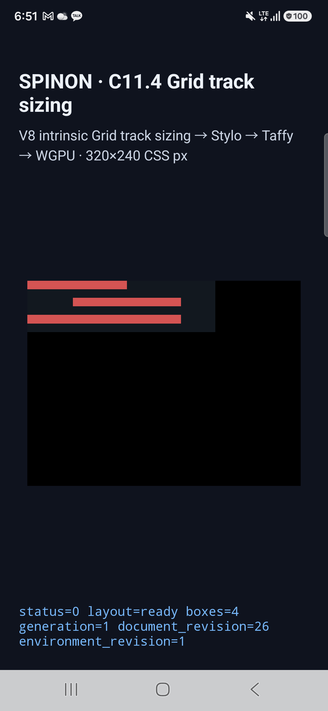

# C11.4 direct-leaf text multi-span 실행 근거

## 검증 대상

Chrome 155 사전 oracle에서 고정한 네 direct-leaf text 장면을 `RuntimeBlockFlexGridTrackSizingV1` fixture로 실행했다. 두 span-2 item의 forward/reversed DOM 순서와 span-2/span-3 순서를 뒤집은 경우를 포함한다. 독립 기대 Columns는 span-2 matrix `[25, 35, 35, 0]`, 복합 matrix `[53⅓, 63⅓, 63⅓, 0]` CSS px다. 각 장면에서 intrinsic text input, span stage, contribution trace, 모든 node frame, draw/present를 비교했다.

## 최종 앱 실행

| 대상 | 기기/버전 | 결과 | 실행 근거 |
|---|---|---:|---|
| Android 실기기 | Samsung SM-S731N, Android 16/API 36, arm64-v8a, 1080×2340, density 450, Xclipse 940/ANGLE over Vulkan | 4/4 (최신 재실행) | [device.json](./android-device-c114-text-multispan-contributions-android-device-20261020T215102621Z-daee998f/device.json), [result.json](./android-device-c114-text-multispan-contributions-android-device-20261020T215102621Z-daee998f/result.json), [installed-apk-verification.json](./android-device-c114-text-multispan-contributions-android-device-20261020T215102621Z-daee998f/installed-apk-verification.json) |
| Android AVD | ARM64 API 37, `emulator-5554`, QEMU | 4/4 | `android-avd-c114-text-multispan-contributions-android-avd-20261020T212853774Z-2a625474/simulator.json`, `result.json` |
| iOS Simulator | iPhone 17 Pro, iOS 26.2 | 4/4 | `ios-simulator-c114-text-multispan-contributions-ios-simulator-20261020T212856853Z-a54892a3/simulator.json`, `result.json` |

사용자가 Android 실기기 연결을 확인한 뒤 같은 APK를 `R5KYB06SMPE`에 재설치해 네 장면을 다시 실행했다. 최신 `result.json`에서 네 장면의 track, 전체 node frame, trace chunk, draw/present가 모두 통과했다. 설치 전 APK와 `/data/app/.../base.apk` SHA-256은 모두 `700db4024be649037da902c67370587ec80ee543145caee2fb16278bf8e2439c`다. 아래 빨간 영역은 CSS item box이며, 로그에 `runtime_text_count=0`, `glyph_batch_draw_count=0`으로 기록됐다. 글리프 paint는 범위 밖이다.

네 장면 모두 root frame `220×60px`과 node 순서가 예상값과 일치했다. span-2 순서 비교 track은 `[25, 35, 35, 0]`이며, span-2/3 조합은 `[53.333335876464844, 63.333335876464844, 63.333335876464844, 0]`이다. 허용 오차는 1/64 CSS px다. 최종 Android 실기기 APK와 기기 설치본의 SHA-256은 `700db4024be649037da902c67370587ec80ee543145caee2fb16278bf8e2439c`로 일치했다. 같은 APK가 API 37 AVD에서도 실행됐다.

## 빌드와 코드 검사

- Android fixture app: `mise exec -- env SPINON_ENABLE_C04_RUNTIME_GPU=1 SPINON_ENABLE_C04_RUNTIME_GPU_FIXTURE_TEST=1 SPINON_ENABLE_C11_GRID_METAL_SURFACE_PIXELS_TEST=1 bun run build:android` — 성공.
- iOS Simulator fixture app: 같은 환경 변수로 `bun run build:ios-sim` — 성공, iOS 26.2 SDK. 기존 V8 debug-map 및 duplicate-symbol 경고가 있었고 build는 성공했다.
- Runtime feature tests: `mise exec -- cargo test --locked -p spinon-runtime --features c11-4-grid-track-sizing-fixture-test` — 191 passed, 3 ignored.
- FFI fixture tests: `mise exec -- cargo test --locked -p spinon-ffi --features c04-runtime-gpu-fixture-test` — 62 passed, 2 ignored.
- Workspace Clippy: `mise exec -- cargo clippy --locked --workspace --all-targets -- -D warnings` — 성공.
- Format: `mise exec -- cargo fmt --all -- --check` — 성공.
- Fixture feature/build flag 검사: `mise exec -- bun test tools/css-reference/fixture-module-boundary.test.mjs tools/css-reference/c11-ios-build-flags.test.mjs` — 19 passed.
- Capture runner 문법: `mise exec -- node --check tools/css-reference/capture-c11-4-auto-repeat-neighbors-simulator.mjs` — 성공.
- 기본 `spinon-ffi` rlib은 scene 문자열을 포함하지 않았고, `c04-runtime-gpu-fixture-test` positive control은 포함했다. [artifact boundary 기록](./artifact-boundary.md). 이 검사는 host debug `.rlib`의 fixture 소스 격리를 확인하며 최종 release 앱 크기를 나타내지 않는다.

## 검토와 실행 이력

- 구현/runtime의 독립 실패 관점 20개를 검토했다. `row_end == Auto` 검증, root min/max/flex 제약, auto-flow/implicit track 검증 누락을 발견해 보완했다. 보완 후 Rust test와 세 플랫폼 앱을 다시 빌드하고 4/4 matrix를 재실행했다. [구현/runtime 검토 20개](./implementation-review-20.md).
- 초기 캡처는 MinContent contribution 질의가 한 번이라고 예상해 runner assertion에서 실패했다. 런타임 로그에는 sizing의 두 phase에서 같은 item 질의가 두 번 기록되어 있었다. 비교기를 실제 trace에 맞게 고친 후 네 scene을 재실행했다. 실패 실행은 아래 `20261020T212122714Z-8c79a563` 디렉터리에 보존했다. 이는 런타임 layout 실패가 아니며, 성공 결과로 계산하지 않았다.
- 구현 전 계획 검토 20개와 계획 PR diff 검토 30개는 [Chrome 사전 비교 evidence](../c11-4-text-multispan-precomparison-2026-10-21/README.md)에 있다. 작업 계획 PR #407은 병합되어 base commit `23b9db30c7d71db881c315e2f2110893380c2f29`에 포함됐다. 그 PR에는 check rollup이 없었으므로 CI 통과로 주장하지 않는다.
- 구현 PR #408의 diff 적대 검토 30개를 [기록](./pr-diff-review-30.md)했고 rebase merge SHA `4b7282116c0aeab12ba10edeae51fcf7f7bb3a33`으로 병합했다. GitHub PR 화면과 `gh pr checks --required`에 check 결과가 없어 CI 통과로 주장하지 않는다.

## 한계와 공식 상태

이 fixture는 고정 문자열, Ahem 10px, direct leaf `
` item, 네 scene과 `min-content` column으로 제한된다. 일반 font/script, 여러 text node, nested/anonymous item, glyph paint, WPT, iOS 실기기, OS compositor 이후 픽셀은 검증하지 않는다. Android screenshot은 surface가 화면에 표시된 모습이고, 앱 runtime의 geometry/draw marker가 기준이다.

C11.4 전체, 공개 CSS Grid 지원, 내부 계약 버전은 변경하지 않았다. `spec/STATUS.md`의 C11.4 checkbox와 공식 완료 수는 그대로 둔다. Android 실기기 검증은 단일 기기의 fixture 동작이며 iOS 실기기, glyph paint, WPT, compositor 이후 픽셀은 미검증이다.
