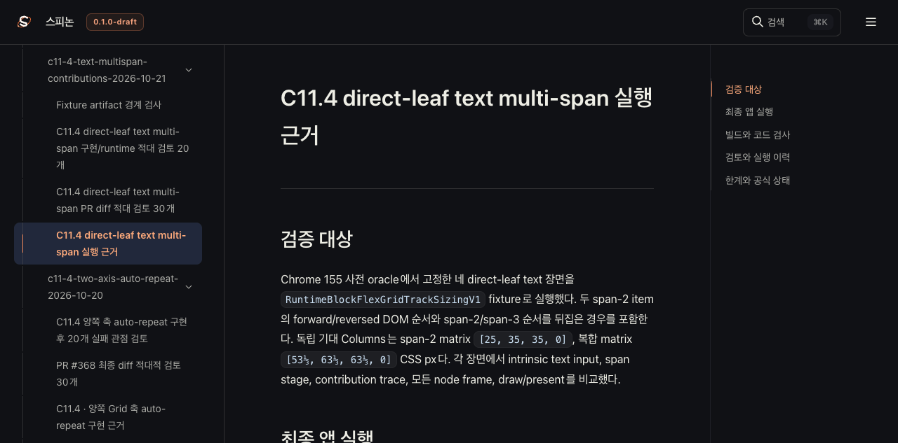
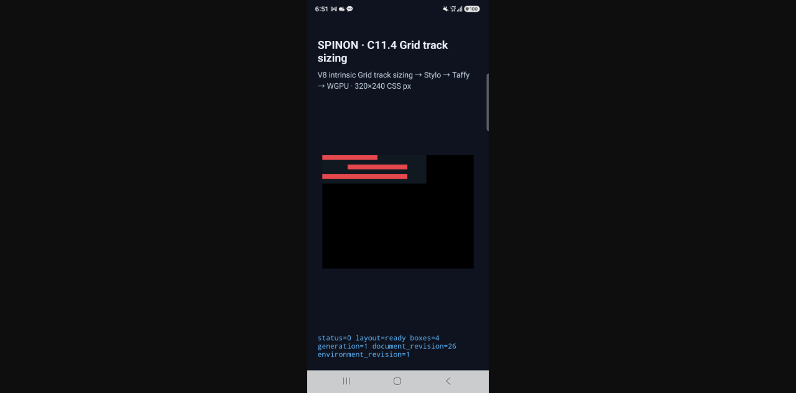

# C11.4 최신 Android 실기기 결과 Tailnet 미리보기 동기화

## pass28 최종 확인

2026-10-21에 기존 미리보기 서버가 제공하는 정적 디렉터리에 선택 RSPress 빌드 결과를 동기화했다. 서버 PID `1191`과 `127.0.0.1:8768` listener는 유지했다. 공개 경로는 `https://macstudio.tailed42f2.ts.net/spinon/`이다.

선택 빌드는 `packages/docs`에서 다음 명령으로 만들었다.

```sh
mise exec -- bun run docs:build -- --config ../../spec/internal/evidence/c11-4-text-multispan-tailnet-preview-2026-10-21/rspress-pass28.config.ts
```

RSPress 선택 빌드는 성공했다. 산출물 1,735개, 73,954,202 bytes를 대상으로 preflight를 고정했다. 기존 파일 96개 교체 전에 같은 상대 경로로 백업했고, 백업 크기 합계는 9,119,548 bytes다. 최종 로컬 검증에서 빌드 파일 1,735/1,735와 백업 96/96의 크기·SHA-256이 일치했다. 새 파일 99개, 교체 파일 96개, 동일 파일 1,540개였고 삭제는 없었다.

Tailnet URL을 대상으로 한 원격 검증은 HTTP 200 1,735/1,735, SHA-256 일치 1,735/1,735, 실패 0건이다. 최신 실기기 화면과 JSON result URL도 응답 내용·SHA가 일치한다. Agent Browser에서 result JSON은 4개 scene을 포함한 JSON으로 파싱됐다.

| 항목 | 검증 |
|---|---|
| 로드맵 | PR #408 병합 SHA와 C11.4 미완료 상태, 최신 Samsung 실기기 화면 링크 확인 |
| 상태 대장 | PR #408 SHA와 최신 실행 result 링크 확인, C11.4 체크 해제 상태 확인 |
| 계획 | PR #408 SHA와 최신 실행 result 링크 확인 |
| 실행 근거 페이지 | 새 캡처가 `1080×2340`으로 완전히 로드되고 device/result/APK 검증 JSON 링크가 열림 |
| 최신 result JSON | Tailnet에서 `application/json`으로 제공되고 네 scene을 파싱함 |
| 원본 화면 URL | 직접 URL도 HTTP 200, `1080×2340`으로 Agent Browser에서 열림 |

문서 사이트의 Markdown 이미지 처리는 캡처를 해시가 붙은 `static/image/` 파일로 내보낸다. 로드맵은 evidence 폴더의 원본 경로를 직접 연결하므로 pass27 산출물에는 같은 PNG를 원본 경로에도 보존했다. 따라서 evidence 페이지의 포함 이미지와 로드맵의 직접 화면 링크가 모두 유효하다.

### 확인한 Tailnet 화면






### URL

- [로드맵](https://macstudio.tailed42f2.ts.net/spinon/roadmap.html)
- [공식 상태 대장](https://macstudio.tailed42f2.ts.net/spinon/STATUS.html#c11-css-grid)
- [C11.4 계획](https://macstudio.tailed42f2.ts.net/spinon/plan/c11-4-text-multispan-contributions.html)
- [실행 근거와 화면](https://macstudio.tailed42f2.ts.net/spinon/spec/internal/evidence/c11-4-text-multispan-contributions-2026-10-21/README.html)
- [최신 Android 실기기 result JSON](https://macstudio.tailed42f2.ts.net/spinon/spec/internal/evidence/c11-4-text-multispan-contributions-2026-10-21/android-device-c114-text-multispan-contributions-android-device-20261020T215102621Z-daee998f/result.json)
- [최신 Samsung 실기기 화면](https://macstudio.tailed42f2.ts.net/spinon/spec/internal/evidence/c11-4-text-multispan-contributions-2026-10-21/android-device-c114-text-multispan-contributions-android-device-20261020T215102621Z-daee998f/text-span2-before-span3.png)

## 교정 이력과 범위

- pass25는 파일 해시가 일치했지만 이전 로드맵을 제공해 Agent Browser 확인에서 폐기했다.
- pass26은 PR #408 로드맵과 상태를 반영했지만 원본 PNG 직접 URL이 정적 출력에 없어 `Not found`였다.
- pass27은 evidence PNG를 표시했으나 상태·계획의 새 raw result 링크가 출력에 빠진 점을 Agent Browser가 발견했다.
- pass28은 최신 PNG와 device/result/APK 검증 JSON을 `public/spec/internal/...`에 포함해 화면 링크와 실행 결과 링크를 함께 고쳤다.
- 저장소 전체 문서 빌드가 아니라 이 미리보기용으로 경로를 고정한 선택 RSPress 빌드다. 이 기록은 CI 성공을 주장하지 않는다.
- C11.4 체크박스, 공개 기능 범위, 공식 완료 수는 바꾸지 않았다. 실기기 fixture는 track·frame·trace·draw/present 결과이며 글리프 paint는 검증하지 않는다.

## 기계 검증 파일

- `preflight-pass28.json`: 동기화 전 선택 파일과 기존 대상의 SHA-256 목록
- `copy-pass28.json`: 원자적 복사 및 기존 파일 백업 결과
- `final-verification-pass28.json`: Tailnet 디렉터리와 백업의 로컬 재검증 결과
- `served-verification-pass28.json`: Tailnet URL별 HTTP 상태·크기·SHA-256
- `remote-verification-pass28.log`: 원격 검증 요약
- `sync-tailnet-pass28.mjs`, `verify-tailnet-pass28.mjs`: 선택 빌드와 대상 디렉터리의 재현 가능한 동기화·검증 스크립트
- `pr-diff-review-30.md`: 문서·정적 경로의 별도 실패 관점 검토 30개
