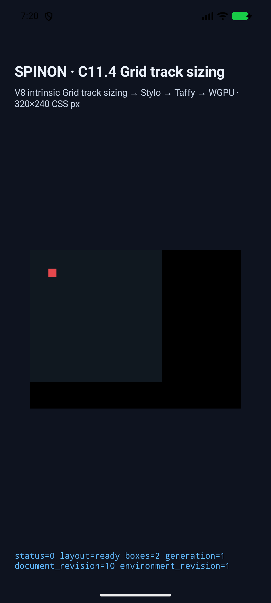
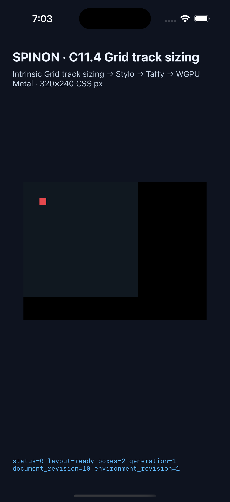

# C11.4 · 양쪽 Grid 축 auto-repeat 구현 근거

**날짜:** 2026-10-20

**범위:** `grid-template-columns`와 `grid-template-rows` track list에 auto-repeat을 하나씩 독립 적용하는 제한 profile. 두 축의 `auto-fill`/`auto-fit` mode, repeat range, repeat count, empty-track collapse를 분리한다.

**판정:** Chrome 155 사전 비교 12개와 Android API 37 ARM64 AVD·iPhone 17 Pro/iOS 26.2 Simulator 각 33개 scene을 확인했다. 제한된 CSS 문법과 고정 scene 근거이며 C11.4·C11 완료 또는 공개 CSS 적합성을 뜻하지 않는다.

## 기준과 구현 범위

[CSS Grid Level 1 §7.2.3.2](https://www.w3.org/TR/2025/CRD-css-grid-1-20250326/#auto-repeat)는 auto-repeat 횟수를 각 track list에서 산정하고, placement 뒤 `auto-fit`의 빈 repeated track을 collapse한다. Columns와 rows는 별도 track list다. [§10.1 gutters](https://www.w3.org/TR/2025/CRD-css-grid-1-20250326/#gutters)는 collapsed track 양쪽 gutter가 겹치는 위치에 놓임을 정의한다. Chrome 155의 독립 DOM 관찰과 규범 기반 기대값은 [12-case 사전 비교](../c11-4-two-axis-auto-repeat-precomparison-2026-10-20/README.md)에 고정했다. 사전 비교는 앱 출력에서 기대값을 역산하지 않는다.

구현은 cascade metadata, typed projection, layout validation과 stage trace에서 axis별 auto-repeat을 독립 보존한다. 기존 single-axis 동작도 별도 projection regression으로 확인한다. 한 track list에는 auto-repeat 하나만 허용하고, 기존의 limited fixed-minimum track pattern 및 fixed neighbor subset을 유지한다. Repeated line name, `grid-template-areas`, 비-`px` neighbor, 한 list 안의 여러 auto-repeat, integer-repeat 혼합과 기타 미지원 grammar는 계속 거부한다.

Chrome fixture는 square/asymmetric `auto-fill`, 양축 `auto-fit`의 empty/single/span/second-repeat occupancy, 두 mixed-mode 방향과 single-axis control을 포함한다. 추가 Chrome 155 probe는 collapsed gutter 뒤 explicit suffix item frame을 확인한다. [Probe observation](./chrome155-autofit-suffix-probe.json)와 원본 [Agent Browser log](./chrome155-autofit-suffix-probe.log)은 suffix frame `(190, 190, 12, 12)`를 기록한다. W3C 설명상 collapsed gutters coincide하며 겹치는 gutter를 두 번 더하지 않는다.

## Rust와 Simulator 근거

- `CARGO_INCREMENTAL=0 mise exec -- cargo test --locked --workspace`: **1,134 passed, 0 failed, 4 ignored**. [원본 로그](./rust-workspace-test.log). 로그에 보이는 임시 unused-import 경고는 Clippy 전에 제거했고, 전체 test 로그 뒤에는 이 import 제거와 서식 정리만 있었다.
- `mise exec -- cargo clippy --locked --workspace --all-targets -- -D warnings`: 통과. [원본 로그](./rust-workspace-clippy.log)
- `mise exec -- cargo fmt --all -- --check`: 통과. 변경 source·Markdown은 whitespace 오류가 없다. 원본 capture logs는 그대로 보존했고, `git diff --check`는 한 runtime log의 원래 trailing space와 log EOF blank lines를 보고한다.
- `spinon-layout`: 186/186, `spinon-style-to-layout`: 197/197. [layout 로그](./spinon-layout-test.log) · [style projection 로그](./style-to-layout-test.log)
- [구현 후 독립 실패 관점 20개](./implementation-review-20.md)는 계획 검토와 다른 코드·런타임 실패 경로를 확인한다.

| 실행 환경 | Scene 결과 | Simulator 정보 |
| --- | --- | --- |
| Android API 37 ARM64 AVD | 33/33 scene, 모두 `drawPresented: true` | `emulator-5554`, `sdk_gphone16k_arm64`, APK SHA-256 `38239102b746f46b9747d7979ddba8ab7203f45c6017f55fad1472f3609d0b21` |
| iOS Simulator | 33/33 scene, 모두 `drawPresented: true` | iPhone 17 Pro, iOS 26.2, app SHA-256 `fa358d0da5621bb7c4779901a8f6171a3cb386d177f96d2f466419f7cc3c29b8` |

각 matrix는 앞선 21개 fixed-neighbor/minimum-size scene과 신규 12개 dual-axis scene을 포함한다. 캡처 validator는 scene ID의 정확한 집합, trace 복원, 두 축의 tracks/collapse/gutter, node frame과 draw/present를 검사한다. [Android 결과 JSON](../c11-4-auto-repeat-two-track-min-size-2026-10-20/android-avd-c114-neighbors-android-avd-20261019T221920350Z-cf547c61/result.json) · [iOS 결과 JSON](../c11-4-auto-repeat-two-track-min-size-2026-10-20/ios-simulator-c114-neighbors-ios-simulator-20261019T220311971Z-4cde0c2a/result.json).

| Android API 37 ARM64 AVD | iPhone 17 Pro / iOS 26.2 Simulator |
| --- | --- |
|  |  |

overflow sample scene에서 root의 CSS width 40px 안/경계 밖 배경, root 밖 x=91px의 item color와 별도 root background가 Android AVD PixelCopy 및 iOS Simulator Metal drawable에서 각각 4/4 exact였다. [Android 표본 로그](../c11-4-auto-repeat-two-track-min-size-2026-10-20/android-avd-c114-neighbors-android-avd-20261019T221920350Z-cf547c61/runtime-auto-fill-overflow-neighbors.log) · [iOS 표본 로그](../c11-4-auto-repeat-two-track-min-size-2026-10-20/ios-simulator-c114-neighbors-ios-simulator-20261019T220311971Z-4cde0c2a/runtime-auto-fill-overflow-neighbors.log). 이 표본은 border stroke 비교가 아니다. Android는 software AVD이며 hardware GPU/실기기 결과가 아니다. iOS readback은 compositor 이후 화면의 픽셀을 증명하지 않는다.

기본 `spinon-ffi` static rlib에는 C11.4 fixture sentinel이 없고 opt-in fixture-test rlib에는 있다. [artifact 경계](./fixture-artifact-boundary.json)는 static library만 검사하며 최종 앱 크기나 release artifact의 크기를 증명하지 않는다.

## 검토와 미완료 범위

초기 Android AVD run의 GLES context hang을 기록하고 AVD를 새로 시작해 최종 33-scene matrix를 통과했다. 실패 run은 보존했으며 최종 결과로 세지 않았다. [실행 로그](../c11-4-auto-repeat-two-track-min-size-2026-10-20/android-avd-c114-neighbors-android-avd-20261019T220821533Z-d963d8b6/android-avd-both-fit-span-two-renderer-hang.txt).

계획 PR #367은 병합됐고 구현 PR [#368](https://github.com/ohah/spinon/pull/368)을 열었다. [최종 PR diff 실패 경로 30개](./pr-diff-review-30.md) 검토에서 병합 차단 결함은 나오지 않았다. 현재 required checks와 merge state는 GitHub에서 확인하고 병합 뒤 Tailnet roadmap을 별도 PR로 동기화한다. WPT, 실기기, Android hardware GPU, iOS compositor 이후 pixel equality, line names/areas, 임의 track grammar와 전체 C11.4 적합성은 이 근거에서 확인하지 않았다.
