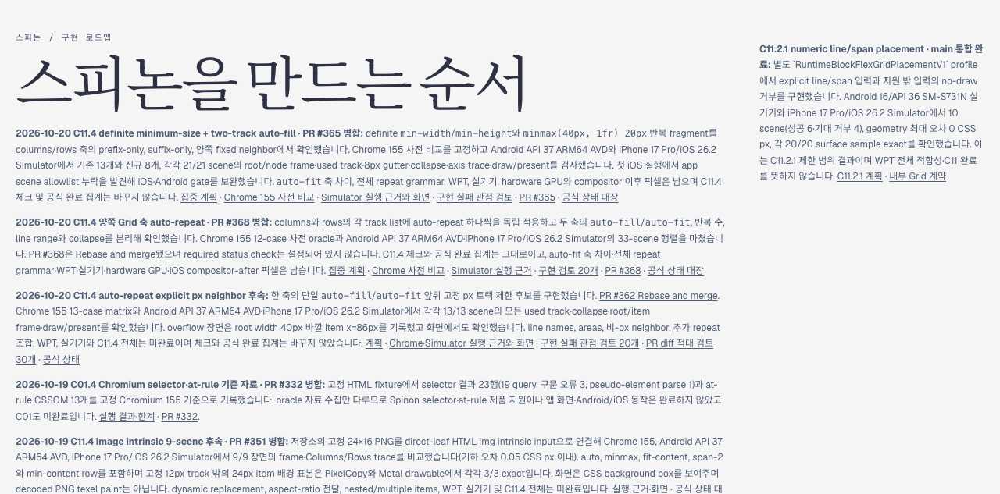
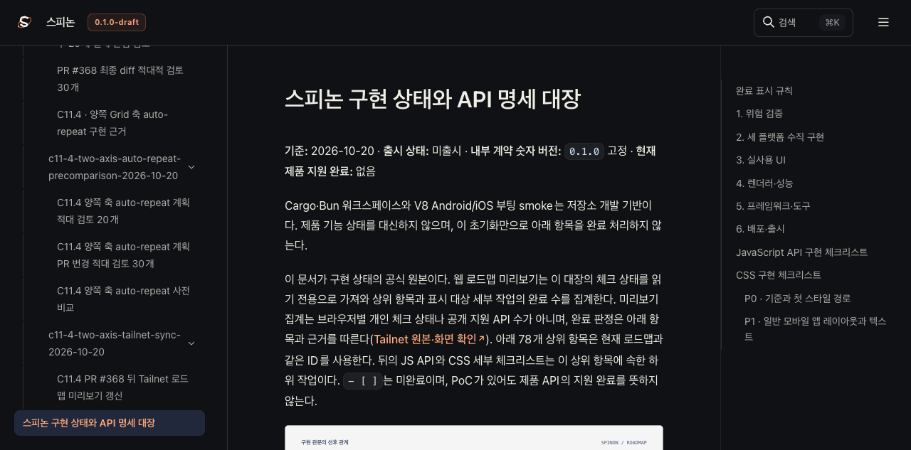
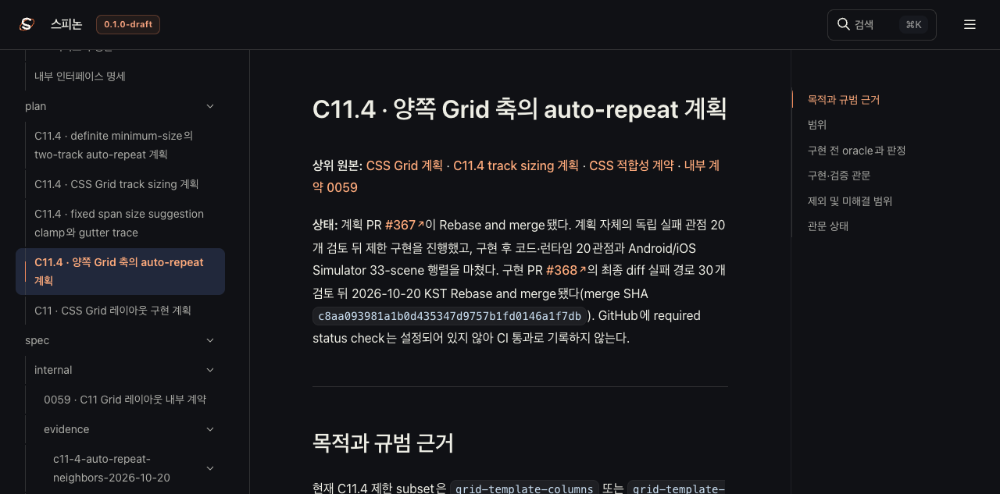
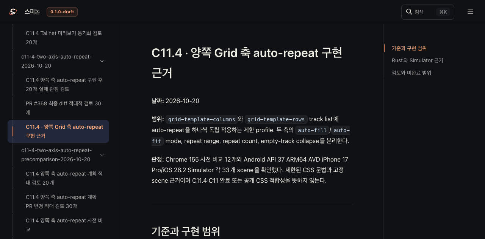
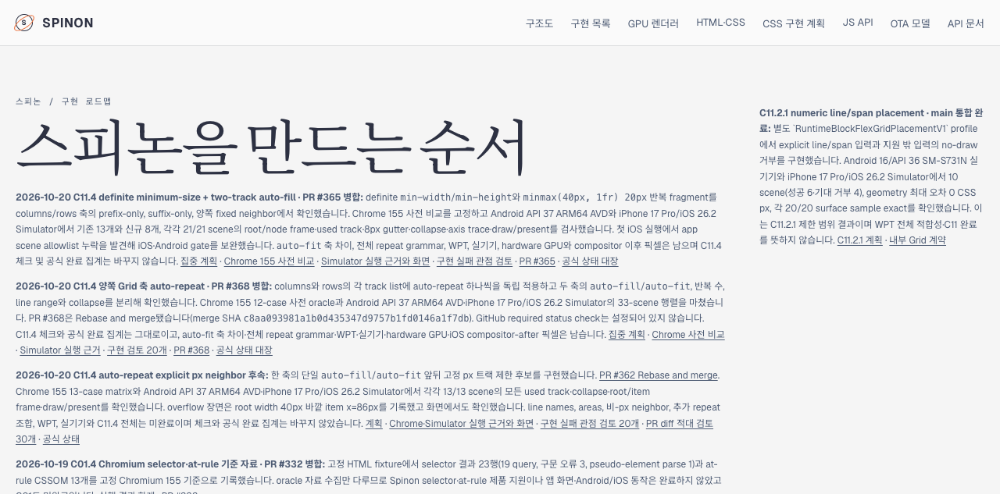

# C11.4 PR #368 뒤 Tailnet 로드맵 미리보기 갱신

**기준:** PR [#368](https://github.com/ohah/spinon/pull/368) Rebase and merge commit `c8aa093981a1b0d435347d9757b1fd0146a1f7db`. 
**범위:** 공개 roadmap, 공식 상태 대장, C11.4 집중 계획·실행 근거를 선택된 Rspress root로 빌드해 기존 Tailnet 정적 미리보기 `/spinon/`에 반영했다. GitHub Pages 배포와 앱 실행은 하지 않았다.

## 반영 내용

- PR #368의 양쪽 Grid 축 auto-repeat 제한 구현과 실제 merge SHA를 공개 roadmap, `spec/STATUS.md`, 집중 계획, 내부 근거 색인에 기록했다.
- C11.4 체크와 공식 완료 집계는 바꾸지 않았다. GitHub required status check가 설정되어 있지 않아 CI 통과로 기록하지 않았다.
- 각 track list에 auto-repeat 하나씩만 두는 범위, `auto-fill`/`auto-fit` 독립 조합, 반복 수·line range·collapse 검증을 연결했다. 남은 `auto-fit` 축 차이, 전체 repeat 문법, WPT, 실기기, hardware GPU, iOS compositor-after 픽셀은 미완료다.
- Tailnet에는 선택 문서만 빌드해 동기화했다. Tailnet 서버와 tmux 세션은 유지했고, GitHub Pages와 앱은 실행하지 않았다.

## 선택 빌드와 동기화

Rspress `2.0.22` 고정 실행 파일로 선택 root를 빌드했다. pass12는 1,718 source files에서 생성한 69 HTML route와 자산 총 1,458 files, 55,304,169 bytes를 동기화했다. pass13에서는 문서 빌드 로그의 끝 공백을 정리하고 이 보고서를 갱신한 뒤 다시 빌드했다. 선택 소스의 host/worktree 경로 199개를 staging에서 지웠고 생성 문서 1개를 추가 정리해 남은 절대 경로는 0개다. 최종 Tailnet 제공 결과와 파일별 hash는 `preflight-pass13.json`, `copy-and-backup-pass13.json`, `served-verification-pass13.json`에 기록했다. 선택 입력 hash 목록은 [pass12 manifest](./SHA256SUMS-preview-inputs-pass12.txt)와 [pass13 manifest](./SHA256SUMS-preview-inputs-pass13.txt)에서 확인한다.

| pass12 사전 비교·복사·제공 | 결과 |
| --- | ---: |
| 파일 수 / 선택 bytes | 1,458 / 55,304,169 |
| 생성 / 교체 / 동일 | 577 / 52 / 829 |
| 교체 전 backup 검증 | 52/52 SHA-256 일치 |
| 교체 대상 열린 파일 | 0/52 |
| 삭제 | 없음 |
| 원자 교체 검증 | 629/629 |
| Tailnet HTTP 200·byte·SHA-256 | 1,458/1,458 일치 |

사전 비교·복사 결과·backup·열린 파일·Tailnet 응답은 [pass12 preflight](./preflight-pass12.json), [pass12 copy와 backup](./copy-and-backup-pass12.json), [pass12 open handles](./open-handles-pass12.json), [pass12 served verification](./served-verification-pass12.json)에 있다. pass13 최종 갱신의 파일별 사전 비교·backup·열린 파일·HTTP 200·byte·SHA 결과는 저장소의 `preflight-pass13.json`, `copy-and-backup-pass13.json`, `open-handles-pass13.json`, `served-verification-pass13.json`에 보존한다.

복사 helper는 변경 전 target 상태와 source file set·byte·SHA를 재검증하고, 바뀌는 기존 파일은 실행별 backup 후 같은 디렉터리의 임시 파일을 rename한다. 첫 pass13 preflight에서 Tailnet 서버 PID 1191이 HTML 2개를 열고 있어 현재 바이트를 staging에 보존했다. 보고서를 갱신한 재동기화에서도 같은 서버의 열린 HTML 3개를 추가로 보존하고 다시 비교했다. 열린 파일을 직접 바꾸지 않았으며 두 보존 단계는 `open-handles-initial-pass13.json`, `open-handles-pass13.json`, `preserved-open-targets-pass13.json`에 남겼다.

실제 Tailnet에서 [roadmap·STATUS·plan·precomparison·implementation evidence·내부 index·sync report 8개 route](./new-c11-4-routes-pass12.json)가 모두 HTTP 200이었다. 69개 생성 HTML의 링크·자산 검토에서 same-origin `/spinon/` 바깥 경로는 0개다. 더 넓은 링크 검토는 선택하지 않은 이전 문서의 로컬 대상 10개가 현재 preview에 없음을 찾았다. 이 pass는 해당 경로를 복사하거나 삭제하지 않았으며 새 C11.4 링크와는 별도다([route 결과](./html-route-check-pass12.json)). 출력 디렉터리만 대상으로 했던 첫 임시 검사는 기존 preview 파일을 세지 않아 305개를 누락으로 잘못 분류했다. 그 결과는 [초기 검사](./route-check-initial-overstrict-pass12.json)로 보존하고 실제 `SpinonPreview` root를 확인한 결과로 대체했다.

## Agent Browser 화면 확인

Agent Browser로 pass13 반영 후 roadmap, STATUS와 계획을 다시 열었다. roadmap UI는 `212개 표시 · 공식 완료 72/212`, C11.4 `intrinsic track sizing` checkbox는 unchecked다. PR #368 merge SHA가 보이고 같은 origin의 `/spinon/` 바깥 링크는 0개다. 계획 문서는 merge SHA와 required check 미설정을 표시한다. 실행 근거 페이지의 Android PNG는 1080×2400, iOS PNG는 1206×2622로 로드됐고 실패 이미지는 0개였다. 캡처는 Tailnet 문서 화면이며 Android/iOS 앱 실행 화면이 아니다.

초기 pass12 화면 관찰값은 [roadmap](./browser-check-pass12.json), [STATUS](./status-check-pass12.json), [계획](./plan-check-pass12.json), [Chrome 사전 비교](./precomparison-check-pass12.json), [Simulator 근거·이미지](./evidence-check-pass12.json), [sync report](./sync-report-check-pass12.json)에 기록했다. pass13 최종 확인은 [roadmap](./browser-check-pass13.json), [STATUS](./status-check-pass13.json), [계획](./plan-check-pass13.json)에 기록한다. 아래 pass12 캡처와 pass13 roadmap 캡처는 Tailnet의 실제 문서 화면이다.

Agent Browser 세션은 pass12와 최종 pass13 확인 뒤 각각 종료하고 종료 후 전용 프로세스가 없는지 확인했다. 종료 관찰은 pass12의 [종료 기록](./browser-close-pass12.json)과 저장소 내부 pass13 `browser-close-pass13.json`에 남긴다. Tailnet preview server PID 1191과 tmux 세션은 유지했다.

## 남은 범위

이 변경은 C11.4 전체 Grid 지원이나 WPT 적합성, 실기기·hardware GPU·iOS compositor-after pixel parity를 추가로 주장하지 않는다. 전체 내부 link audit에서 이번 선택 범위 밖 10개 route가 빠진 상태도 유지한다.
