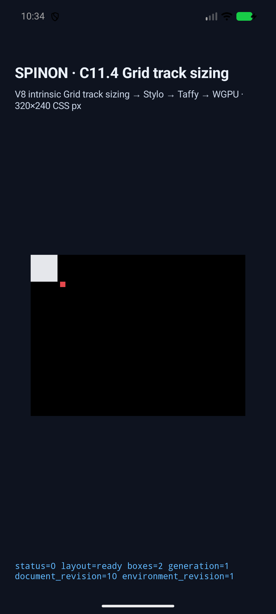
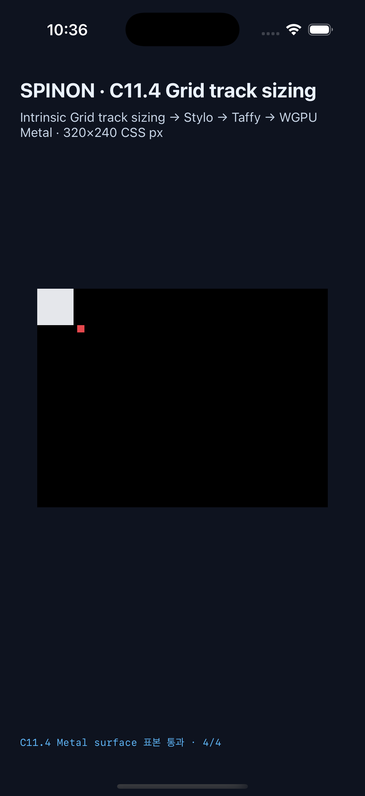

# C11.4 양 축 auto-repeat + template areas runtime 근거

## 범위

`RuntimeBlockFlexGridTrackSizingV1`에서 columns와 rows에 auto-repeat을 하나씩 두고 `grid-template-areas`를 함께 적용하는 고정 fixture slice다. 기존 양축 auto-repeat 12개와 단일축 area 13개를 유지하고, 양축 area 9개를 더해 Android와 iOS에서 각각 34개 scene을 실행했다. area가 repeat 확장보다 큰 축은 explicit grid를 확장하며 새 track은 기존 고정 `grid-auto-columns:16px`, `grid-auto-rows:12px` fixture 값으로 sizing한다. 반복 수·area alias·auto-fit collapse는 Taffy 0.15.0 경로에 전달한다.

## 원인과 수정

첫 Android 재현은 `grid.rs::validate_template_areas`가 `columns_auto_repeat XOR rows_auto_repeat`를 요구해 layout 전에 거부했다. Cascade와 typed projection에서는 target profile을 허용했지만 layout validation에 단일축 제약이 남아 있었다. validation을 “둘 중 하나 이상”으로 바꾸고 양축 모두 metadata가 유효한 회귀를 추가했다. `TaffyLayoutEngine` 단위 회귀는 영역을 3×3으로 확장한 item frame `(44,40,8,8)`을 확인한다.

전체 실행은 두 harness 결함도 드러냈다. 빈 item 목록에서 node-frame 문자열 뒤에 구분자가 붙던 문제와, `gridColumn`/`columnEnd`처럼 서로 다른 키 모양을 하나의 CSS prefix 규칙으로 처리하던 문제를 수정했다. 최종 matrix에서는 빈 `auto-fit`과 `grid-column`/`grid-row` longhand scene 모두 통과했다. PR evidence에는 완결된 최종 run만 포함한다.

## Android와 iOS 실행

| Target | 결과 | 실행 정보 |
| --- | --- | --- |
| Android API 37 ARM64 AVD | 34/34 scene, draw/present 34/34, overflow 표본 4/4 exact | `emulator-5558`, `sdk_gphone64_arm64`, APK SHA-256 `bb44ddea0ec50270242c2fd295e4b1aa93013bf846d1505fe3320221708e276f` |
| iOS Simulator | 34/34 scene, draw/present 34/34, Metal 표본 4/4 exact | iPhone 17 Pro, iOS 26.2, UDID `ACA7BF91-E2D5-4CF7-909A-08D1AD95FF3D`, app SHA-256 `f374f98d8dc0787fe9fecdbb4ed975a0e3f9bcb1129ad6bf340716f6389f45cf` |

각 행렬은 기존 dual-axis auto-repeat 12개, single-axis area 13개, 신규 dual-axis area 9개를 포함한다. 모든 scene에서 root/item node frame, used tracks, collapse state, trace, draw/present를 검사했다. `area-added-both`는 root 40×40px, item `(44,40)`·8×8px, columns `[20,16,16]`, rows `[20,12,12]`다. root 내부 배경, root 바깥 item 색, 오른쪽·아래 host surface 표본은 Android PixelCopy와 제출 전 iOS Metal drawable에서 각각 4/4 exact다. iOS 값은 OS compositor 이후 화면 결과가 아니다.

| Android API 37 ARM64 AVD | iPhone 17 Pro / iOS 26.2 Simulator |
| --- | --- |
|  |  |

- [Android result JSON](android-avd-c114-two-axis-areas-overflow-android-avd-20261023T013400226Z-c6218d0c/result.json) · [Android PixelCopy log](android-avd-c114-two-axis-areas-overflow-android-avd-20261023T013400226Z-c6218d0c/runtime-template-area-repeat-two-axis-area-added-both.log) · [Android matrix output](android-matrix-final-output.log)
- [iOS result JSON](ios-simulator-c114-two-axis-areas-overflow-ios-simulator-20261023T013607344Z-14f770b2/result.json) · [iOS Metal log](ios-simulator-c114-two-axis-areas-overflow-ios-simulator-20261023T013607344Z-14f770b2/runtime-template-area-repeat-two-axis-area-added-both.log) · [iOS matrix output](ios-matrix-output.log)
- [Android build](android-build-final.log) · [iOS build with `DEBUG_INFORMATION_FORMAT=dwarf` and Metal pixel readback enabled](ios-build-metal-pixels-final.log)
- [PR #545 screenshot rendering and Agent Browser shutdown verification](agent-browser-pr-545-images.json)

## Rust와 fixture 검사

- `spinon-layout --lib`: 240 passed, including the new dual-axis area layout regression.
- `spinon-style`: 192 passed; `spinon-style-to-layout`: 221 passed.
- `spinon-ffi` opt-in fixture test: the 22 template-area scenes and longhand CSS-property mapping passed.
- `cargo fmt --all -- --check`, source/docs `git diff --check`, Node syntax check, scene boundary test: pass. Captured build/runtime `.log` files retain the original tool output, including trailing spaces; they are excluded from whitespace-only diff checks rather than rewritten.
- Chrome 156 precomparison: 9/9 oracle scenes matched independently calculated expected values; source evidence is [here](../c11-4-two-axis-template-areas-precomparison-2026-10-23/README.md).
- Final implementation/runtime failure-path review: [20 distinct checks](implementation-runtime-review-20.md).

The full current-source default/product FFI archive negative control was not rerun: free space fell to 112 MiB after simulator builds. No existing caches or unrelated evidence were deleted. The Android/iOS builds above are opt-in fixture-test builds; they do not prove that the final APK/IPA excludes fixture data. WPT, Android physical device/hardware GPU, iOS compositor-after pixels, border stroke, arbitrary CSS admission, and full C11.4 conformance remain unverified. C11.4 stays unchecked and the official completion count stays `77/213`.
