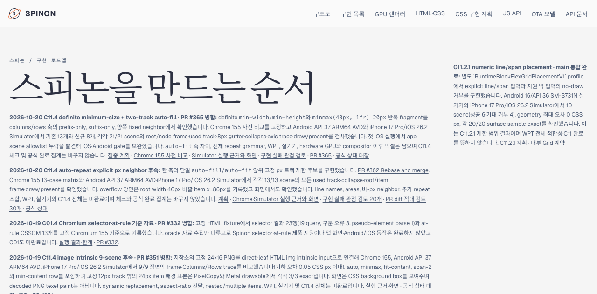
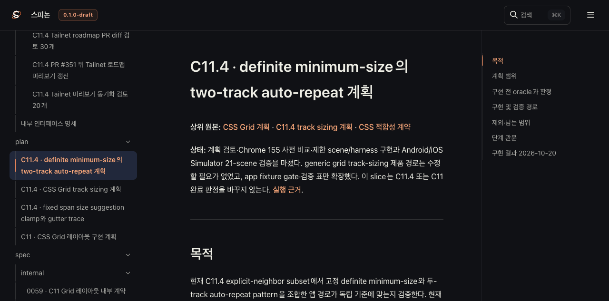
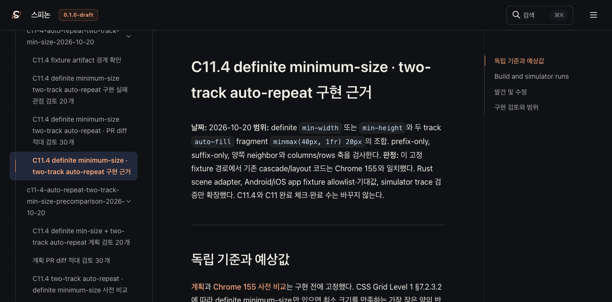

# C11.4 two-track auto-repeat Tailnet 미리보기 갱신

**기준 커밋:** `1590056dec37feacdeb8b84234a71d709bc3d1a9`의 PR #365 반영 내용. 
**범위:** C11.4 집중 계획·실행 근거와 공개 roadmap을 Rspress 선택 root로 빌드해 기존 Tailnet 정적 미리보기 `/spinon/`에 동기화했다. GitHub Pages와 Android/iOS 앱은 실행하지 않았다.

## 반영 내용

- 공개 roadmap에 PR #365의 definite minimum-size two-track `auto-fill` 결과와 미완료 범위를 추가했다.
- `spec/STATUS.md`, 집중 계획, 내부 근거 색인에 PR #365의 Rebase merge SHA `a2c137213f72e82b3a8e3cc153e92c8b9db9a653`를 기록했다. C11.4 체크와 공식 완료 집계는 수정하지 않았다.
- 선택 root에는 C11.4 계획, Chrome 사전 비교, Android/iOS Simulator 실행 근거를 `/internal/`과 `/spec/internal/` 경로로 제공했다. 설치된 Rspress 2.0.22와 저장소 lockfile은 유지했다.
- 미리보기 갱신 helper는 `pass11`을 추가했다. pass11은 별도 backup 경로를 쓰며, 기존 pass6–pass9 재실행은 원래 backup 경로를 유지한다.

## 동기화 결과

| 확인 | 결과 |
| --- | ---: |
| 선택 root 입력 | 1,074 files; 125 source-local path redactions |
| sanitized site 출력 | 933 files |
| 생성 / 교체 / 동일 | 495 / 37 / 401 |
| 교체 전 backup | 37/37 SHA-256 일치 |
| 교체 대상 열린 파일 | 0/37 |
| 삭제 | 없음 |
| Tailnet HTTP·byte·SHA 확인 | 933/933 일치 |

`source_worktree_head`는 `1590056dec37feacdeb8b84234a71d709bc3d1a9`이고 preflight의 dirty flag는 true다. 이 값은 선택 입력 manifest가 고정한 각 문서·자산의 SHA-256으로 보완한다. 원본 checkout과 기존 `node_modules` symlink는 동기화 대상이 아니며 유지했다. Helper의 pass11 backup 경로는 기존 실행 경로를 보존하도록 사후 검토에서 분기 처리했다. 이 변경은 pass11이 사용한 경로를 바꾸지 않는다.

사전 검사·교체·제공 해시는 [preflight](./preflight-pass11.json), [copy와 backup](./copy-and-backup-pass11.json), [열린 파일 확인](./open-handles-pass11.json), [HTTP 제공 확인](./served-verification-pass11.json)에 있다. 빌드 입력 목록은 [SHA256 manifest](../c11-4-image-tailnet-preview-update-2026-10-20/SHA256SUMS-preview-inputs.txt), 선택 root와 redaction 기록은 [root manifest](../c11-4-image-tailnet-preview-update-2026-10-20/prepare-root-pass11.json), [sanitizer 결과](../c11-4-image-tailnet-preview-update-2026-10-20/sanitize-pass11.json), [Rspress build log](../c11-4-image-tailnet-preview-update-2026-10-20/selected-build-pass11.log)에 남겼다.

## Agent Browser 확인

Agent Browser에서 Tailnet roadmap, 집중 계획, 실행 근거 페이지를 열었다. 세 페이지가 표시됐고 실행 근거 페이지의 Android PNG는 1080×2400, iOS PNG는 1206×2622 natural size로 로드됐다. 완전 로드된 UI counter는 `공식 완료 72/212`였다. 이 수는 roadmap의 ID 기반 표시 결과다. `STATUS.md`의 전체 Markdown checkbox는 86/225이며, 그중 완료 10개를 포함한 ID 없는 하위 확인 13개는 roadmap item 수에 포함하지 않는다. 또한 `C04.12`와 `C05.2`는 서로 다른 행이 같은 ID를 재사용한다. roadmap parser는 ID를 상태 map key로 사용하므로 마지막 동일 ID 행의 상태가 앞선 행에도 적용될 수 있다. 따라서 72/212는 현재 UI 표시값으로 기록하며 원본 checkbox 전체 합계와 같은 집계라고 주장하지 않는다. 본 PR에서는 상태 대장이나 C11.4 checkbox를 바꾸지 않았다. 한 차례 DOM 확인은 hydration 중간의 78/0을 반환했지만 완전 로드 뒤 다시 읽었다.

각 route의 요청과 화면 확인 뒤 `spinon-tailnet-c114-final` Browser를 닫았다. 전용 Chrome은 먼저 종료됐고, 남은 Agent Browser daemon도 사라진 것을 확인했다.

## 검토 및 남은 범위

- [Tailnet 동기화 실패 관점 20개](./sync-review-20.md)
- [PR 변경 적대 검토 30개](./pr-diff-review-30.md)
- 이번 작업은 문서 미리보기 배포다. 자동 GitHub Pages 배포, 새 앱 실행, C11.4 전체 구현을 뜻하지 않는다.
- `auto-fit` 축 차이, 전체 repeat 문법, WPT, 실기기, hardware GPU 및 iOS compositor 이후 픽셀은 미완료다.
