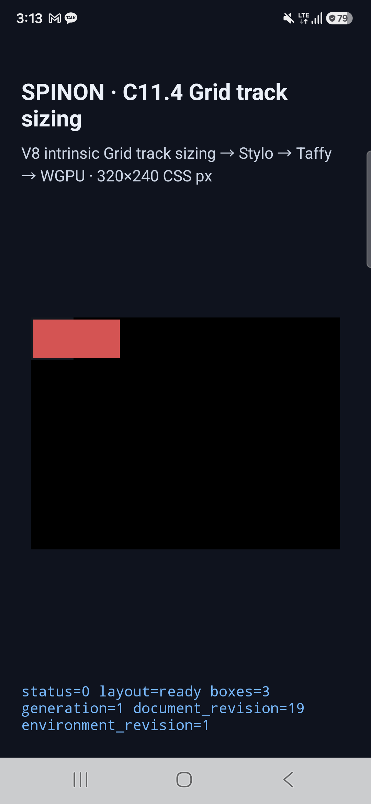
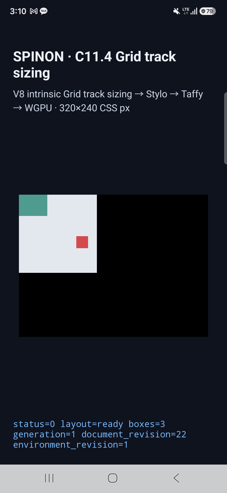

# C11.4 typed implicit track 실기기 Android 검증

- 실행일: 2026-10-21
- 소스 revision: [source-revision.json](./source-revision.json)
- 기기·GPU: [device.json](./device.json)
- 전체 결과: [run-20261021/result.json](./run-20261021/result.json)
- 로컬·설치 APK SHA-256: [apk-sha256.txt](./apk-sha256.txt)
- PR diff 실패 관점 검토: [pr-diff-review-30.md](./pr-diff-review-30.md)

## 대상과 기준

Samsung SM-S731N 실기기(Android 16/API 36, arm64-v8a, `ro.kernel.qemu=0`)에서 C11.4 typed implicit `grid-auto-columns`·`grid-auto-rows` fixture 14개를 실행했다. 고정 SDK NDK로 만든 opt-in fixture APK를 USB serial `R5KYB06SMPE`에 설치했다. 로컬 APK와 설치된 `base.apk` SHA-256은 모두 `191f7457528f8691c3d0d03b1d8b28887a7172939a077b80e4d4b79fe4625224`다.

장면별 intrinsic sizing trace의 열·행 최종 track과 node frame을 2026-10-20 Android API 37 ARM64 AVD 저장 결과에 대조했다. 해당 AVD 행렬은 고정 CSS 기대값·iOS Simulator와 별도 비교가 끝난 기준이다. 1/64 CSS px 허용치에서 14개 전부 통과했고, track 최대 차이 0 CSS px, frame 최대 차이 0.000006 CSS px였다. 14개 모두 trace chunk를 빠짐없이 복원했고 frame marker와 `SPINON_C0410_DRAW status=0 presented`가 남았다.

## 경계 밖 paint

`implicit-min-content-overflow-border` 장면에서 실제 Android 표면 PixelCopy adapter로 경계 주변의 고정 표본 5개를 확인했다. `x=0`의 root 색 표본, root 가장자리 위·밖의 item 색, root 밖 item 내부(`x=91 CSS px`)의 item 색, item 바로 뒤(`x=92 CSS px`)의 배경색이 모두 기대 RGBA와 정확히 일치했다(5/5). 원본 로그는 [PixelCopy 실행 로그](./run-20261021/runtime-implicit-min-content-overflow-border-surface-pixels.log), 전체 화면은 아래 캡처다.

| 표본 | CSS 좌표 | 기대·관찰 RGBA | 결과 |
| --- | ---: | --- | --- |
| root 색 inside | (0, 8) | `16,24,32,255` | exact |
| item이 덮는 root edge | (43, 8) | `229,72,77,255` | exact |
| root 바깥 edge | (44, 8) | `229,72,77,255` | exact |
| root 밖 item | (91, 8) | `229,72,77,255` | exact |
| item 직후 배경 | (92, 8) | `0,0,0,255` | exact |



gutter collapse와 typed track 결과가 보이는 추가 캡처:



나머지 장면의 frame·track·trace 결과는 [전체 JSON](./run-20261021/result.json), 장면별 logcat 추출본과 1080×2340 ADB screencap은 [run-20261021](./run-20261021/) 아래에 있다. 수집 후 텍스트 로그 끝의 공백만 제거했으며 marker와 관찰값은 바꾸지 않았다.

모든 evidence 파일의 digest는 [SHA256SUMS.txt](./SHA256SUMS.txt)에 있다.

## 재현

```sh
mise exec -- env SPINON_ENABLE_C04_RUNTIME_GPU=1 SPINON_ENABLE_C04_RUNTIME_GPU_FIXTURE_TEST=1 bun run build:android
adb -s R5KYB06SMPE install -r platforms/android/app/build/outputs/apk/debug/app-debug.apk
adb -s R5KYB06SMPE shell am start -S -f 0x10008000 -n dev.spinon.bootstrap/.MainActivity \
  --ez spinon_c114_grid_track_sizing true \
  --es spinon_c114_grid_scene typed-auto \
  --es spinon_c114_grid_run_id physical-typed-auto
```

다른 typed 장면은 `spinon_c114_grid_scene`에 [14개 scene ID](./run-20261021/result.json)를 넣어 반복한다. 경계 표본을 재현할 때는 `spinon_c11_grid_pixel_matrix_run_id`와 `spinon_c11_grid_pixel_matrix_samples` intent extra도 전달한다. 해당 sample payload와 기기 관찰값은 실행 log에 보존했다.

## 범위

이 실행은 내부 fixture APK의 제한 C11.4 profile을 검증했다. 공개 CSS 계약, 전체 C11.4, WPT, 다른 기기, 전체 border stroke의 픽셀 정확성, compositor 이후 Chrome pixel equality를 입증하지 않는다. C11.4 완료 체크와 공식 완료 수는 변경하지 않았다.

Android 빌드는 성공했으며 compile SDK 37.2와 Android Gradle Plugin 8.13.2 지원 범위(36.1) 차이에 대한 기존 경고가 기록됐다. 전체 문서 사이트 빌드나 Pages 배포는 이 실행에서 하지 않았다.
