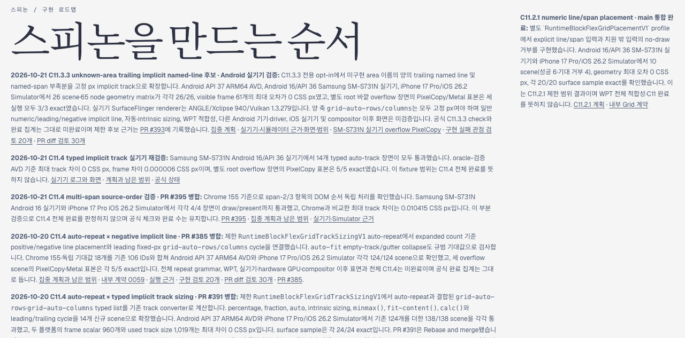
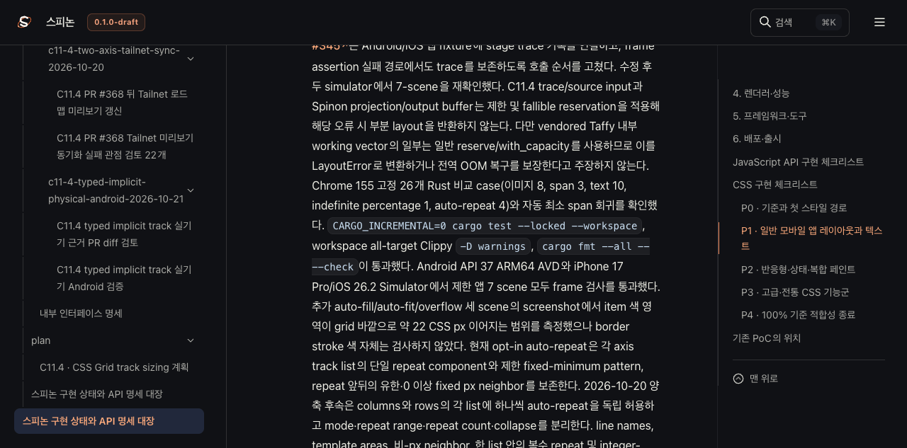
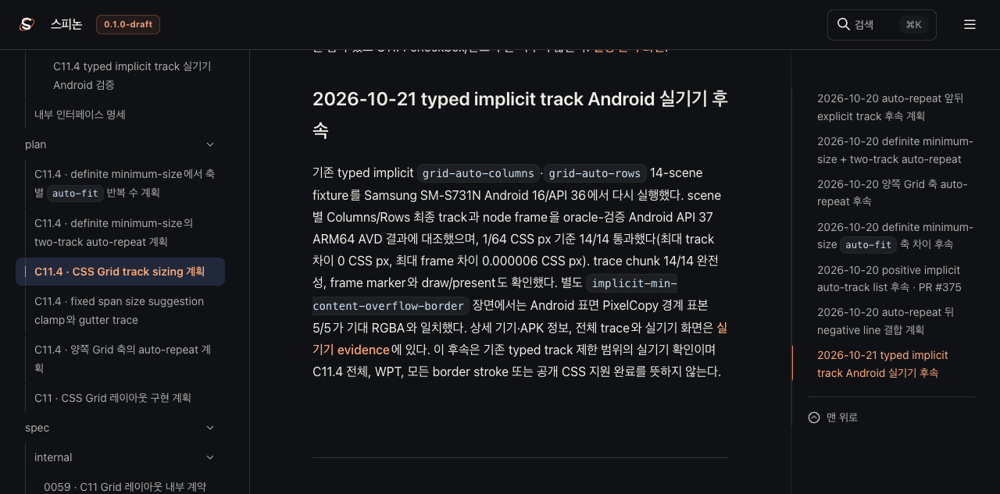
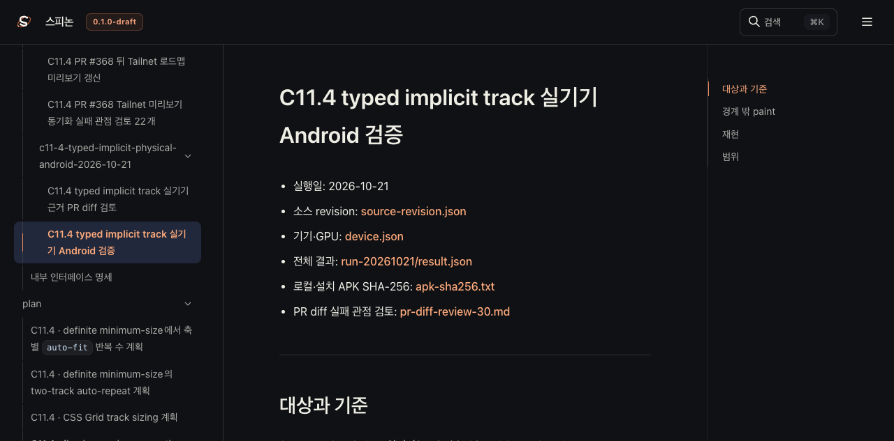

# PR #399 병합 뒤 Tailnet 로드맵 미리보기 갱신

- 날짜: 2026-10-21
- 기준 커밋: `4d69a05e316685497ea3950bb325c81a79608819` (PR #399, C11.4 typed implicit Android 실기기 결과)
- 미리보기: [구현 로드맵](https://macstudio.tailed42f2.ts.net/spinon/roadmap.html) · [공식 상태 대장](https://macstudio.tailed42f2.ts.net/spinon/STATUS.html) · [C11.4 계획](https://macstudio.tailed42f2.ts.net/spinon/plan/c11-4-grid-track-sizing.html) · [Android 실기기 근거](https://macstudio.tailed42f2.ts.net/spinon/internal/evidence/c11-4-typed-implicit-physical-android-2026-10-21/README.html)

## 반영 범위

PR #399 병합 뒤 공식 상태 대장, C11.4 계획, 내부 색인, 로드맵 HTML과 Samsung SM-S731N Android 16/API 36 실기기 근거를 RSPress 선택 사이트에 반영했다. 이전 성공 입력 집합을 복제한 뒤 현재 문서 네 종류와 새 실기기 evidence 44개 파일을 덮어 넣어 입력을 만들었다. 입력 구성은 [selected-inputs-pass25.json](./selected-inputs-pass25.json)에 기록했다. 같은 RSPress 출력이 HTML과 JavaScript를 함께 갱신한다.

전용 [RSPress config](./rspress-pass25.config.ts)로 선택 빌드했다. 입력 루트는 `build/spinon/c11-4-typed-implicit-tailnet-root-pass25/`, 출력 사이트는 `build/spinon/c11-4-typed-implicit-tailnet-site-pass25/`다. 출력에는 1,732개 파일, 총 74,275,364바이트가 있다. 이 제한 빌드는 기존 dead-link·dead-image 검사를 끈 별도 설정만 사용한다. 이번에는 저장소 전체 문서 빌드와 GitHub Pages 배포를 실행하지 않았다.

## Tailnet 파일 동기화

사전 비교 결과 새 파일 102개, 교체 93개, 동일 1,537개였다. 삭제는 하지 않았다. 교체 전 Tailnet 파일 93개를 `~/Library/Application Support/SpinonPreviewBackups/c11-4-typed-implicit-tailnet-sync-2026-10-21/pass25/`에 저장하고 각 크기와 SHA-256을 검증했다. 복사 후 1,732개 대상과 93개 백업이 전부 빌드·사전값과 일치했다.

- [사전 비교](./preflight-pass25.json)
- [복사와 교체 전 백업 기록](./copy-and-backup-pass25.json)
- [최종 대상·백업 검증](./final-verification-pass25.json)
- [Tailnet HTTPS 1,732개 응답·SHA-256 비교](./served-verification-pass25.json)
- [실행 요약](./sync-summary-pass25.json)
- [빌드 파일별 manifest](./tailnet-files-pass25.jsonl) · [백업 manifest](./tailnet-backups-pass25.jsonl)

동기화 스크립트는 선택 파일 집합을 재검증하고 기존 대상이 사전 비교 이후 바뀌면 중단한다. 교체 파일은 먼저 백업하고, 같은 디렉터리에 임시 파일을 쓴 뒤 fsync와 원자 rename을 수행한다. 열려 있던 이전 파일 6개 모두 Tailnet 서버 PID 1191이 보유했고, 서버에는 `127.0.0.1:8768` 대기 소켓만 있었다. 다른 프로세스나 활성 클라이언트 연결은 발견되지 않았다. 서버 PID는 갱신 전후 동일하게 유지했다. [동기화 스크립트](./sync-tailnet-pass25.mjs)와 [외부 제공 검증 스크립트](./verify-served-pass25.mjs)를 보존했다.

## Agent Browser 확인

터미널 브라우저는 사용하지 않았다. Agent Browser에서 Tailnet의 로드맵, 공식 상태 대장, C11.4 계획과 Android 실기기 근거 페이지를 열었다. 로드맵에서 14 scene 결과와 PixelCopy 5/5를 확인했고, 상태 대장에서 C11.4 체크가 미완료인 것과 새 실기기 근거 링크를 확인했다. 계획 페이지에도 14/14 결과가 표시됐다. 근거 페이지의 1080×2340 Android 캡처 2장이 모두 로드됐다. PR #400을 연 뒤 본문에 추가한 Tailnet 화면 이미지 3장도 1280×633 크기로 모두 로드되는 것을 확인했다. [페이지별 확인값](./browser-verification-pass25.json)

화면 검토 뒤 Agent Browser 세션을 닫고 브라우저 프로세스가 남지 않았는지 확인했다. Tailnet 미리보기 서버 PID 1191은 보존했다.

## 공식 상태와 검증 한계

공식 [STATUS.md](../../../STATUS.md)의 C11.4 체크와 완료 수는 그대로 미완료다. 실기기 결과는 제한 fixture만 검증하며 전체 CSS Grid, WPT, 모든 border stroke의 픽셀 정확성을 뜻하지 않는다. PR 변경에 대한 별도 실패 관점 검토는 [sync-review-30.md](./sync-review-30.md)에 있다.
