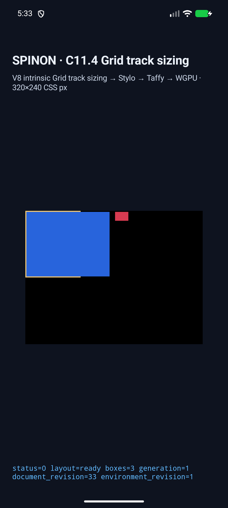
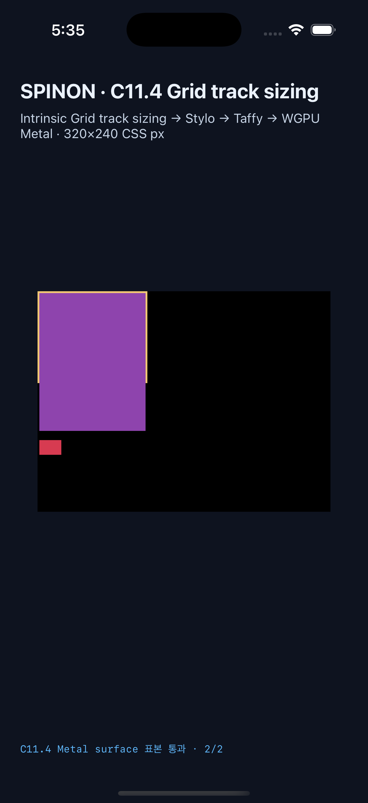

# C11.4 `visibility:hidden` border overflow 실행 근거

이 slice는 기존 mixed intrinsic/flexible/fixed Grid fixture의 네 exact scene을 확장한다. 새 ID는 Columns/Rows의 hidden scene과 visible paint control이며, opt-in `c04-runtime-gpu-fixture-test` adapter만 받는다. 일반 CSS admission, 전체 Grid/`visibility` 적합성, 실기기 GPU 또는 C11.4 공식 완료를 주장하지 않는다.

구현 전 독립 기대값과 Chrome 156 관측은 [계획](../../../../plan/c11-4-visibility-hidden-border-overflow.md) 및 [precomparison 자료](../c11-4-mixed-flex-visibility-hidden-border-overflow-precomparison-2026-10-28/README.md)에 고정했다. Hidden/visible scene 차이는 span의 `visibility` 한 값이다.

## 최종 시뮬레이터 실행

| 대상 | Run ID | 환경 | 앱 SHA-256 |
|---|---|---|---|
| Android | `c114-mixed-intrinsic-flex-fixed-android-avd-20261028T083254064Z-ec49e19a` | API 37 ARM64 `spinon_api37_1_compat16k`, 16 KB page, `emulator-5554`, 1080×2400 | `dcccd80152d6bc8702afb9343de98ecc192b896449d91470d6b1f2fdf4db572b` |
| iOS | `c114-mixed-intrinsic-flex-fixed-ios-simulator-20261028T083358020Z-01851d7b` | iPhone 17 Pro (`iPhone18,1`), iOS 26.2, 1206×2622 | `ea99f73d011480697235cc051dbed6e80e117b88e4b9bc6b9a3756938da6cbaa` |

각 플랫폼에서 기존 14개 regression scene과 신규 4개 scene이 모두 통과했다. 설치 APK hash는 빌드 APK와 같고, 두 실행은 V8 `7b50b62cb18f28617959e8452e2cd18195b38bcf` 및 같은 구현 revision을 사용했다.

- Base commit/tree: `a44ab6c079b35e91055afd66e9300a70c8de2918` / `eac51a37e5a03416452f9083fb080dc71bd6ca02`.
- Android/iOS tracked diff SHA-256: `06e7cd89db43fdbe94a863df11b69065de21a6a547e3c614c456cac371c874d6`.
- Hashed implementation/test/oracle file-set SHA-256: `b47cf8640429d5106588016ad3e3e164305aa7c37d4a49ee3910c0ef91328a7a`.
- iOS simulator는 실행 전부터 booted였고 이 실행에서 boot/shutdown하지 않았다. Android capture cleanup은 Spinon 앱만 force-stop했다.

신규 네 장면은 각각 root/frame 5개를 보존한다. Hidden scene은 draw box 3개, visible control은 4개다. Columns root는 `100×120px`, Rows root는 `120×100px`; 2px border를 뺀 track-sizing content는 `96×116px` 또는 `116×96px`이다. 네 장면 target tracks는 `[150,40,0]px`, content-axis 남은 공간은 `-114px`다. Border 바깥 표본은 hidden에서 아래 파란 A item, visible control에서 보라 span을 읽는다.

| Scene 축/visibility | Root-local 첫 item·span frame | Root 밖 표본 RGBA | Border 표본 RGBA |
|---|---|---|---|
| Columns hidden | `(2,2,150,116)` | `(120,60)` → `[40,100,220,255]` | `(1,60)` → `[240,198,116,255]` |
| Columns visible control | `(2,2,150,116)` | `(120,60)` → `[142,68,173,255]` | `(1,60)` → `[240,198,116,255]` |
| Rows hidden | `(2,2,116,150)` | `(60,120)` → `[40,100,220,255]` | `(60,1)` → `[240,198,116,255]` |
| Rows visible control | `(2,2,116,150)` | `(60,120)` → `[142,68,173,255]` | `(60,1)` → `[240,198,116,255]` |

Android 표본은 PixelCopy다. iOS 표본은 3× Metal drawable readback이며 compositor 제출 전 결과다. 양쪽 모두 지정 표본만 확인했다. 전체 표면 pixel parity, Android 실기기, hardware GPU, iOS scanout 이후 화면을 증명하지 않는다.

| Android API 37 AVD | iPhone 17 Pro / iOS 26.2 Simulator |
|---|---|
|  |  |

## 검증

- [18-scene 독립 matrix와 17 negative controls](./matrix-verification-18-scenes.json): manifest completeness, exact scene set, frames, target tracks, intrinsic trace, platform matcher tables, screenshot SHA/dimensions, PixelCopy/Metal coordinates와 RGBA를 대조했다.
- Runtime focused tests: `cargo test --locked -p spinon-runtime --features c11-4-grid-track-sizing-fixture-test visibility_hidden -- --nocapture` — 4/4.
- FFI exact-route test: `cargo test --locked -p spinon-ffi --features c04-runtime-gpu-fixture-test routes_only_the_eight_exact_visibility_mixed_track_scenes -- --nocapture` — 1/1.
- Layout crate: `cargo test --locked -p spinon-layout --features c11-4-grid-track-sizing-fixture-test` — 308/308.
- `cargo fmt --all -- --check`, default workspace Clippy, runtime/FFI fixture opt-in Clippy (`-D warnings`), capture JavaScript syntax check, Python verifier self-test, `git diff --check` — 통과.
- [기본/opt-in archive 경계](./artifact-boundary.json): 신규 scene marker 4개와 C11.4 host/eval FFI symbol은 기본 `spinon-ffi` static archive에서 0건, fixture-test positive control에서 각각 marker 4/4와 symbol 2개다. 이 판정은 macOS ARM64 static archive 경계만 다루며 APK/IPA 전체 제외를 뜻하지 않는다.

## Hostile review와 수정 기록

- [Runtime/구현 20개 실패 관점](./implementation-runtime-review-20.md)
- [구현 PR diff 30개 별도 실패 관점](./pr-diff-review-30.md)

초기 capture에서는 zero-area C item의 draw count와 Rust Debug trace 문자열의 공백 차이로 assertion이 실패했다. 기대 draw count를 hidden 3/visible 4로 고정하고 Debug 필드만 공백 정규화했다. 추가 review에서 새 scene ID가 기존 300px geometry로 변환될 수 있는 경계도 찾아 scene ID별 root contract와 반대 스타일 negative control을 추가했다. 위 최종 run 두 개는 이 수정 이후 같은 source hash로 다시 실행했다.

공식 C11.4 상태는 미완료이며 `spec/STATUS.md` 집계는 `72/213` 그대로다. 남은 범위에는 일반 입력, 전체 Grid 조합, WPT, clipping/scrolling, 임의 item tree/style, 실기기/hardware GPU와 iOS compositor 이후 pixel 검증이 포함된다.
