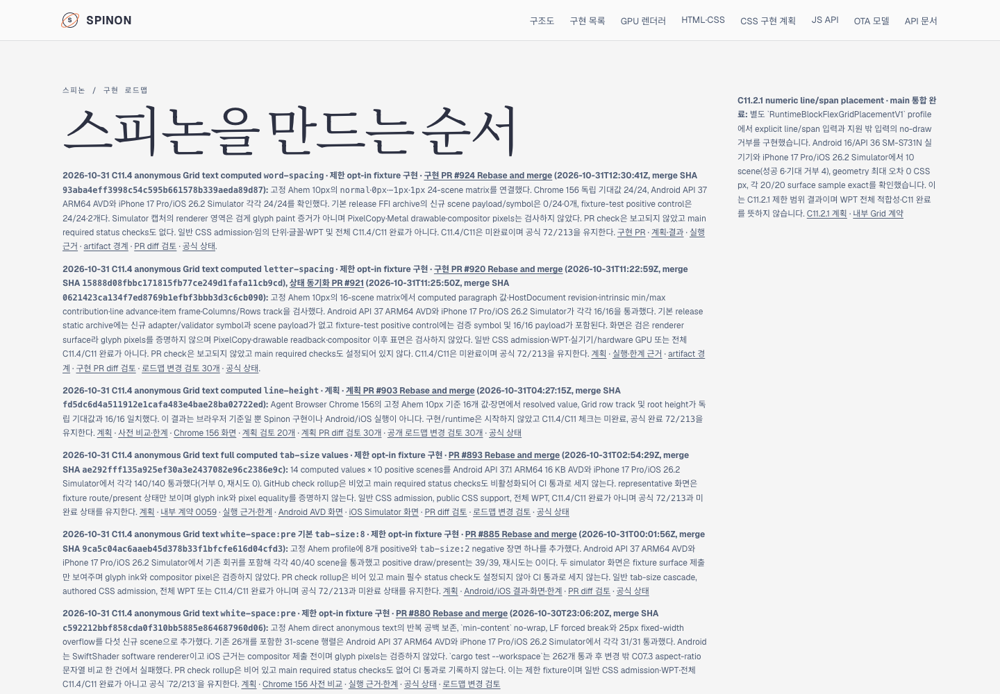

# C11.4 computed `word-spacing` 병합 후 문서 동기화

## 구현 PR 결과

구현 PR [#924](https://github.com/ohah/spinon/pull/924)은 2026-10-31T12:30:41Z Rebase and merge로 병합됐다(merge SHA `93aba4eff3998c54c595b661578b339aeda89d87`). 이 slice는 기존 opt-in anonymous Grid text fixture의 24개 고정 scene이다. Android API 37 ARM64 AVD와 iPhone 17 Pro/iOS 26.2 Simulator 각각 24/24, Chrome 156 독립 기대값 24/24를 확인했다. 상세 실행·artifact·한계는 [구현 근거](../c11-4-anonymous-grid-text-word-spacing-runtime-2026-10-31/README.md)에 기록했다.

PR check은 보고되지 않았고 `main` required status checks도 설정되어 있지 않아 CI 통과로 판정하지 않는다. Simulator renderer 영역은 검게 표시되어 glyph paint, PixelCopy, Metal drawable 또는 compositor 이후 pixel equality를 증명하지 않는다.

## 상태와 문서 변경

이 동기화는 merge 결과를 내부 계약 0059, [공식 상태 대장](../../STATUS.md), C11/C11.4 계획과 공개 HTML 로드맵에 반영한다. 공식 C11/C11.4 checkbox는 미완료로 두고 완료 집계 `72/213`도 유지한다. 일반 CSS author admission, WPT 적합성 또는 전체 C11.4 지원으로 승격하지 않는다.

PR diff의 독립적인 30개 문서 실패 관점은 [검토 기록](./pr-diff-review-30.md)에 있다.

## Tailnet 미리보기

선택된 RSPress 2.0.22 route build는 source 167개를 사용해 235개 route를 생성했다. RSPress 전체 문서 build는 기존 문서의 여러 dead link에서 실패했다. 선택 build는 범위 밖의 전체 링크를 검사하지 않으므로 전체 문서 링크 검증으로 해석하지 않는다.

Tailscale backend는 `Running`이고 기존 `tailnet-preview-server.mjs`가 `127.0.0.1:8768`에서 응답했다. 사전 검사에서 교체 대상 열린 파일은 0개였다. publication은 235개 route였고 교체 전 파일은 백업했다. 기존 미리보기 파일을 삭제하거나 서버를 재시작하지 않았다. 로컬 대상 235/235, 모든 backup 및 Tailnet HTTPS 235/235의 HTTP 200·SHA-256 일치를 확인했다. 기계 판독 요약과 route manifest 파일명은 `tailnet-sync-summary-pass02.json`, `selected-publication-pass05.json`, `preflight-pass06.json`, `copy-and-backup-pass06.json`, `served-verification-pass06.json`이다.

Agent Browser에서 공개 로드맵 카드에 PR #924, merge SHA, 양 플랫폼 24/24와 `72/213`이 보이는 것을 확인했다. `/STATUS.html`의 C11 및 C11.4 checkbox는 둘 다 unchecked였다. 캡처는 아래에 있고 기계 판독 기록은 `agent-browser-verification-pass02.json`이다. `agent-browser close --all` 뒤 Agent Browser 프로세스가 남지 않은 것을 확인했다. Terminal Browser는 사용하지 않았다.

내부 Tailnet hostname은 공개 증거 파일에 남기지 않았다. 재사용 스크립트는 `SPINON_TAILNET_PREVIEW_BASE=https://<host>/spinon/`을 환경 변수로 받으며, 기록에는 hostname을 저장하지 않는다.

공식 Pages/`gh-pages` 배포는 하지 않았다.
