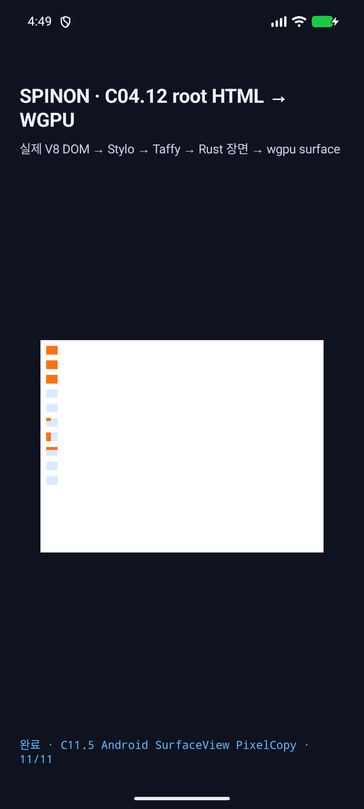
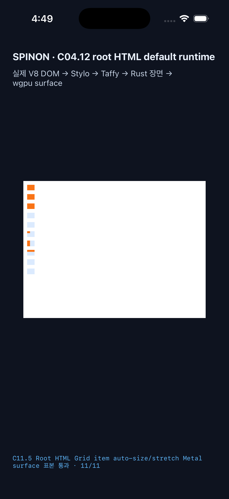

# C11.5 Root HTML Grid item auto-size/stretch 후보 실행 근거

이 폴더는 branch `feat/c11-5-grid-item-auto-stretch`의 미병합 후보를 기록한다. 기준 commit은 `8288072446e1847580c2804570a0d5d6f20723c4`이고, 호환성 수정 source commit은 `5969be0aca200a5507126bbf479aa45f7cf155c1`이다. 시뮬레이터 빌드는 해당 commit과 같은 working tree에서 수행했으며 fixture SHA-256은 metadata에 고정했다. opt-in 실행 동안 Android/iOS의 `root-html-default-rendering.html`을 fixture로 임시 교체해 번들링한 뒤 원본 SHA-256 `38813ca802618bd20bdf3bbb9ed9bc7525c289f48c0928813c855567f9e7df85`로 복구했다. Fixture의 Grid container는 기본 `content-box`, item은 `content-box`와 `border-box`를 모두 포함하며 모든 margin/padding/border는 0이다.

## Rust 검증

- C11.5 runtime focused tests: 5/5 통과. 10개 accepted scene은 독립 expected JSON의 item frames와 parent/self computed alignment values를 대조하고, 16개 범위 밖 입력은 partial scene 없이 거부한다.
- Root HTML grid alignment projection tests: 3/3 통과.
- 관련 Grid text stretch 회귀: 2/2 통과.
- `cargo clippy --locked -p spinon-layout -p spinon-style-to-layout -p spinon-runtime --all-targets -- -D warnings`, `cargo fmt --all -- --check`, `git diff --check` 통과.
- PR review에서 발견한 shared `border-box` gate 회귀를 제거한 뒤 runtime 5/5, projection 3/3 및 두 box-sizing의 accepted frame matrix를 다시 확인했다.
- 명령과 전체 로그는 gzip 원문인 `rust-*-focused.log.gz` 및 `rust-clippy.log.gz`에 보존했다. 전체 workspace test suite는 이 후보에서 실행하지 않았다.

## Android API 37 ARM64 에뮬레이터

`emulator-5554`에서 `layout=ready`, 29 boxes, 980×735 CSS px viewport, 840×630 SurfaceView를 기록했다. Renderer는 ANGLE/Vulkan SwiftShader다. SurfaceView PixelCopy는 11/11 exact이며 fixed-width item의 바깥쪽이 같은 Grid cell 배경색인 표본도 포함한다. Android default APK의 DEX에는 C11.5 adapter와 fixture ID가 없고, opt-in APK에는 포함된다. 이 결과는 실기기 또는 hardware GPU 근거가 아니다.

원본 Logcat, OS screenshot, PixelCopy PNG, opt-in/default 빌드 로그와 해시는 이 폴더에 있다. 텍스트 실행 로그는 원문 그대로 `.log.gz`로 압축했다.

## iOS iPhone 17 Pro / iOS 26.2 Simulator

동일 fixture에서 `layout=ready`, 29 boxes, 980×735 CSS px viewport, 960×720 Metal drawable을 기록했다. drawable 표본은 11/11 exact다. 이 readback은 compositor 제출 전이며, `ios-simulator-screen.png`는 별도 OS-composited screenshot이다. default executable에는 C11.5 auto-stretch argument와 scene ID가 없고, opt-in executable에는 포함된다.

## 기존 fixed-size C11.5 route 회귀

수정 source commit과 같은 코드에서 기존 self-alignment fixture를 앱 기본 Root HTML 경로로 다시 실행했다. Android API 37 AVD는 79 boxes와 PixelCopy 7/7 exact, iPhone 17 Pro Simulator는 79 boxes와 compositor 전 Metal drawable 7/7 exact를 기록했다. raw build/runtime 로그와 opt-in artifact hash는 `*-fixed-self-alignment-regression*.log.gz` 및 `simulator-build-metadata.json`에 있다.

## 완료 경계

이 결과는 Root HTML 제한 runtime profile의 PR 후보 검증이다. real-device/hardware GPU, iOS compositor 이후 pixel, 전체 CSS Grid/WPT 적합성은 다루지 않는다. 계획 20개·구현/runtime 20개·PR diff 30개 실패 관점 검토를 별도 파일에 기록했다. PR #1132 check rollup은 비어 있어 CI 통과로 세지 않으며 C11.5와 C11 공식 체크 및 `72/213` 집계는 유지한다.
