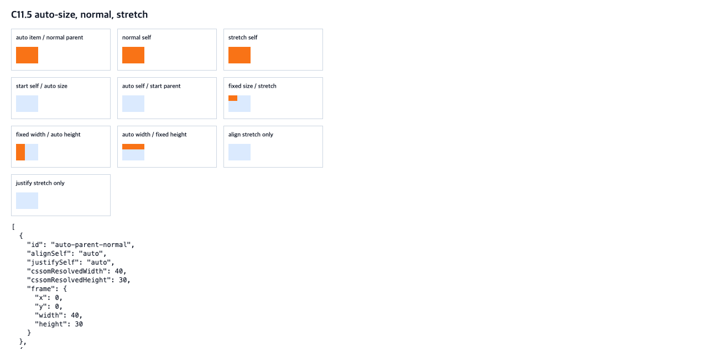

# C11.5 Grid item auto-size and stretch precomparison

This is a preimplementation oracle for the next narrow parsed Root HTML Grid item slice. Chrome observations and independently derived expected frames are stored separately; neither is Spinon implementation evidence.

## Scope

- Ten empty, non-replaced `div` items in fixed `40×30 CSS px` grid areas with one explicit row and column.
- `width` and `height` are each either `auto` or finite non-negative fixed `px`.
- Items have no preferred aspect ratio, content, margin, padding, border, or overflow behavior beyond `visible`.
- The matrix covers parent `normal`/`start`, self `auto`/`normal`/`stretch`/`start`, both axes, and fixed/automatic dimensions on either axis.

## Evidence

- Fixture: [`root-html-grid-item-auto-stretch-precomparison.html`](https://github.com/ohah/spinon/blob/main/tests/fixtures/css/c11/root-html-grid-item-auto-stretch-precomparison.html), SHA-256 `d034f5584f4475270e11e2eec3947671571f98496e3b31b145c53e237cfcc40e`.
- Browser: Agent Browser, HeadlessChrome `156.0.8078.80`, revision `fb096c0011f9d50f0a264a9376420cdea9c421e3`, macOS `26.5.1 arm64`, viewport `1280×633 CSS px`, DPR 1.
- Chrome observations include computed self-alignment keywords, CSSOM-resolved width/height, and measured frames ([JSON source](https://github.com/ohah/spinon/blob/main/spec/internal/evidence/c11-5-grid-item-auto-stretch-precomparison-2026-11-04/chrome156-observation.json)). Independent expected frames ([JSON source](https://github.com/ohah/spinon/blob/main/spec/internal/evidence/c11-5-grid-item-auto-stretch-precomparison-2026-11-04/expected.json)) are derived from normative rules, not copied from browser output.
- Screenshot: SHA-256 `3d70d992e6b52f578f0ae37f53f2192156c469c302733ece7b99b23d0d429737`, `1280×633` pixels.

## Normative basis

- [CSS Box Alignment Level 3: self-alignment values](https://www.w3.org/TR/css-align-3/#align-justify-self-property) defines `auto`, `normal`, and `stretch`, including stretch's automatic-size condition.
- [CSS Grid Layout Level 2: item alignment](https://www.w3.org/TR/css-grid-2/#grid-item-align) defines Grid item alignment behavior and the `normal` fallback for items without a preferred aspect ratio.

These ten scenes do not establish arbitrary authored CSS admission, replaced items, aspect-ratio sizing, content-based intrinsic sizing, baseline alignment, general Grid support, WPT conformance, simulator behavior, or C11.5/C11 completion.
