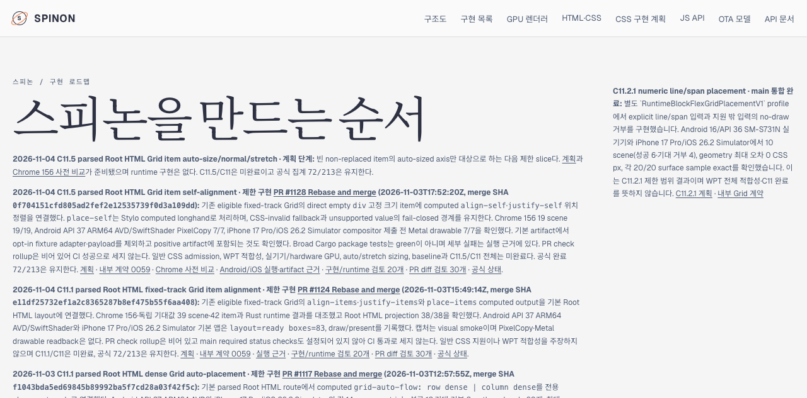

# C11.5 auto-size/stretch Tailnet roadmap sync

The Tailnet roadmap was updated after PR #1130 merged. Only the selected static `roadmap.html` page was copied into the existing preview root; the server was kept running.

## Source and served route

- Source: `spec/public/roadmap.html` at main revision `74db75bf49ad24c1d5ac558bb22ffd1911b8684d`.
- Route: [Tailnet roadmap](https://macstudio.tailed42f2.ts.net/spinon/roadmap.html).
- The source, served file, and HTTPS response were `551498` bytes with SHA-256 `0301e2c299cbebd31811f405381883cec6dbdf124b1dd3a346643829e455e87e`; HTTP status was 200.
- Previous served content was preserved at `/tmp/spinon-c11-5-grid-item-auto-stretch-tailnet-sync-2026-11-04/roadmap.html.before`, SHA-256 `e953474d1b547abb8d2a8c82ccdabb7fab2e3b3bd117955d126ef2c5812c2c37`.
- Machine-readable manifests: `tailnet-sync-manifest.json` and `browser-observation.json`.

## Visual verification

Agent Browser HeadlessChrome 156 opened the Tailnet URL, confirmed the planned C11.5 card, its plan and precomparison links, and captured the page at `1280×633` CSS px, DPR 1.

The page identifies the work as plan-stage, says runtime implementation is absent, and keeps C11 incomplete and the official count at `72/213`.

## Build limitation

The pinned Rspress build was attempted with output directed to `/tmp`. It exited with code 1 because existing unrelated Markdown pages contain dead links to missing `.json.html`, `.png.html`, fixture, and evidence routes. A second build after converting this evidence page's local JSON links to GitHub source links still failed on those pre-existing routes; the build log contained no dead-link report for this task's evidence directory. To update the specifically requested public static roadmap, the committed `spec/public/roadmap.html` source was copied atomically and its served hash verified. `STATUS.html` was not rebuilt or replaced. The existing preview server PID 28040 remained running.
