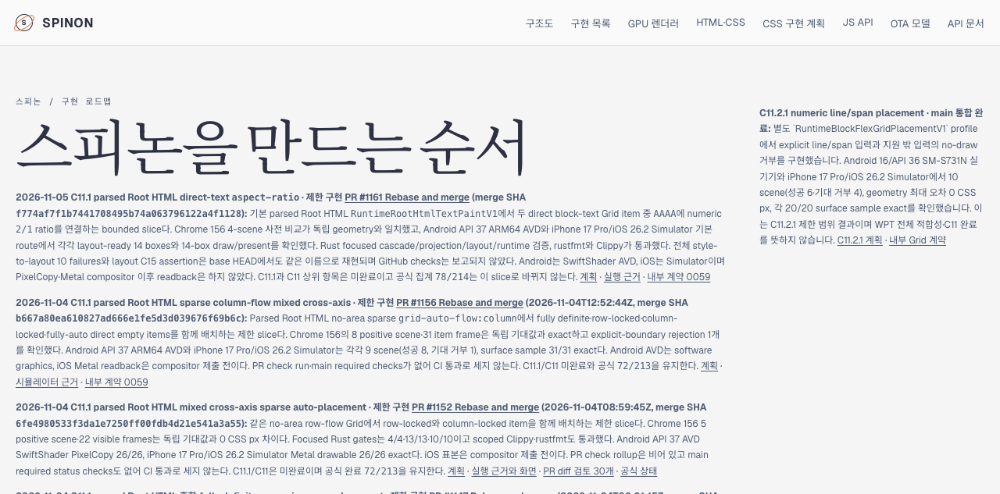
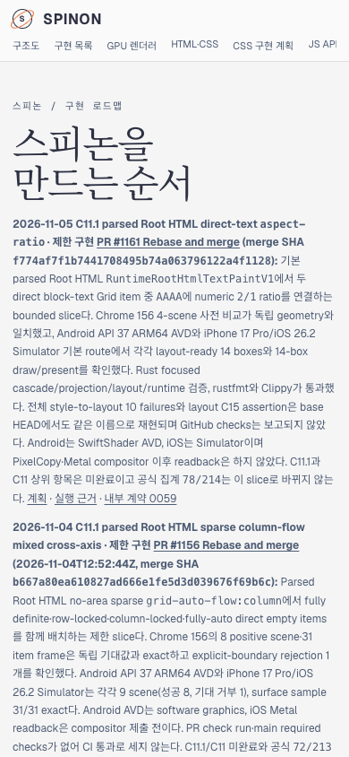

# C11.1 aspect-ratio 병합 상태 Tailnet roadmap sync · 2026-11-05

`spec/public/roadmap.html`의 첫 C11 진행 요약에 PR #1161 Rebase and merge 결과를 추가했다. C11.1/C11 상위 항목은 미완료로 유지하며, 페이지의 현재 공식 동적 집계는 78/214다. 기존 날짜가 붙은 C11 작업 기록은 당시 기록으로 남겼다.

로드맵에서 연결하는 [pass 04 실행 근거](../c11-root-html-grid-text-aspect-ratio-runtime-2026-11-05/pass04-default-alignment-gate/README.md)도 병합된 PR 상태와 SHA로 맞췄고, 해당 근거의 `SHA256SUMS`를 다시 검증했다.

이 문서 변경에 대한 독립 검토 항목은 [PR diff 적대 검토 30개](./pr-diff-review-30.md)에 기록했다.

## Tailnet 미리보기 반영

- Route: `https://macstudio.tailed42f2.ts.net/spinon/roadmap.html` (`roadmap.html`)
- Source SHA-256: `fa505b07b0d649b6f15cc61be733c6c59ab2abf211010bac6899f36b85a0122c`
- 이전 target SHA-256: `3d3f1b9501a70db5613277ca56e64ffaaf0531d19bbc76383654df0aa173d3f0`
- 백업: `~/Library/Application Support/SpinonPreviewBackups/c11-root-html-aspect-ratio-roadmap-tailnet-sync-2026-11-05/roadmap.html`
- Tailscale backend는 `Running`, 기존 preview server PID 28040은 작업 전후 동일했고 재시작하지 않았다. 교체 전 target에 열린 파일 handle이 없음을 확인하고 백업 후 같은 디렉터리에서 atomic rename했다. 삭제한 파일은 없다.
- [preflight](./preflight.json), [copy·backup](./copy-and-backup.json), [local served verification](./served-verification.json), [sync script](./sync-roadmap.mjs)에 절차와 hash를 보존했다. 로컬 preview는 HTTP 200이며 source와 served route hash가 같다.

## Agent Browser 확인

Agent Browser로 Tailnet URL을 다시 열었다. 첫 C11 요약에 PR #1161과 merge SHA `f774af7f1b7441708495b74a063796122a4f1128`가 보이고, 공식 상태 동기화는 상위 78개 + ID 세부 134개 + ID 없는 하위 체크 2개, 완료 78/214로 표시됐다. 390×844 viewport에서 document width도 390px이고 가로 overflow가 없다. [desktop 확인](./agent-browser-verification.json), [mobile 확인](./agent-browser-mobile-verification.json).

