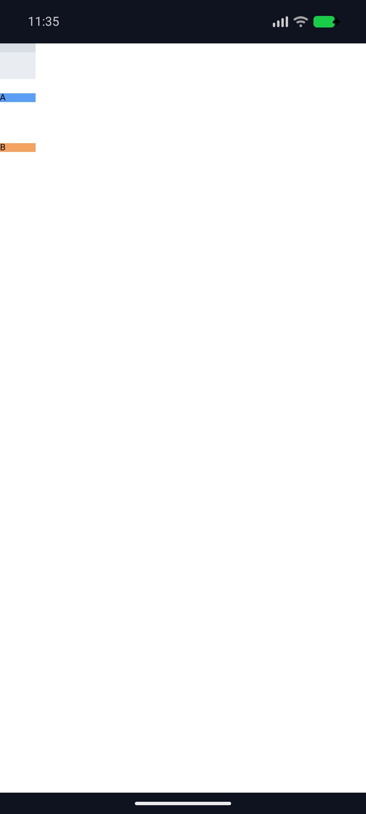
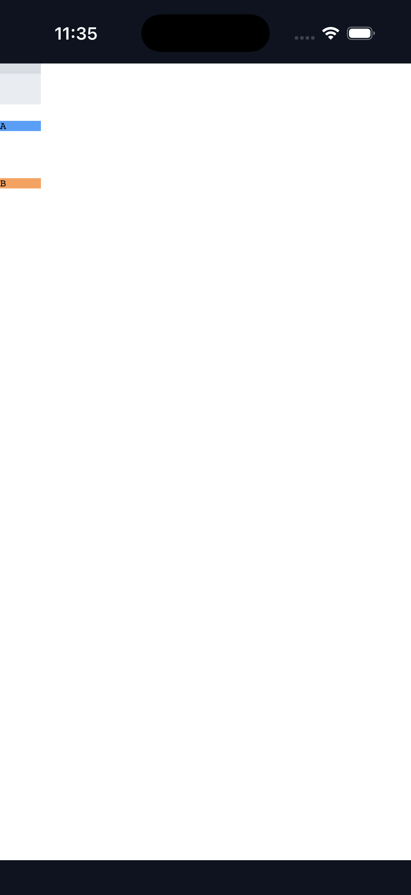
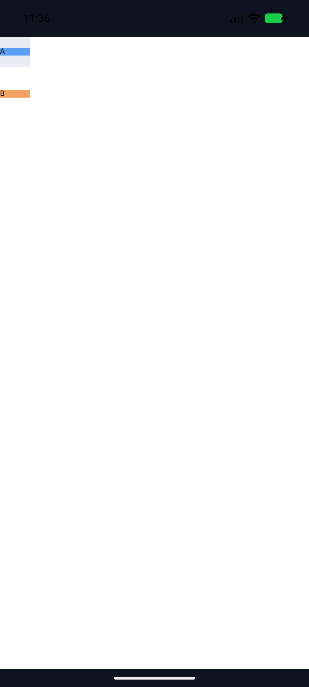
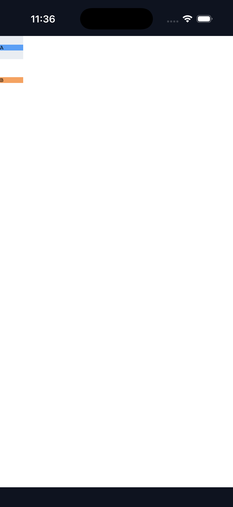

# C11.4 Root HTML `align-content:safe|unsafe center` 실행 근거

## 판정 범위

현재 후보는 기본 parsed Root HTML runtime의 기존 `RootHtmlAutoRowStretchV1` fixed shape에서 정확한 `safe center`와 `unsafe center`만 허용한다. C11.4/C11 완료, 일반 CSS author admission, WPT, 실기기 또는 hardware GPU 지원 판정은 아니다. 기준은 [Chrome 157 사전 비교와 독립 기대값](../c11-root-html-auto-row-safe-center-precomparison-2026-11-07/README.md), [후속 계획](../../../../plan/c11-root-html-auto-row-safe-center.md), [내부 계약 0059](../../0059-c11-grid-layout.md)의 제한 profile이다.

입력은 40×40px Grid, 40px explicit column, 10px explicit row, 두 implicit `auto` rows, 40×10px fixed empty item 뒤 direct text `A`/`B`, column-gap 0과 visible overflow다. Positive control의 row-gap은 0px이며 safe/unsafe/plain center item y offsets는 `[5,15,25]px`다. Overflow row-gap `calc(120% - 2px)`는 definite 40px block basis에서 46px이고, tracks `[10,10,10]px`와 두 gutters의 alignment subject는 122px이다. 기대 좌표는 safe center `[0,56,112]px`, unsafe/plain center `[-41,15,71]px`다.

## 구현과 focused gates

- Style-to-layout profile allowlist는 정확한 computed `safe center`·`unsafe center`를 추가하고 `safe start`, `unsafe end`, `unsafe flex-start`, baseline, distributed safety와 unknown value는 계속 닫아 둔다.
- Layout의 `RootHtmlAutoRowStretchV1` validator와 one-axis placement validator는 같은 제한 alignment helper를 사용한다. 기존 `AlignmentSafety` mapping은 Safe/Unsafe를 Taffy Grid AlignContent로 전달한다. Track trace는 세 row가 모든 장면에서 10px로 유지됨을 확인한다.
- RuntimeSession은 positive/overflow 6 scene의 painted frames를 독립 기대값에 `1/64 CSS px` 허용치로 비교한다. Unsupported `safe start`는 실패하고 같은 session의 light→dark→light 전환 뒤 지원값으로 복구된다.
- `cargo test --locked -p spinon-layout root_html_auto_row -- --nocapture`: 14 passed.
- `cargo test --locked -p spinon-style-to-layout root_html_auto_row -- --nocapture`: 4 passed.
- `cargo test --locked -p spinon-runtime parsed_root_html_calc_row_gap -- --nocapture`: 2 passed.
- `cargo test --locked -p spinon-runtime parsed_root_html_safe_center -- --nocapture`: 2 passed.
- `cargo clippy --locked -p spinon-layout -p spinon-style-to-layout -p spinon-runtime --all-targets -- -D warnings`: passed.
- `cargo fmt --all -- --check`와 `git diff --check`: passed.

## Android·iOS simulator 실행

고정 runner [run-simulators.sh](./run-simulators.sh)는 기존 build/app/bootstrap 자산을 임시 백업하고 복원하며 해시를 비교한다. 각 scene은 `SPINON_ENABLE_C04_RUNTIME_GPU=1`로 Android/iOS 앱을 빌드했고 C11 fixture feature는 모두 끈 상태다. 세 장면을 Android API 37 ARM64 AVD `emulator-5554`와 iPhone 17 Pro / iOS 26.2 Simulator `9DCCE836-7659-4914-B6C1-13F54BFFA9DB`에서 각각 실행했다.

| Scene | Fixture SHA-256 | Android/iOS 실행 | 기대 y offsets (CSS px) |
|---|---|---|---|
| Positive `safe center` | `7faed61c8149d077b1f87527729074c9b7d17052fb13888014e70ab0e85e88e5` | 두 플랫폼 `layout=ready`, 6 boxes, `runtime_text_count=2` draw/present | `[5,15,25]` |
| Overflow `safe center` | `4ecb34c8db7c259fd6399a0fab6ffbb6f9c30dc8b20a8d6919f26d331d1fc0a4` | 두 플랫폼 `layout=ready`, 6 boxes, `runtime_text_count=2` draw/present | `[0,56,112]` |
| Overflow `unsafe center` | `37e1398577ea7c17a495dd1ddbf27fe98e12ccbf804447114bca419737da006b` | 두 플랫폼 `layout=ready`, 6 boxes, `runtime_text_count=2` draw/present | `[-41,15,71]` |

각 실행의 raw log, artifact hash, device info, screenshot, source fixture 복사본과 restoration 결과는 [pass01](./pass01/environment.txt), [pass02](./pass02/environment.txt), [pass03](./pass03/environment.txt)에 있다. 세 실행 모두 `asset_and_simulator_restoration=PASS`다. 복원된 Android 설치 APK와 prior build APK SHA-256은 `48db6dd5748c5bb7717d20ce4b3bc023ebe93acb1dc202b3d973164544c5bc04`; 복원된 iOS 설치/build executable SHA-256은 `eca866e291d5ffbbe7756c354532bb69bca9d2fed264bc8181d02c61a772a929`다.

### Screenshot bounds

[analyze_screenshot_pixels.py](./analyze_screenshot_pixels.py)는 OS PNG의 정확한 RGB bounds를 재고 expected y offsets와 비교한다. Root origin은 같은 platform의 positive-control PNG에서 읽고, 각 장면은 최대 1 CSS px 허용치로 대조한다. [Positive](./pass01/screenshot-pixel-analysis.json), [safe overflow](./pass02/screenshot-pixel-analysis.json), [unsafe overflow](./pass03/screenshot-pixel-analysis.json) 결과가 모두 통과했다. 예를 들어 safe overflow의 `A`/`B` top은 Android에서 56.0/112.0px, iOS에서 56.0/112.0px이며 unsafe overflow의 `A`/`B` top은 Android에서 14.857/70.857px, iOS에서 15.0/71.0px이다. Unsafe의 첫 fixed item은 system status area에 겹쳐 OS screenshot에서 색 bounds를 잡지 못했지만 RuntimeSession/Layout gate는 음수 `-41px` 좌표를 확인한다.

OS screenshot은 시각 및 색 경계 관측일 뿐 PixelCopy나 Metal drawable readback이 아니다. iOS compositor 이후 pixel parity, 실제 기기·hardware GPU, WPT, CI 결과는 확인하지 않았다. 구현 PR의 GitHub check rollup은 이 근거에서 다루지 않는다.
