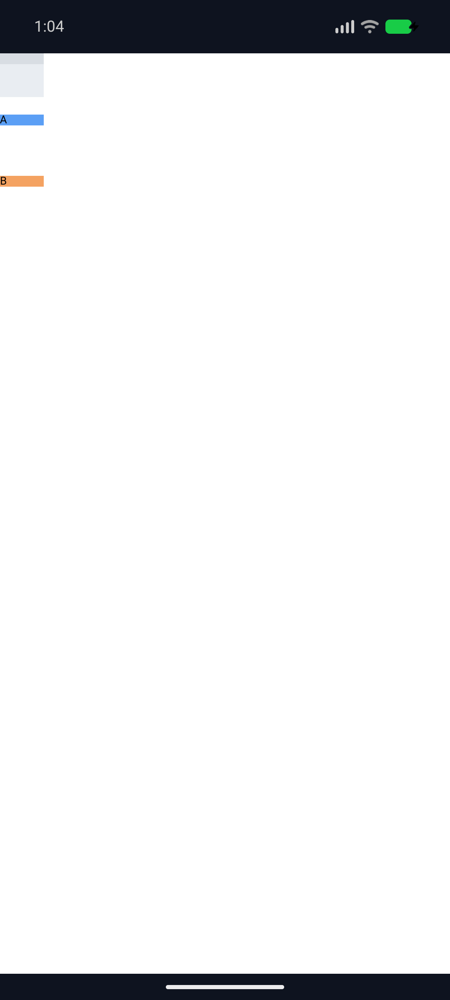
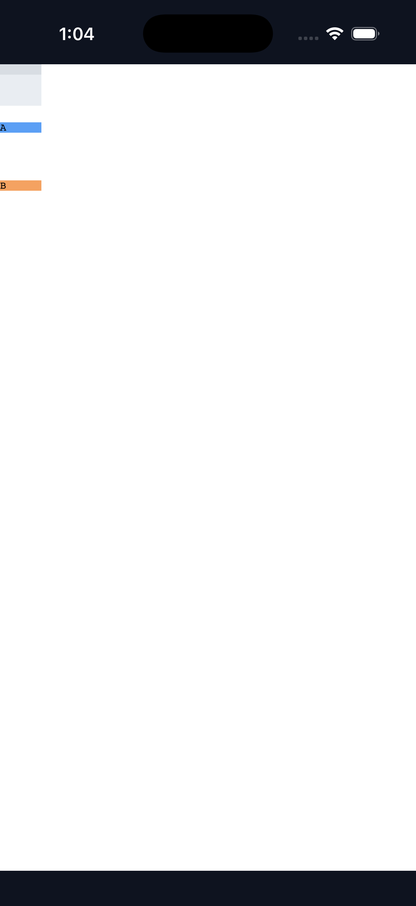
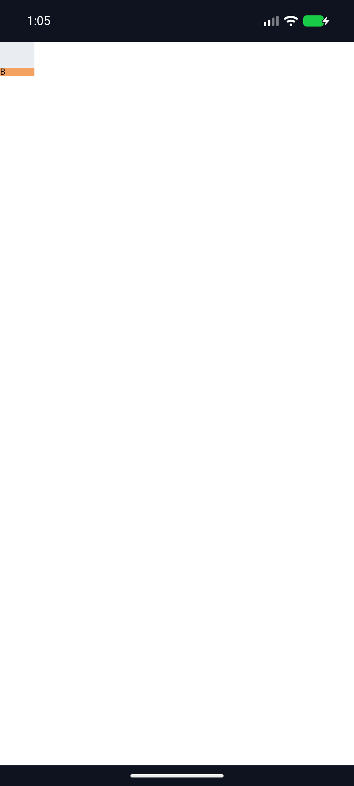
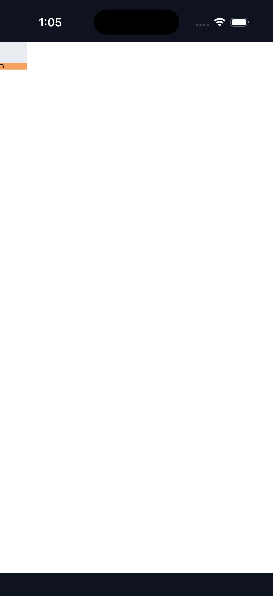

# C11.4 `align-content:safe|unsafe end` 실행 근거

## 범위와 oracle

기본 parsed Root HTML `RuntimeRootHtmlTextPaintV1` 경로에서 기존 `RootHtmlAutoRowStretchV1` 제한 profile의 computed `align-content` 값으로 `safe end`와 `unsafe end`를 추가했다. Profile은 40×40px definite content box, 40px explicit column, 10px explicit row, 두 implicit auto rows, fixed empty item 뒤 direct text `A`/`B`, row-flow와 `column-gap:0`이다. Grid parser, generic CSS admission, public API, FFI, row sizing과 내부 계약 `0.1.0`은 바꾸지 않았다.

[HeadlessChrome 157 사전 비교](../c11-root-html-auto-row-safe-end-precomparison-2026-11-07/README.md)의 8 scene·96 item/frame 좌표를 독립 계산과 대조했다. 최대 차이는 0 CSS px다. Positive space에서 item 시작점은 `[10,20,30]px`; `calc(120% - 2px)` row-gap은 40px basis에서 46px로 resolve되고 overflow subject는 122px이다. 이때 `safe end`는 start fallback `[0,56,112]px`, `unsafe end`와 plain `end`는 `[-82,-26,30]px`다. 모든 case에서 used rows는 `[10,10,10]px`다.

## Rust 검증

- `cargo test --locked -p spinon-layout root_html_auto_row_safe_end -- --nocapture` — 2/2 통과.
- `cargo test --locked -p spinon-layout root_html_auto_row -- --nocapture` — 16/16 통과. Safe/unsafe center, fixed/percentage/`calc()` gap regressions 포함.
- `cargo test --locked -p spinon-style-to-layout root_html_auto_row_safe_end -- --nocapture` — 2/2 통과. Positive/overflow projection 및 `safe start`·`unsafe start`의 속성 단위 오류 확인.
- `cargo test --locked -p spinon-style-to-layout root_html_auto_row -- --nocapture` — 6/6 통과.
- `cargo test --locked -p spinon-style-to-layout allowlist_keeps_baseline_safety_and_unknown_values_closed -- --nocapture` — 1/1 통과.
- `cargo test --locked -p spinon-runtime parsed_root_html_safe_end -- --nocapture` — 2/2 통과. Unsupported value의 원자적 실패와 같은 RuntimeSession의 supported-value 복구 포함.
- `cargo test --locked -p spinon-runtime parsed_root_html_safe_center -- --nocapture` — 2/2 통과.
- `cargo test --locked -p spinon-runtime parsed_root_html_calc_row_gap -- --nocapture` — 2/2 통과.
- `cargo clippy --locked -p spinon-layout -p spinon-style-to-layout -p spinon-runtime --all-targets -- -D warnings` 및 `cargo fmt --all -- --check` — 통과.

## Android/iOS 실행

모든 입력은 fixture-test feature를 끈 기본 app build와 기본 Root HTML route다. Android는 API 37 ARM64 AVD `emulator-5554` (ANGLE/Vulkan/SwiftShader), iOS는 iPhone 17 Pro / iOS 26.2 Simulator (`9DCCE836-7659-4914-B6C1-13F54BFFA9DB`)다. 각 플랫폼에서 positive space, safe overflow, unsafe overflow를 실행했고 세 scene 모두 `layout=ready`, 6 boxes, runtime text 2개와 draw/present를 기록했다.

| 장면 | Chrome/독립 기대 item y (CSS px) | Android OS screenshot 경계 측정 | iOS Simulator screenshot 경계 측정 |
|---|---:|---:|---:|
| Positive `safe end` | `[10,20,30]` | `[9.905,19.810,30.095]` | `[10,20,30]` |
| Overflow `safe end` | `[0,56,112]` | `[0,56,112]` | `[0,56,112]` |
| Overflow `unsafe end` | `[-82,-26,30]` | `[화면 밖, 화면 밖,30.095]` | `[화면 밖, 화면 밖,30]` |

최종 후보 source diff hash `8feb6fc6f7dd630085dcf6058e99146f5e9f47f156d0cd1e27fe7c28a94437d4`에 바인딩된 pass04–06은 positive, safe overflow, unsafe overflow 순이다. 각 scene에서 두 플랫폼 모두 `layout=ready`, 6 boxes, runtime text 2개와 draw/present를 기록했다. Screenshot 경계 허용치는 1 CSS px다. 화면 밖으로 배치된 item 두 개는 viewport screenshot에서 보이지 않지만, Rust layout matrix가 음수 y 좌표를 직접 확인한다. 캡처는 OS screenshot의 색 영역으로 계산한 시각 근거이며 Android PixelCopy, Metal drawable readback, compositor 이후 pixel equality가 아니다.

## 격리와 복원

실행 스크립트는 각 pass마다 기존 bootstrap 입력, 빌드 산출물과 설치 앱을 보관한 뒤 복원한다. 최초 pass01–03과 최종 source hash에 바인딩된 pass04–06 모두 Android APK `48db6dd5748c5bb7717d20ce4b3bc023ebe93acb1dc202b3d973164544c5bc04`, iOS executable `eca866e291d5ffbbe7756c354532bb69bca9d2fed264bc8181d02c61a772a929` 설치본 해시를 복구했고, 모든 pass에 `asset_and_simulator_restoration=PASS`가 기록됐다. 후보 바이너리 해시와 fixture hash는 각 pass의 `environment.txt` 및 플랫폼 artifact manifest에 있다.

첫 screenshot 분석에서는 Grid 배경색이 전체 40px 높이를 채운다고 가정했다. Positive scene은 child item이 Grid 아래쪽을 덮으므로 이 가정은 틀렸다. Analyzer를 Grid 배경색의 남은 첫 행에서 origin/폭을 구하도록 고쳤고, 색 경계를 이용한 세 장면의 y 좌표를 다시 계산했다. 보정값과 screenshot hash는 각 pass의 `screenshot-pixel-analysis.json`과 `screenshot-sha256.txt`에 남겼다.

저장소 diff 검증을 위해 6개 iOS build log와 pass03 Android runtime log의 줄 끝 공백 및 중복 EOF 개행만 제거했다. 로그의 나머지 출력 내용은 그대로다.

## 실패 경계와 남은 범위

`safe start`와 `unsafe start`는 이 slice에서 계속 거부한다. 검토 중 profile 거부가 `grid-auto-rows` 오류로 잘못 귀속되는 것을 찾아 수정했다. 이제 projection은 정확히 `align-content`와 거부된 computed value를 반환하며 해당 속성 검사가 회귀 테스트에 있다. Unsupported input은 frame snapshot을 부분 publish하지 않고 같은 session에서 지원 값으로 복구한다.

이 증거는 지정한 Chrome 관측, Rust profile 및 두 Simulator 조합에 한정된다. Spinon WPT 적합성, 다른 grid topology·writing mode·direction, physical device, hardware GPU, iOS compositor 이후 pixels, generic author CSS admission 또는 C11.4/C11 완료를 뜻하지 않는다. 공식 전체 상태 `78/214`와 C11/C11.4 미완료 표시는 유지한다.

- [구현/runtime 실패 관점 20개](./implementation-review-20.md)
- [계획](../../../../plan/c11-root-html-auto-row-safe-end.md)
- [Chrome 사전 비교](../c11-root-html-auto-row-safe-end-precomparison-2026-11-07/README.md)
- [내부 계약 0059](../../0059-c11-grid-layout.md)
