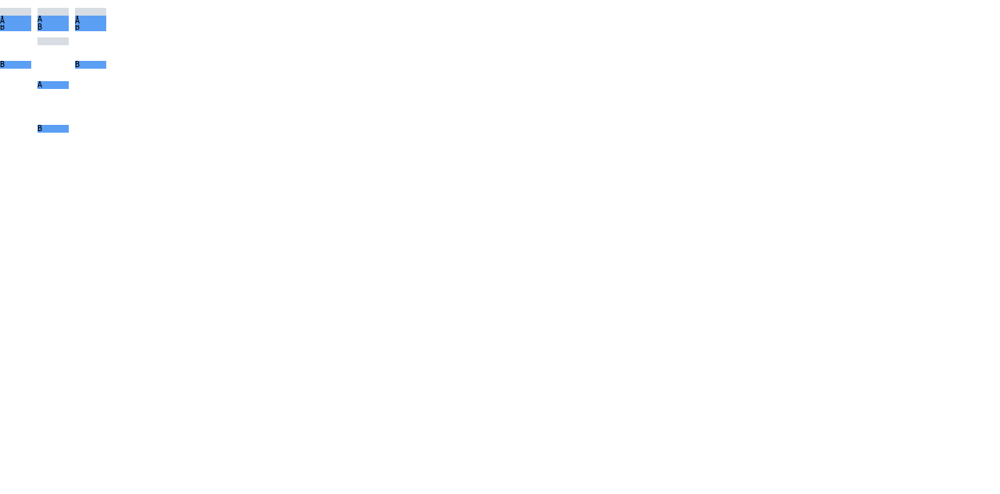

# C11.4 `align-content:safe|unsafe flex-end` 사전 비교

## 입력과 독립 산식

기준 HTML은 기본 parsed Root HTML 고정 profile과 같은 40×40px Grid, 40px column, 10px explicit row, 두 direct-text implicit `auto` rows, fixed empty item과 `A`/`B` text items를 쓴다. `end`, `safe flex-end`, `unsafe flex-end`를 `row-gap:0px` positive scene 및 definite 40px block-size basis의 `calc(120% - 2px)` overflow scene에 적용한다.

CSS Box Alignment Level 3 §4.1은 `flex-end`가 flex formatting context 밖의 content alignment에서 `end`처럼 동작한다고 정의한다. §4.4에서 safe alignment는 overflow 시 시작점 방향으로 fallback하고 unsafe는 요청 end alignment를 유지한다. 이 산식은 positive y offsets `[10,20,30]`, overflow `end`·`unsafe flex-end` offsets `[-82,-26,30]`, overflow `safe flex-end` offsets `[0,56,112]`을 독립적으로 계산한다. Three 10px tracks와 two 46px gutters는 모든 장면에서 유지되어야 한다. 규범 참조는 [CSS Box Alignment Level 3 §4.1](https://www.w3.org/TR/css-align-3/#positional-values), [§4.4](https://www.w3.org/TR/css-align-3/#overflow-values)다. 문서는 2026-10-08 Working Draft이며 `<overflow-position>` 값은 at-risk다.

## HeadlessChrome 157 관측

Agent Browser 0.31.1 / HeadlessChrome 157.0.0.0에서 1280×633 CSS px, DPR 1 viewport를 사용했다. Computed `align-content`는 세 입력 문자열을 각각 그대로 보존한다. 6 scene·72 item-frame coordinates가 독립 기대값과 0 CSS px 최대 오차로 일치했다(허용치 1/64 CSS px). `computed grid-template-rows`는 모든 scene에서 `10px 10px 10px`; overflow computed row-gap은 `calc(120% - 2px)`다.

| `row-gap` | 값 | Observed item y (CSS px) |
|---|---|---|
| `0px` | `end` | `[10,20,30]` |
| `0px` | `safe flex-end` | `[10,20,30]` |
| `0px` | `unsafe flex-end` | `[10,20,30]` |
| `calc(120% - 2px)` | `end` | `[-82,-26,30]` |
| `calc(120% - 2px)` | `safe flex-end` | `[0,56,112]` |
| `calc(120% - 2px)` | `unsafe flex-end` | `[-82,-26,30]` |

관측 JSON, 독립 기대값과 비교기는 각각 [Chrome observation](./chrome-observed.json), [expected](./expected.json), [comparison](./comparison.json), [compare.py](./compare.py)다. [Chrome screenshot](./chrome-reference.png)은 이 고정 입력의 기준 화면이다.

Agent Browser session을 닫은 뒤 `agent-browser` 및 `HeadlessChrome` process scan은 비었다([lifecycle](./browser-lifecycle.json)). 이 자료는 browser oracle과 계획 입력만 고정하며 Spinon 구현, app runtime, mobile/physical device, WPT 적합성, GPU surface readback 또는 C11.4/C11 완료를 주장하지 않는다.

## Artifact SHA-256

| Artifact | SHA-256 |
|---|---|
| `flex-end-reference.html` | `77042fc472dc2f8d731325807427a8b1e3110c4f8df2c9c9025ec27f0df04498` |
| `chrome-observed.json` | `9e6435fdd0f7152d782c29a9fc79eb78a656bc449be98f1f65cae6e3f9ab613b` |
| `expected.json` | `5e48302708822e658cf04b3f5c9d3489094cccf207a942e2152a31ca8c7aeaf8` |
| `comparison.json` | `50a7ecef715821fadf0e39bb2dece72c8c5a8003384735bb0438e00993ff3a9d` |
| `chrome-reference.png` | `953bb44d6b28529cdf7ea0288418d33a3a6e1de2478ad50919bbb579000b0947` |
