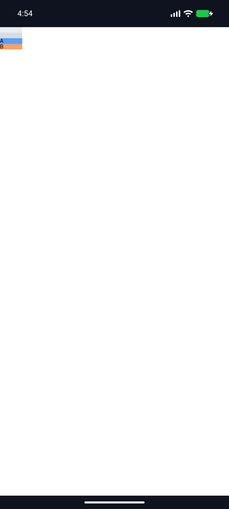
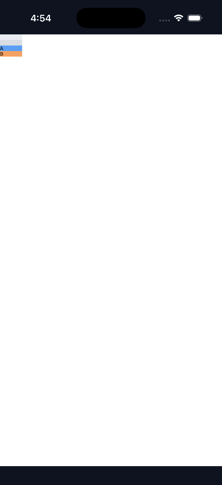
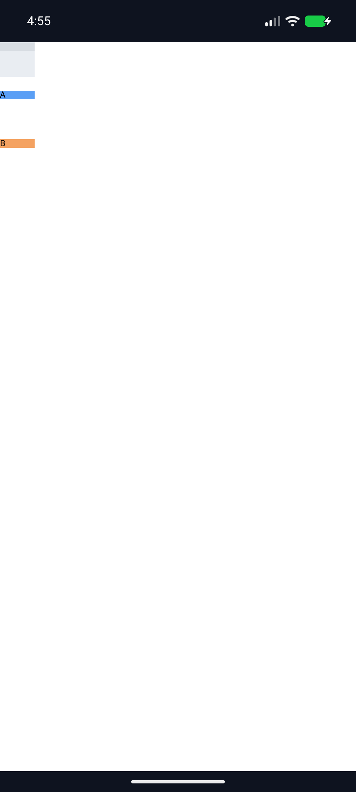
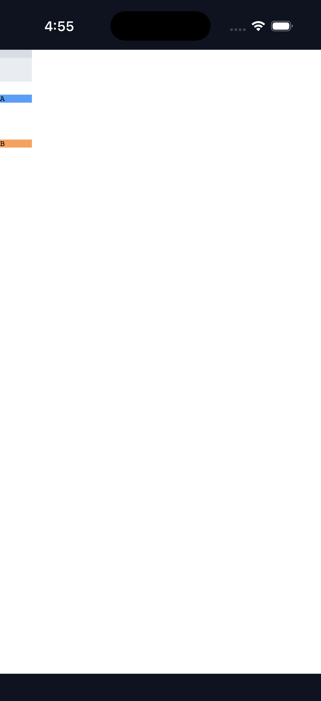
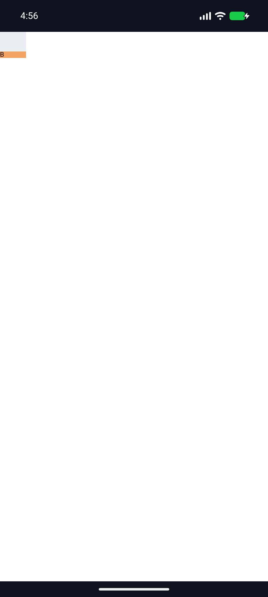
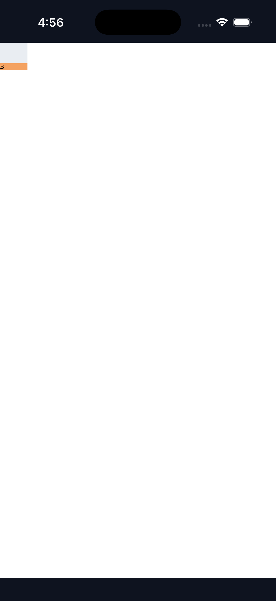

# C11.4 parsed Root HTML `align-content:safe|unsafe flex-end` 실행 근거 · 2026-11-07

## 범위

기준은 [Chrome 157 사전 비교와 독립 기대값](../c11-root-html-auto-row-safe-flex-end-precomparison-2026-11-07/README.md)이다. 후보 HEAD `1bc9a21fc72a1426061337e63bdb323e714b70d9`에서 기존 `RootHtmlAutoRowStretchV1`의 고정 Root HTML profile에 `safe flex-end`와 `unsafe flex-end`를 추가했다. 40×40px Grid, 40px column, 10px explicit row, 두 direct-text implicit `auto` rows, fixed 40×10px item, 10px line-height text `A`/`B`, definite 40px percentage basis와 고정 gap shape가 유지된다.

Chrome/독립 기대값 6 scene·72 item-frame coordinates는 0 CSS px 최대 오차로 사전 대조됐다. Focused Rust 결과는 Layout 2/2, style projection 2/2, RuntimeSession 2/2이고 회귀 필터는 각각 layout 9/9, style projection 6/6, RuntimeSession 9/9다. 별도 allowlist control 1/1, scoped Clippy, `cargo fmt --all -- --check`와 `git diff --check`도 통과했다.

## V8 빌드와 실패 pass

Pinned V8 checkout은 `7b50b62cb18f28617959e8452e2cd18195b38bcf`, depot_tools는 `41c9bd890277c2f551499d171d215dfdf5dab97d`다. Android/iOS Simulator용 V8을 각각 12 jobs로 빌드했다. Android `libv8_monolith.a` SHA-256은 `e0288be05fdedd7b5bed945dc446f7ec7dc11454034d0efc3dfe297d32cd7813`, iOS Simulator archive는 `7a3e24607ea7b419d3fd858c35c094a566660f9d3112015487fa010d99e99815`다. V8 및 depot_tools checkout은 수정되지 않았다.

- `pass01`은 앱 설치 전에 고정 V8 source checkout이 없어서 Android build preflight에서 중단됐다.
- `pass02`는 V8 source checkout 후 Android `libv8_monolith.a`가 아직 없어 Android build preflight에서 중단됐다.
- 두 pass 모두 기존 installed APK/executable, 기존 build output과 bootstrap 자산을 복원했고 `asset_and_simulator_restoration=PASS`다. 실패 log는 버리지 않았으며 성공 실행과 합산하지 않는다.

## Simulator 실행

세 성공 pass는 Android API 37 ARM64 AVD `emulator-5554`와 iPhone 17 Pro / iOS 26.2 Simulator `9DCCE836-7659-4914-B6C1-13F54BFFA9DB`에서 기본 Root HTML 앱 route를 실행했다. C11 fixture feature flags는 모두 껐고 앱 로그는 각 platform에서 `status=pass`, `layout=ready`, `boxes=6`, runtime text 기록 2개를 보였다. 실행마다 기존 설치본·APK·iOS executable·bootstrap 입력을 복원하고 원래 SHA-256과 대조해 통과했다.

| Scene | Pass | Layout offsets (CSS px) | Screenshot observation |
|---|---|---|---|
| Positive `safe flex-end` | [`pass03`](./pass03/environment.txt) | `[10,20,30]` | Android `[9.90,19.81,30.10]`, iOS `[10,20,30]`; 1 CSS px tolerance 내 |
| Safe overflow | [`pass04`](./pass04/environment.txt) | `[0,56,112]` | Android와 iOS 모두 `[0,56,112]` |
| Unsafe overflow | [`pass05`](./pass05/environment.txt) | `[-82,-26,30]` | 양 플랫폼 screenshot에서 viewport 안의 세 번째 item `y=30`만 검출됐다. 음수 frame은 Rust layout/runtime trace가 기준이다. |

각 pass의 `screenshot-pixel-analysis.json`은 화면의 Grid 배경과 고정색 item bounds를 측정한다. 이는 OS screenshot visual bounds일 뿐 Android `PixelCopy`, iOS Metal drawable readback 또는 compositor 최종 pixel parity가 아니다. Simulator는 software-rendered/Simulator 환경 근거이며 실기기, hardware GPU, WPT와 일반 CSS admission은 검증하지 않았다.

세 iOS verbose build transcript는 [`build.log.gz` pass03](./pass03/ios/build.log.gz), [pass04](./pass04/ios/build.log.gz), [pass05](./pass05/ios/build.log.gz)에 lossless gzip으로 보존했다. Decompress 결과는 각 원본 transcript와 byte-identical이며 uncompressed SHA-256은 [manifest](./ios-build-transcript-sha256.txt)에 있다.

## 남은 상태

이 제한 slice는 전체 C11.4나 C11 완료가 아니다. 관련 checkbox는 미완료이며 공식 집계 `78/214`를 유지한다. PR check rollup이 비어 있으면 CI 통과로 계산하지 않는다.
