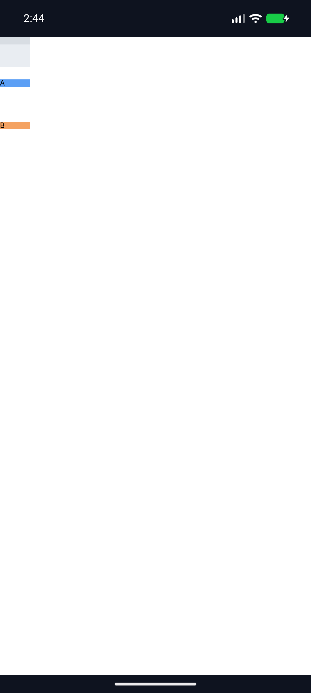
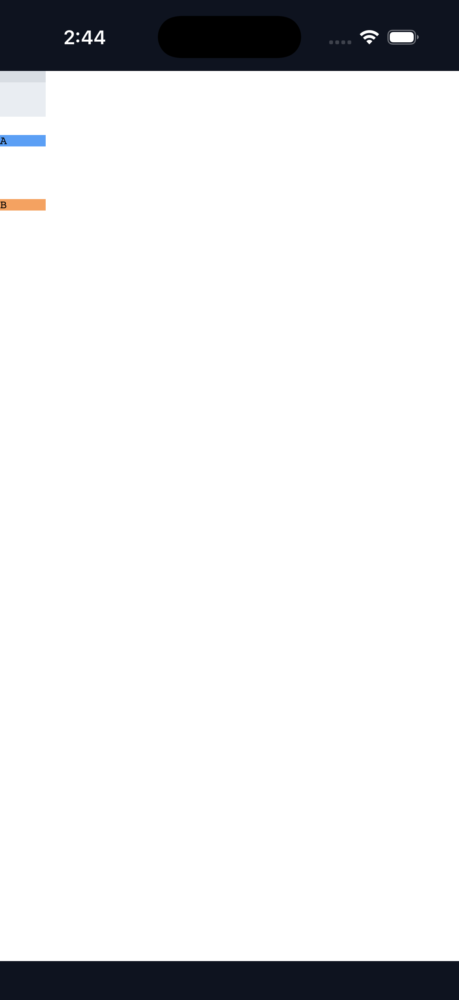

# C11.4 `align-content:safe|unsafe flex-start` 구현·실행 근거

## 구현 범위

기본 parsed Root HTML `RootHtmlAutoRowStretchV1` profile에서 computed `align-content:safe flex-start`와 `unsafe flex-start`만 제한적으로 허용한다. 입력 profile, row sizing, row-gap 계산, fixture ABI, generic CSS admission과 내부 계약 `0.1.0`은 바꾸지 않는다. computed serialization은 safety modifier와 `flex-start`를 그대로 보존한다. `safe|unsafe flex-end`와 baseline 조합은 계속 거부한다.

기준은 [Chrome 157 사전 비교와 독립 기대값](../c11-root-html-auto-row-safe-flex-start-precomparison-2026-11-07/README.md)이다. `start`, `safe flex-start`, `unsafe flex-start` × positive/overflow 두 row-gap scene, 총 6개 장면에서 72개 item-frame 좌표가 exact 일치했다. 모든 장면의 used rows는 `[10,10,10]px`; overflow 장면의 각 gutter는 `46px`이다.

## Rust 검증

- `cargo test --locked -p spinon-layout root_html_auto_row_safe_ -- --nocapture` — 7/7 통과.
- `cargo test --locked -p spinon-style-to-layout root_html_auto_row_safe_ -- --nocapture` — 5/5 통과.
- `cargo test --locked -p spinon-style-to-layout allowlist_keeps_baseline_safety_and_unknown_values_closed -- --nocapture` — 1/1 통과.
- `cargo test --locked -p spinon-runtime parsed_root_html_safe_ -- --nocapture` — 7/7 통과.
- `cargo clippy --locked -p spinon-layout -p spinon-style-to-layout -p spinon-runtime --all-targets -- -D warnings` — 통과.
- `cargo fmt --all -- --check`, `git diff --check` — 통과.

Projection은 computed serialization과 item frame을, Layout은 item frame·세 auto rows·두 gutter를, RuntimeSession은 complete snapshot 및 positive/overflow geometry를 검사한다. RuntimeSession의 unsupported `safe flex-end` 대조는 property `align-content`로 원자 거부되고 같은 session의 지원 요청은 계속 사용할 수 있다.

## Android·iOS Simulator

기본 Root HTML app route를 Android 17 / API 37 ARM64 AVD `emulator-5554`와 iPhone 17 Pro / iOS 26.2 Simulator (`9DCCE836-7659-4914-B6C1-13F54BFFA9DB`)에서 실행했다. 모든 C11 fixture flag은 꺼 두고 C04 Runtime GPU 경로를 사용했다. Runner는 설치 앱, bootstrap 입력과 이전 빌드 산출물을 실행 전 해시로 보관하고, 세 pass 뒤 모두 복원했다. Android APK와 iOS app에 포함된 fixture HTML SHA-256도 입력 fixture와 일치했다.

| 장면 | Android | iOS | 기대 상대 y (CSS px) |
|---|---|---|---|
| Positive, `safe flex-start`, gap `0px` | layout-ready, 6 boxes, 2 text draws, presented | 동일 | `[0,10,20]` |
| Overflow, `safe flex-start`, gap `calc(120% - 2px)` | layout-ready, 6 boxes, 2 text draws, presented | 동일 | `[0,56,112]` |
| Overflow, `unsafe flex-start`, gap `calc(120% - 2px)` | layout-ready, 6 boxes, 2 text draws, presented | 동일 | `[0,56,112]` |

OS screenshot fixed-color bounds를 1 CSS px 허용오차로 측정했다. Positive의 Android 관측은 `[0,9.9048,19.8095]`, iOS는 `[0,10,20]`; 두 overflow 장면은 두 플랫폼 모두 `[0,56,112]`였다. 시각적으로 마지막 두 row가 40px Grid 배경 밖에 배치된다.

스크린샷은 화면 bounds의 visual evidence다. Android PixelCopy, Metal drawable readback, iOS compositor 이후 pixel parity를 측정하지 않았다.

## 복원 및 artifact

세 simulator pass 각각 `asset_and_simulator_restoration=PASS`다. 원래 설치된 Android APK SHA-256은 `48db6dd5748c5bb7717d20ce4b3bc023ebe93acb1dc202b3d973164544c5bc04`, iOS executable SHA-256은 `eca866e291d5ffbbe7756c354532bb69bca9d2fed264bc8181d02c61a772a929`였으며 설치 앱과 빌드 산출물 복원 뒤 같은 값으로 확인했다. 장면별 build/install/launch/runtime/screenshot/hash 로그와 화면 분석 JSON은 `pass01`~`pass03` 아래에 보존했다.

Xcode build log에서 줄 끝 공백과 추가 EOF 빈 줄만 정규화했다. 명령 출력의 나머지 내용은 보존했다.

## 실패 관점 검토 및 남은 범위

- [구현·RuntimeSession 실패 관점 20개](./implementation-review-20.md)
- [실제 변경 diff 실패 관점 30개](./pr-diff-review-30.md)
- [계획](https://github.com/ohah/spinon/blob/main/plan/c11-root-html-auto-row-safe-flex-start.md)
- [계획 단계 검토 20개](https://github.com/ohah/spinon/blob/main/plan/c11-root-html-auto-row-safe-flex-start-plan-review-20.md)

일반 CSS admission, 다른 track/item topology, writing mode/direction, `safe|unsafe flex-end`, WPT, 실기기, hardware GPU 및 전체 C11.4/C11 구현은 이 slice에서 검증하지 않았다. C11.4/C11은 미완료이며 공식 `78/214`와 계약 버전 `0.1.0`을 유지한다.
