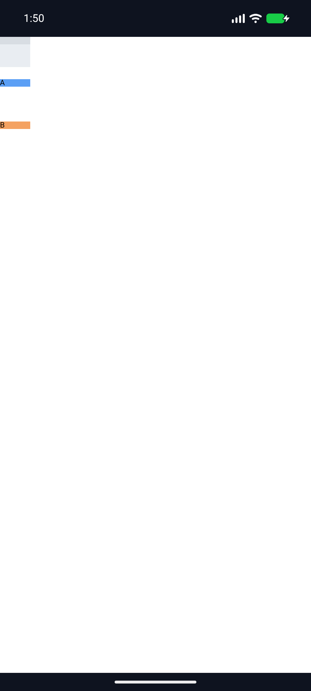
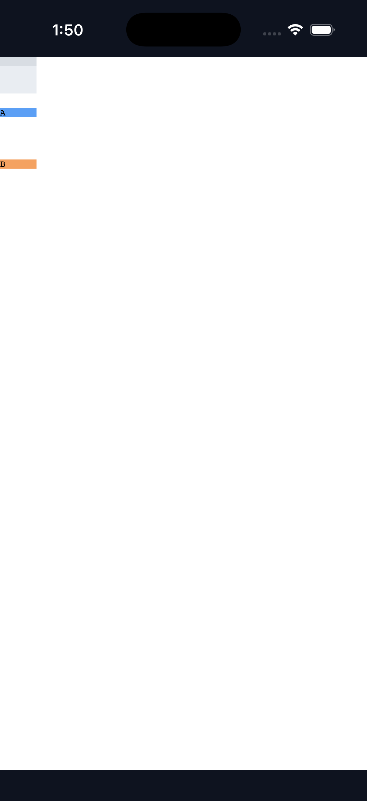
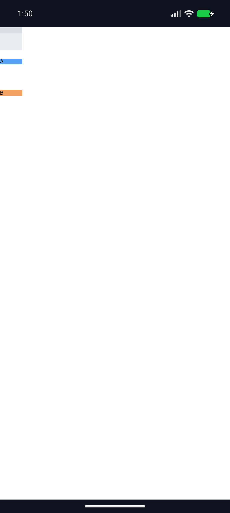

# C11.4 `align-content:safe|unsafe start` 실행 근거

## 기준과 범위

기본 parsed Root HTML `RuntimeRootHtmlTextPaintV1` 경로에서 기존 `RootHtmlAutoRowStretchV1` fixed profile의 computed `align-content:safe start`와 `unsafe start`를 허용한다. Chrome 157 사전 관측·독립 기대값은 [precomparison](../c11-root-html-auto-row-safe-start-precomparison-2026-11-07/README.md)에 고정했다. 6개 정렬·gap scene에서 72/72 item-frame 좌표가 정확히 일치했고 최대 오차는 0 CSS px다.

Profile은 definite 40×40px content box, 40px explicit column, 10px explicit row, 두 implicit auto rows, row flow, 40×10px fixed empty item과 두 direct-text item으로 제한한다. `calc(120% - 2px)` row gap은 definite 40px block basis에서 46px이다. 세 10px row와 두 gutter로 overflow alignment subject는 122px이지만 `start`, `safe start`, `unsafe start` 모두 시작점 0px을 유지한다. Used rows는 `[10,10,10]px`다.

## Rust 검증

- `cargo test --locked -p spinon-layout root_html_auto_row_safe_start -- --nocapture` — 2/2 통과.
- `cargo test --locked -p spinon-style-to-layout root_html_auto_row_safe_start -- --nocapture` — 2/2 통과. Stylo computed `align-content`가 `safe start`/`unsafe start` 그대로 보존되는지, unsupported `safe flex-start`의 오류 귀속을 확인한다.
- `cargo test --locked -p spinon-runtime parsed_root_html_safe_start -- --nocapture` — 2/2 통과. six-scene frame, complete snapshot, property 오류와 같은 RuntimeSession 회복을 확인한다.
- 기존 safe/unsafe center·end, auto-row, percentage·`calc()` gap focused regression — layout 18/18, style-to-layout 8/8, RuntimeSession safety 6/6 및 calc-gap 2/2 통과.
- `cargo clippy --locked -p spinon-layout -p spinon-style-to-layout -p spinon-runtime --all-targets -- -D warnings`와 `cargo fmt --all -- --check` — 통과.

## Android/iOS Simulator

기본 Root HTML app route를 Android API 37 ARM64 AVD `emulator-5554` (Android 17) 및 iPhone 17 Pro / iOS 26.2 Simulator (`9DCCE836-7659-4914-B6C1-13F54BFFA9DB`)에서 각각 실행했다. C11 fixture flags는 꺼져 있고 C04 runtime GPU 경로를 사용했다. 세 scene 모두 두 플랫폼에서 `layout=ready`, 6 boxes, 2 runtime text records, `presented`를 기록했다. Android APK와 iOS app에 fixture HTML hash가 일치하는지도 빌드 후 확인했다.

| Scene | `align-content` | 기대 item y (CSS px) | Android screenshot bounds | iOS screenshot bounds |
|---|---|---:|---:|---:|
| Positive | `safe start` | `[0,10,20]` | `[0,9.905,19.810]` | `[0,10,20]` |
| Overflow | `safe start` | `[0,56,112]` | `[0,56,112]` | `[0,56,112]` |
| Overflow | `unsafe start` | `[0,56,112]` | `[0,56,112]` | `[0,56,112]` |

각 pass의 허용 오차는 1 CSS px이며 원본 PNG, pixel analysis, runtime log, build/install log와 artifact hash를 함께 보존했다. iOS build log의 끝 공백과 중복 EOF 개행만 정규화했으며 나머지 출력은 유지했다. positive screenshot은 fixed item top을 root y=0 anchor로 삼았다. 시작 정렬에서는 child가 Grid 배경을 덮어 배경색이 아래에만 남으므로 배경색의 첫 픽셀을 root origin으로 오인하지 않도록 analyzer를 고쳤다.

캡처는 OS screenshot의 색 영역 경계만 측정한다. Android PixelCopy, Metal drawable readback, iOS compositor 이후 pixel parity가 아니다. 화면 바깥으로 빠지는 item을 이 장면에서 주장하지 않는다. Rust matrix가 각 frame을 1/64 CSS px tolerance로 판정한다.

## 상태 보존과 한계

pass01–03 모두 기존 bootstrap 입력, Android APK, iOS build, 설치 앱을 실행 전 hash로 복구했고 `asset_and_simulator_restoration=PASS`를 남겼다. 복구된 Android base APK는 `48db6dd5748c5bb7717d20ce4b3bc023ebe93acb1dc202b3d973164544c5bc04`, iOS executable은 `eca866e291d5ffbbe7756c354532bb69bca9d2fed264bc8181d02c61a772a929`다. 후보 source diff hash는 세 pass 모두 `c27f48ba3cba0397bb4d7b519504c9b8983ee9046fc0fc3a5b7b1dc0734a1a6a`다.

이 결과는 고정 profile·두 Simulator와 고정 fixture에 한정된다. 일반 CSS admission, 다른 item/track topology, writing mode·direction, WPT, 물리 기기, hardware GPU 및 전체 C11.4/C11 완료를 뜻하지 않는다. C11.4/C11 미완료, 공식 완료 `78/214`, 내부 숫자 계약 버전 `0.1.0`을 유지한다.

- [계획](../../../../plan/c11-root-html-auto-row-safe-start.md)
- [구현/runtime 실패 관점 20개](./implementation-review-20.md)
