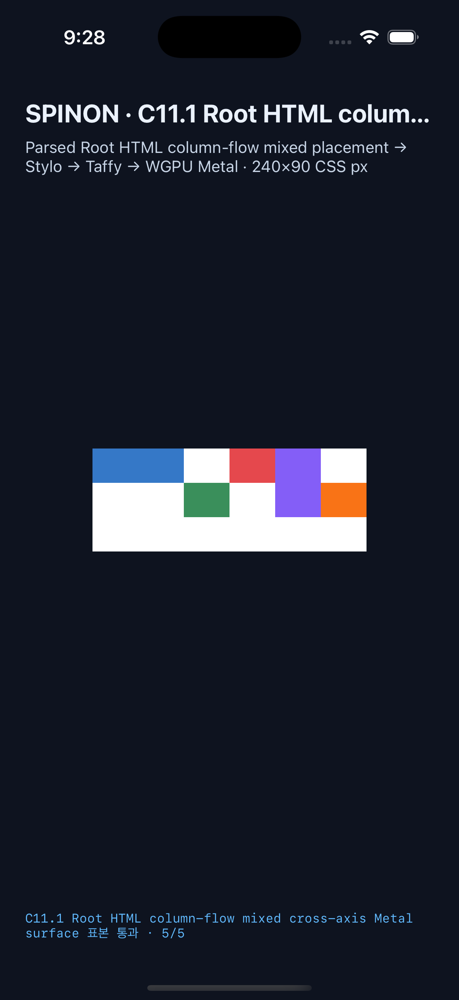

# C11.1 Root HTML mixed column-flow simulator evidence

This is a bounded parsed Root HTML implementation slice for sparse column-flow placement with row-locked and column-locked items. The independent expectation and Chrome 156 precomparison are in [the precomparison record](../c11-root-html-grid-column-flow-mixed-precomparison-2026-11-04/README.md).

## Final simulator runs

| Platform | Run ID | Result |
| --- | --- | --- |
| Android API 37 ARM64 AVD (`emulator-5554`, 420 dpi) | `c111cfm-avd-mw23bnua-bf812a8f` | 9 scenes; 8 success, 1 expected rejection; 31/31 items; geometry error 0 CSS px; 31/31 PixelCopy samples exact; maximum channel error 0. ADB `wm density` independently agrees with app density 2.625×. |
| iPhone 17 Pro / iOS 26.2 Simulator | `c111cfm-ios-mw23cgwv-f0048937` | 9 scenes; 8 success, 1 expected rejection; 31/31 items; geometry error 0 CSS px; 31/31 Metal drawable samples exact; maximum channel error 0. Drawable is 3× the 160×90 CSS viewport; readback is before OS compositor submission. |

Both rejection runs report `invalid_grid_placement / grid-row-start / node 16` and publish no partial layout. Each scene runs in a fresh app process.

## Captures

Android PixelCopy captured the mixed span scene directly from the app's `SurfaceView`:

iOS screenshot shows the same mixed span scene in the iPhone simulator:

The per-scene logs, device metadata, screenshots, PixelCopy PNGs, exact pixel comparisons, and generated summaries are preserved in the two run directories above.

## Limits

This evidence is not a claim of full CSS Grid, public CSS support, C11.1 completion, or C11 completion. The Android AVD uses a software graphics path; iOS pixels are read before compositor submission. Hardware Android GPU output and post-compositor iOS output remain unverified.
