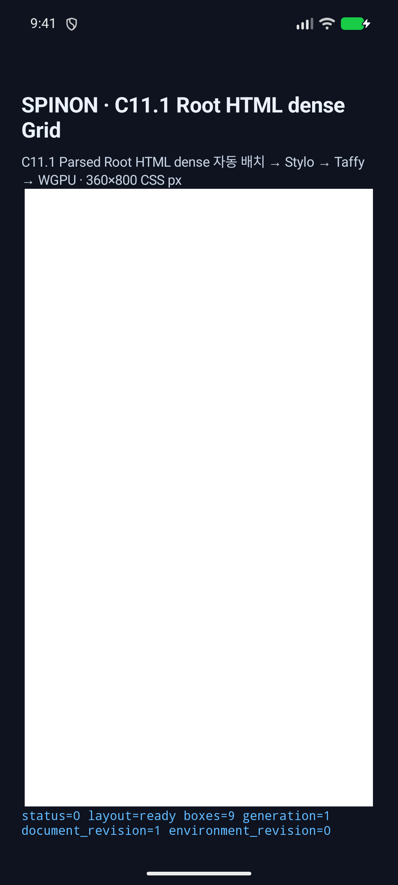
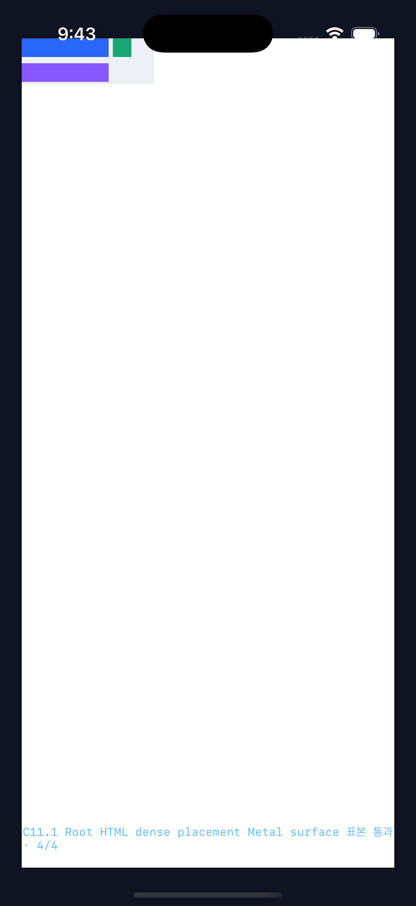

# C11.1 parsed Root HTML dense placement — Android/iOS runtime evidence

제한 구현 PR [#1117](https://github.com/ohah/spinon/pull/1117)은 `2026-11-03T12:57:55Z` Rebase and merge됐고 merge SHA는 `f1043bda5ed69845b89992ba5f7cd28a03f42f5c`다. PR check rollup은 비어 있어 CI 통과로 기록하지 않는다. C11.1/C11 및 공식 완료 `72/213`은 그대로다. [병합 후 문서 동기화 PR의 diff 검토](./post-merge-doc-sync-pr-diff-review-30.md)

## Final scored runs

| Platform | Run | Result | Geometry | Surface pixels |
| --- | --- | --- | --- | --- |
| Android API 37 ARM64 AVD | [`c11rhd-avd-mw0og13y-a2ee6adb`](./c11rhd-avd-mw0og13y-a2ee6adb/comparison.json) | 14 scenes: 12 success, 2 expected rejection; 60 authored nodes | Maximum absolute error 0 CSS px (limit 0.5) | PixelCopy 52/52 exact; maximum channel error 0 |
| iPhone 17 Pro / iOS 26.2 Simulator | [`c11rhd-ios-mw0ogycb-54215204`](./c11rhd-ios-mw0ogycb-54215204/comparison.json) | 14 scenes: 12 success, 2 expected rejection; 60 authored nodes | Maximum absolute error 0 CSS px (limit 0.5) | Metal drawable readback 52/52 exact; maximum channel error 0 |

Each scene ran in a fresh app process against the fixed Chrome 156 expected geometry and sample manifest. The Android run verifies the Root HTML environment remains 360×800 CSS px while `device_scale_factor` and `physical_scale` match the AVD density 2.625 and PixelCopy scale. It used an emulator `SurfaceView` PixelCopy path. The iOS run read the WGPU Metal drawable before OS compositor submission. Neither run proves a physical-device GPU path or iOS post-compositor output.

Older exploratory run directories from 2026-11-03 remain preserved in the local checkout but are not part of the scored evidence. One capture had exact-looking pixels with the CSS viewport incorrectly reduced to about 137×305; another drew at 1× into the 2.625× AVD surface and failed PixelCopy. The comparator tests include explicit rejection controls for both mapping errors. During the final rerun, run `c11rhd-avd-mw0o91n6-97cf48ba` reached the expected 10,001-track rejection but the host `adb exec-out screencap -p` timed out. Its failure log is preserved and excluded. Rebooting only the selected AVD without wiping its data restored system screenshot capture; the scored Android run above passed. Failed and incomplete captures remain preserved and are excluded from the totals above.

## Screenshots

The screenshots illustrate the rendered scenes; pixel parity is established by the separate runtime and surface-pixel comparison artifacts.

| Android API 37 AVD | iPhone 17 Pro / iOS 26.2 Simulator |
| --- | --- |
|  |  |
| [Column dense hole-fill screenshot](./c11rhd-avd-mw0og13y-a2ee6adb/column-dense-hole-fill-android.png) | [Column dense hole-fill screenshot](./c11rhd-ios-mw0ogycb-54215204/column-dense-hole-fill-ios-simulator.png) |

## Reproduction

```sh
node tools/css-reference/capture-c11-root-html-dense-auto-placement-runtime-matrix.mjs android emulator-5556
node tools/css-reference/capture-c11-root-html-dense-auto-placement-runtime-matrix.mjs ios 9DCCE836-7659-4914-B6C1-13F54BFFA9DB
```

The runner checks the generated matrix and all input SHA-256 values, builds the opt-in app fixture, validates the 14 scene outcomes, compares root/item geometry and fixed pixel samples, checks CSS viewport and device-scale mapping on Android, saves a screenshot per scene, and force-stops the Android app at completion. The host `spinon-ffi` default/opt-in static archive boundary is recorded separately in [fixture artifact evidence](./fixture-artifact-boundary.md); it does not establish APK/IPA release-artifact exclusion.

## Scope

This evidence covers only the planned parsed Root HTML dense-placement slice. Its nested mixed-flow scene tests a sparse parent containing a dense child; the reverse nesting order is not a separate matrix scene. It does not establish full CSS Grid or WPT conformance. The implementation/runtime review has [20 distinct failure perspectives](./implementation-runtime-review-20.md), and the actual diff has a separate [30-perspective review](./pr-diff-review-30.md). The C11.1/C11 checkboxes and official completion count `72/213` remain unchanged.
