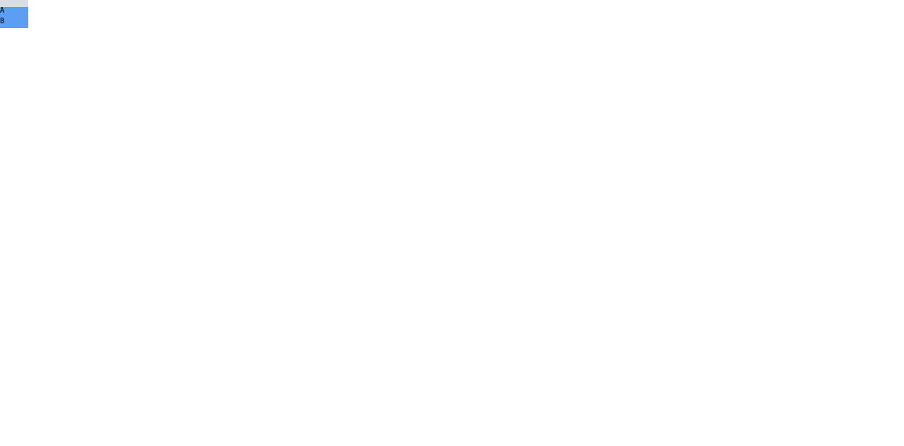

# C11.4 explicit `align-content:stretch` 사전 비교

## 고정 조건

- 규범 기준: [CSS Grid Layout Module Level 1, 2025-03-26 CRD §§7.6, 7.6.1, 8.5, 10.5, 11.8](https://www.w3.org/TR/2025/CRD-css-grid-1-20250326/). §11.8은 관련 축의 content distribution 값이 `normal` 또는 `stretch`일 때 남은 양의 definite free space를 `auto` max track sizing function을 가진 track들에 균등 분배한다.
- Fixture: [root-html-multiple-auto-row-align-content-stretch-precomparison.html](../../../../tests/fixtures/css/c11/root-html-multiple-auto-row-align-content-stretch-precomparison.html), SHA-256 `44a3423cd3be20935b2436d7f9f3701e580e6d39205b445b5b2a8158ca3e7308`. Visible Grid owner 한 개, content box 40×40px, explicit column 40px 하나, explicit row 10px 하나, `grid-auto-rows:auto`, row auto-flow, gap 0이다. Source order는 fixed empty item, direct text `A`, direct text `B`; 두 text는 10px/10px monospace 한 줄이다. 오직 `align-content:stretch`를 직전 merged fixture의 `normal`에서 바꿨다.
- Agent Browser 0.31.1에서 HeadlessChrome 157.0.0.0, viewport 1280×633 CSS px, DPR 1을 관측했다. 같은 DOM에서 CSSOM 값만 `normal`과 `start`로 바꾼 control도 기록했다.

## 독립 기대값과 관측

Explicit 10px row와 두 implicit auto rows의 각 10px text minimum contribution으로 initial track bases는 `[10,10,10]px`다. Definite 40px block axis에 positive free space 10px이 남고, 두 implicit auto max track이 각각 5px을 받아 used rows `[10,15,15]px`가 된다. Expected item frames는 `[0,0,40,10]`, `[0,10,40,15]`, `[0,25,40,15]` CSS px이며 text line count는 1/1이다. Explicit `stretch`와 `normal` control은 같은 결과를 내며 `start` control은 `[10,10,10]px`를 유지한다.

HeadlessChrome 157은 `align-content:stretch`의 computed value와 `10px 15px 15px` tracks, 세 child frame 및 1/1 text lines를 관측했다. `normal` control은 같은 tracks/frames, `start` control은 `10px 10px 10px` tracks를 관측했다. 세부 값은 [expected.json](./expected.json), 원 browser evaluation은 [chrome-observations.json](./chrome-observations.json)에 있다.

**증거 수정 · 2026-11-07:** 이전 `chrome/fixture.png` SHA-256 `f99b591634c5e2631ac61ce52fad768ff9616cb565c3712a09aeef81d14f5e5c`는 명시된 `stretch` 장면이 아니라 새로 캡처한 `align-content:start` control과 일치했다. 연결된 파일은 computed `align-content:stretch`를 명시한 뒤 Agent Browser로 다시 캡처한 화면으로 교체했으며 SHA-256은 `e717e0bfc1e5de8872a88a2d755b5664ad36e99219a675d8929c9058331714bf`다. 이전 화면 byte는 [새 `start` 캡처](../c11-root-html-auto-row-content-alignment-precomparison-2026-11-07/chrome/align-content-start.png)에 보존했다. 수정한 stretch 장면은 [별도 캡처](../c11-root-html-auto-row-content-alignment-precomparison-2026-11-07/chrome/align-content-stretch.png)에서도 확인할 수 있다.

이 사전 비교는 Chrome 관측으로 독립 계산을 교차 확인한다. Spinon runtime, WPT, 일반 CSS admission 또는 pixel parity를 입증하지 않는다. [계획](../../../../plan/c11-root-html-multiple-auto-row-align-content-stretch.md)
