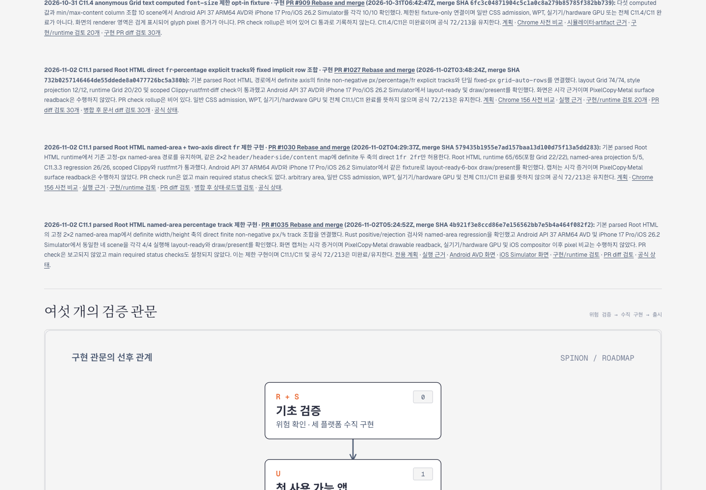
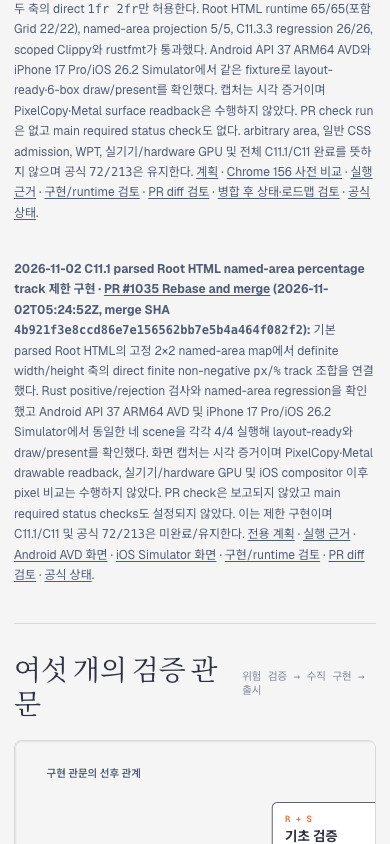

# C11.1 named-area percentage-track 병합 후 로드맵 확인 · 2026-11-02

구현 PR [#1035](https://github.com/ohah/spinon/pull/1035)은 `4b921f3e8ccd86e7e156562bb7e5b4a464f082f2`로 병합됐다. 이 문서 변경은 그 SHA와 결과를 상위 C11 계획, C11.1 전용 계획, 공식 상태, 내부 계약 0059와 공개 로드맵에 동기화한다. C11.1/C11 완료 체크는 변경하지 않았고 공식 집계는 `72/213` 그대로다.

## 선택 문서 build와 Agent Browser

Rspress `2.0.22`로 로드맵과 연결 문서의 선택 root를 빌드했다. 미러된 plan route, 공식 상태, 내부 계약 0059, runtime evidence 및 Android/iOS PNG route를 확인했다. 선택 root는 repository 전체의 기존 dead-link 검사를 끈 별도 미리보기이므로 전체 문서 링크 적합성을 주장하지 않는다.

Agent Browser에서 로컬 선택 build를 열어 C11.1 percentage named-area 병합 카드와 merge SHA를 확인했다. 1440×1000 desktop에서는 문서 폭이 viewport와 같았고, 390×844 mobile에서는 문서 폭이 390px였다. 공식 `72/213` 문자열이 보였고 카드의 Android/iOS PNG 링크는 각각 HTTP 200, `image/png`, 24,802 byte 및 75,088 byte였다. 두 캡처는 로드맵 레이아웃·링크 확인용이지 runtime 동작이나 live Tailnet 배포 증거가 아니다.

| 캡처 | 크기 | SHA-256 |
| --- | ---: | --- |
| [Desktop](./roadmap-desktop-agent-browser.png) | 1440×1000 | `4e5967db2511a107f95685b9a947b77e822b14c3eac923594078500587b2e13b` |
| [Mobile](./roadmap-mobile-agent-browser.png) | 390×844 | `fd3886441b0b7eca1d95dc7a507bb8da233f275e16e2eea0bb332f81dba0e793` |

Agent Browser `close --all` 후 해당 session은 `active=false`였고 Agent Browser 브라우저 프로세스는 남지 않았다. 일회성 localhost preview server도 종료했다. 기존 Tailnet preview server는 이 local 후보 캡처 과정에서 수정하거나 재시작하지 않았다.

## 완료 범위

이 후보 문서 diff는 병합 SHA와 지원 범위를 정확히 연결한다. 전체 CSS Grid 지원, Spinon WPT 적합성, hardware GPU, 표면 pixel parity, C11.1/C11 완료 또는 공식 완료 수 증가를 주장하지 않는다. Live Tailnet 배포는 별도 확인 대상이다.
