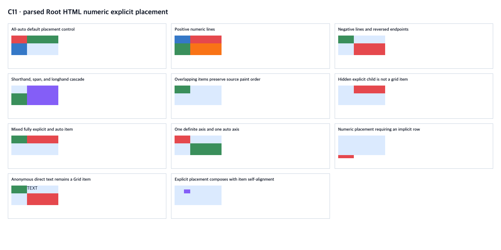

# C11.1 parsed Root HTML numeric Grid placement 사전 비교

이 자료는 기본 parsed Root HTML runtime의 Grid 자식에 숫자형 명시 배치를 연결하기 전 독립 oracle이다. Chrome 관측과 CSS Grid 규칙에서 계산한 기대값을 분리했다. 아래 결과는 Spinon 구현 또는 모바일 동작 근거가 아니다.

## 관측 범위

- 고정 `120×50 CSS px` Grid와 `40px 80px` columns, `20px 30px` rows를 사용한 11개 장면이다.
- all-auto baseline, 양수/음수 line, 역순 line, shorthand·span·cascade, 겹침·paint order, hidden child, auto와 explicit 혼합, implicit row 요구, anonymous direct text를 다룬다.
- 모든 계산값은 Grid container 기준 item frame, computed placement longhand, resolved track list와 hit-test 결과를 기록한다.
- 구현 후보는 all-auto 장면과 모든 visible item이 양 축에서 definite numeric placement를 갖고 explicit tracks 안에 있는 장면만 받는다. 혼합·부분 auto, implicit track 요구, auto-placed anonymous text는 scene 전체를 거부해야 한다. 마지막 장면은 existing C11.5 `align-self`·`justify-self` 값과 explicit placement 결합을 관측한다.

## 근거 파일과 재현 환경

- Fixture: [`root-html-grid-explicit-placement-precomparison.html`](https://github.com/ohah/spinon/blob/main/tests/fixtures/css/c11/root-html-grid-explicit-placement-precomparison.html), SHA-256 `e6beb2c084c0d1c0dbc6e90137d20abc7e12a7623ff46f5884e7bb5f223f10d7`.
- Oracle: Agent Browser `0.31.1`, `HeadlessChrome/156.0.0.0`, macOS `26.5.1 arm64`, inner viewport `1280×633 CSS px`, DPR 1. 화면 캡처는 1280×640 PNG다.
- [Chrome 관측 JSON](https://github.com/ohah/spinon/blob/main/spec/internal/evidence/c11-root-html-grid-explicit-placement-precomparison-2026-11-04/chrome156-observation.json)은 CSSOM computed line values와 `getBoundingClientRect()`를 담고, [독립 기대값](https://github.com/ohah/spinon/blob/main/spec/internal/evidence/c11-root-html-grid-explicit-placement-precomparison-2026-11-04/expected.json)은 authored explicit track에서 계산한 geometry 및 구현 accept/reject 조건을 별도로 담는다. 독립 verifier는 11개 scene, 23 item frame, computed longhand, hidden/text controls, overlap hit-test와 C11.5 alignment 교차를 확인한다.
- [캡처 입력·SHA-256 manifest](https://github.com/ohah/spinon/blob/main/spec/internal/evidence/c11-root-html-grid-explicit-placement-precomparison-2026-11-04/input.json)와 [재실행 verifier](https://github.com/ohah/spinon/blob/main/spec/internal/evidence/c11-root-html-grid-explicit-placement-precomparison-2026-11-04/verify_precomparison.py)를 보존한다.
- Chrome 화면: SHA-256 `8b79a0bf4b124f81c1cd19e0dd34ce8b2b6992702dc3bd46f57590332c6d730f`.

## 규범과 구현 경계

[CSS Grid Layout Module Level 2 §8](https://www.w3.org/TR/css-grid-2/#placement-shorthands)는 numeric line/span, line placement conflict handling, shorthand expansion과 auto-placement 순서를 정의한다. 기존 C11.2.1 제한 변환이 이미 처리하는 numeric line normalization을 재사용하며 CSS 문자열 shorthand parser를 추가하지 않는다.

이 사전 비교는 Root HTML의 임의 CSS admission, named lines/areas, implicit track sizing, dense/column flow, arbitrary mixed explicit/auto placement, replaced/content items, 일반 WPT 적합성 또는 C11 완료를 주장하지 않는다.
