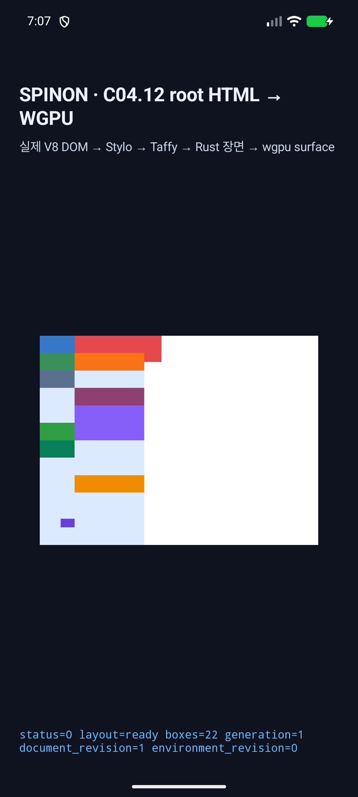
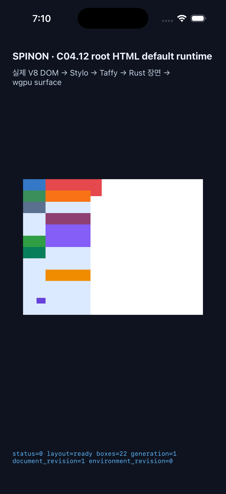

# parsed Root HTML 숫자형 Grid 배치 runtime · 2026-11-04

**상태:** 제한 구현 PR [#1137](https://github.com/ohah/spinon/pull/1137)이 2026-11-03T22:48:45Z Rebase and merge됐다(merge SHA `6af14f69512c0c73d890efc728751e0ca342f9c0`). GitHub check rollup은 비어 있고 `main`에는 required status check이 설정되지 않아 CI 통과로 세지 않는다. 공식 C11 상태와 `72/213` 집계는 그대로다. [전용 계획](../../../../plan/c11-root-html-grid-explicit-placement.md)

## 범위

기본 `RuntimeRootHtmlTextPaintV1` 경로에서 named area가 없는 row-flow Grid 하나의 visible item 전부가 양 축에서 definite numeric line/span 값을 가지는 장면을 기존 C11.2.1 normalizer로 보낸다. 기존 normalizer가 line/span 정규화, reversed endpoint, explicit track 범위, 혼합 auto 및 산술 경계를 계속 검사한다. 새 shorthand parser나 새 배치 알고리즘은 추가하지 않았다.

Fixture hash는 `922b6f37db0ce6f00262cf6d927e4d947502233796ad08c68cfccaef77c9c7f9`다. 여섯 Grid 장면은 positive lines, negative/reversed lines, shorthand/span/cascade, overlap paint order, `display:none` child, C11.5 self-alignment을 포함한다. 첫 장면은 120×40 CSS px Grid의 80px 두 번째 column에 100×30 item을 두어 오른쪽 경계 밖 20px을 그린다. 모든 장면은 320×240 CSS viewport 안에 있다.

## Rust 검증

| Gate | 결과 | 범위 |
| --- | ---: | --- |
| `cargo test -p spinon-style-to-layout root_html_explicit --lib` | 8/8 | 새 placement 검증 6개와 기존 fit-content projection 회귀 2개 |
| `cargo test -p spinon-runtime c11_1_root_html_numeric_grid_placement --lib` | 3/3 | 성공 frame, unsupported scene의 원자적 거부, media-query 변경 후 같은 session 회복 |
| C11.2.1 `grid_placement` | 15/15 | 재사용하는 line/span normalizer 경계 |
| Root HTML dense projection | 4/4 | dense route 분리 회귀 |
| Root HTML column-flow runtime | 2/2 | column-flow route 분리 회귀 |

Style-to-layout 테스트는 양수/음수/reversed line, span·shorthand·cascade, overlap, hidden item, mixed/partial auto, implicit row, anonymous text, self-alignment 교차, sibling Grid owner 분리 및 visible overflow frame을 확인한다. Runtime negative matrix는 mixed placement, partial axis, implicit row, anonymous direct text, nested Grid item, replaced image, named line과 `grid-row:0 / 1`을 scene 전체 거부로 확인한다. 같은 RuntimeSession에서 먼저 valid light-mode scene을 만든 뒤 dark-mode named-line 장면을 거부하고, 다시 light-mode numeric 장면을 계산해 ready frame으로 회복한다. invalid revision에서는 `completed=None`을 확인한다.

별도 alignment filter인 `root_html_grid_item_alignment`은 7개 중 3개가 통과하고 4개가 `C11.5 fixed-track auto-size/stretch contract` 거부로 실패했다. 동일한 네 실패를 변경 파일을 `HEAD`로 복원한 baseline에서도 재현했다. 원본 결과는 [baseline test log](c11-5-alignment-baseline-test.log)에 보존했다. 이 기존 실패를 이번 후보의 통과로 세지 않는다. 전체 workspace test/Clippy 결과로 확대 해석하지 않는다.

## Chrome 156 기준

Agent Browser `0.31.1`의 HeadlessChrome 156, DPR 1, CSS viewport 1280×633에서 여섯 Grid와 14개 item element의 display/color/frame observation을 수집했다. JSON에는 scene frame, item color/display/frame이 보존됐다. CSSOM computed longhand와 11-scene 독립 기대값 비교는 [별도 precomparison](../c11-root-html-grid-explicit-placement-precomparison-2026-11-04/README.md)에 있다. 첫 red item은 `[40,0,100,30]`, Grid는 `[0,0,120,40]`이다. 화면 sample에서도 Grid 오른쪽 경계 바깥의 item 내부는 red이고 item 끝을 지난 지점은 white다.

- 관찰: [JSON](chrome156-runtime-observation.json)
- 화면: [PNG](chrome156-runtime.png)
- 이전 300px 높이 fixture 시도는 초기 diagnosis 자료로만 보존했다: `chrome156-runtime-initial-300csspx.json/png`

## Android AVD 및 iOS Simulator

두 앱은 C04 기본 Root HTML route로 빌드했으며 작업 전용 fixture adapter나 새 ABI를 추가하지 않았다. 테스트 중 Android 및 iOS의 `root-html-default-rendering.html` asset에 fixture를 임시 복사하고 빌드·실행한 뒤 원본을 복원했다. 두 원본의 복원 hash는 모두 `38813ca802618bd20bdf3bbb9ed9bc7525c289f48c0928813c855567f9e7df85`이며 현재 checkout의 asset hash와 일치한다.

| Platform | 실행 | 결과 |
| --- | --- | --- |
| Android API 37 ARM64 AVD `emulator-5554` | `mise exec -- bun run build:android`; emulator에만 설치·실행 | viewport 320×240 CSS px, 840×630 surface texture, 22 boxes, `status=0 presented`; ANGLE/Vulkan SwiftShader software renderer |
| iPhone 17 Pro iOS 26.2 Simulator `ACA7BF91-E2D5-4CF7-909A-08D1AD95FF3D` | `mise exec -- bun run build:ios-sim`; 지정 UDID에서 실행 | viewport 320×240 CSS px, 960×720 drawable, 22 boxes, `status=0 presented`; Metal renderer |

Android USB physical device `R5KYB06SMPE`에는 설치·실행하지 않았다. 캡처는 Android OS screenshot과 iOS Simulator screenshot이며 renderer surface readback 결과가 아니다. 화면상 overflow가 보이고 `simulator-screen-pixel-samples.json`의 PNG 표본도 Grid 바깥 item 내부 red, item 바깥 white를 확인한다. 이 표본은 PixelCopy/Metal drawable parity 또는 hardware GPU parity 주장이 아니다.

## 자료와 한계

- Android: [build log](android-build.log), [logcat](android-logcat.log), [화면 PNG](android-simulator-screen.png)
- iOS: [읽기용 build log](ios-build.log), [원본 build log gzip](ios-build-raw.log.gz), [unified log](ios-log.log), [화면 PNG](ios-simulator-screen.png). 읽기용 log는 줄 끝 공백만 제거했고, gzip 원본의 압축 해제 SHA-256은 `125817af8c53d11ab2bc23ba1729d5faaf90208b5a5002dcf75e2cbc71aa829f`다.
- 화면 표본: [pixel samples JSON](simulator-screen-pixel-samples.json)
- 실패 관점 검토: [구현/runtime 20개](implementation-runtime-review-20.md), [PR diff 30개](pr-diff-review-30.md)
- 최종 fixture hash: `922b6f37db0ce6f00262cf6d927e4d947502233796ad08c68cfccaef77c9c7f9`

검증하지 않은 범위: Android 실기기와 hardware GPU, iOS 실기기, Metal drawable readback, 전체 CSS Grid/WPT 적합성, arbitrary author CSS, implicit track 생성, named line/area, dense·column-flow 배치 및 전체 C11. C11/C11.1 checkbox는 미완료로 유지한다.
